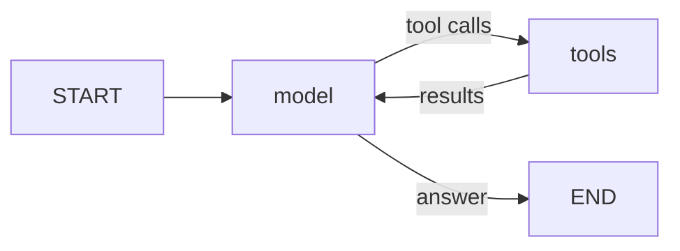

# Retail Insight Agent

A small retail analyst built with **LangGraph**, **Gemini** and **BigQuery**. Ask a
question, let the model choose tools, and continue the conversation in the terminal.
It queries Google's public, synthetic TheLook dataset.

Start with [QUICK_START.md](QUICK_START.md).

## The loop



`AgentLoop` builds this graph explicitly. There is no `create_agent` helper. The
`model` node calls Gemini; the `tools` node validates and executes the requested
Python functions. A conditional edge checks whether the response contains tool
calls. Otherwise, the response is the final answer.

`RetailAgent(AgentLoop)` inherits that implementation and supplies its system
prompt and tools. To build another agent later, inherit `AgentLoop` and provide a
different prompt/tool list. You can also override a node method in the subclass.

## Code map

```text
src/retail_insight/
├── agent.py             # RetailAgent: connects the pieces
├── cli.py               # Chat and slash commands
├── config.py            # Environment settings and limits
├── prompt.md            # Short system prompt
├── core/
│   ├── loop.py          # State, nodes, edges and conversation history
│   ├── model.py         # One Gemini API call
│   └── tool.py          # Tool definition and argument validation
├── tools/
│   ├── bigquery.py      # Schema lookup and read-only SQL
│   └── skills.py        # Load an allowlisted Markdown skill
├── skills/              # Sales, comparisons and concise writing
└── ui/                  # Slash menu and Thinking timer
```

Read `core/loop.py` first, then `agent.py`, `core/model.py` and `tools/bigquery.py`.
`AgentState` contains messages, a model-call counter and the current answer. Each
node returns an updated state. History is kept in memory and reused on follow-ups;
`/new` clears it. Failed or cancelled turns are not added to history.

## Tools and skills

| Tool | Purpose |
|---|---|
| `describe_tables` | Fetch actual schemas for `order_items`, `orders` and `products`. |
| `query_bigquery` | Run model-written SELECT SQL and return at most 100 rows. |
| `read_skill` | Read a local guide for sales, comparisons or writing. |

Skills are short Markdown instructions, not separate agents. The model chooses
when to load them. SQL validation limits queries to the three public tables and
rejects writes, scripts and custom/remote functions. BigQuery also enforces a
maximum billed-byte limit per query. Row truncation is reported explicitly.

## Scope

One agent, one in-memory conversation, and a terminal UI. No reviewer, evaluation
suite, observability integration, web GUI, Docker stack, Azure, A2A or MCP service.
The small `tests/` directory checks application behavior with scripted model
responses; it does not evaluate answer quality or call paid services.

There is no automated factual review: inspect important figures and the SQL with
`/details`. A maximum model-call count, output-token limit and timeout bound each
question. These are execution limits, not a USD budget; long conversation histories
increase token usage. Use `/new` when starting a different investigation.

## Local checks

```bash
uv run pytest -q
uv run ruff check src tests
uv run pyright --pythonpath .venv/bin/python
```

The graph uses Google's response objects directly and preserves tool-call
signatures between iterations. LangGraph brings LangSmith as a transitive
dependency; tracing is explicitly disabled and no observability client is created.

References: [LangGraph Graph API](https://docs.langchain.com/oss/python/langgraph/graph-api),
[Gemini function calling](https://ai.google.dev/gemini-api/docs/function-calling),
[BigQuery query limits](https://docs.cloud.google.com/python/docs/reference/bigquery/latest/google.cloud.bigquery.job.QueryJobConfig).
