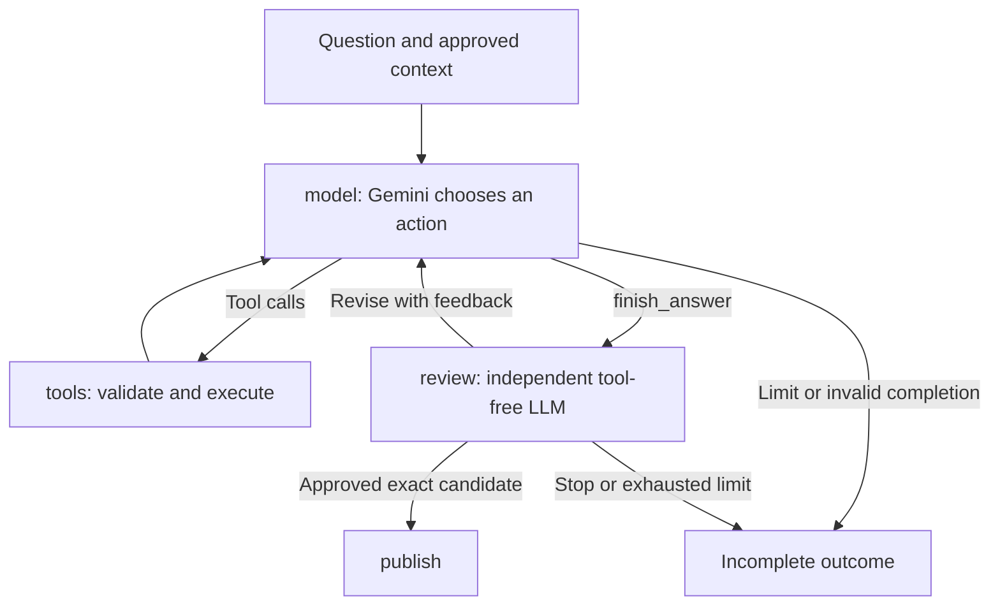

# Architecture

Retail Insight runs a coordinator and three specialists in one Python process. The implementation uses explicit LangGraph nodes and conditional edges. The LLM chooses the investigation path; application code enforces budgets, tool permissions and reviewed publication.

## Agent loop

[`CustomAgentLoop`](../src/retail_insight/runtime/graph.py) builds this graph. [`Analyst`](../src/retail_insight/runtime/analyst.py) inherits it and supplies context assembly, accounting, evidence and completion handling. The four role classes inherit `Analyst`, overriding prompts, tools and warehouse capabilities. There is no prebuilt agent factory.

Plain model text is a draft. Publication requires `finish_answer` and approval of the exact candidate. Revisions return to the same model/tool loop. Limits bound model calls, tool calls, queries, reviews, dollars and elapsed time; unresolved runs finish explicitly as incomplete.

## Team workflow

[`AgentTeam`](../src/retail_insight/runtime/team.py) invokes role graphs locally. The coordinator's `delegate` tool calls it for retail, inventory or distribution. Independent calls can run concurrently; each receives a reservation from the coordinator's budget and settles confirmed usage afterward. A specialist cannot spend an independent unlimited budget or acquire report-write authority through delegated text.

[`workflow.py`](../src/retail_insight/runtime/workflow.py) exports a compiled application graph with four selectable entry nodes. The default entry is the coordinator. Its LLM decides which specialists to consult; there is no fixed sequence requiring all specialists for every question. The same inherited loop runs inside each role.

| Role | Capabilities |
| --- | --- |
| Coordinator | Delegate questions, combine returned evidence, review the final synthesis |
| Retail | Read-only sales SQL, result inspection, prior answers and authorized reports |
| Inventory | Modeled unsold stock, age, quantities and recorded cost |
| Distribution | Distribution-center inventory and optional Google Maps MCP lookups |

Shared tools live in `src/retail_insight/tools/`; role-specific tools live beside each agent in `agents/<role>/tools.py`. Integrations implement Google models, BigQuery, Maps and Azure boundaries. Skills provide optional analytical guidance, never additional permissions. Common trust and writing instructions are assembled centrally.

## Memory and security

Each prompt receives a fresh budget. Conversation history contains approved answers and associated evidence; transient model messages and drafts do not become conversation memory. SQLite stores context by owner, role, conversation and warehouse profile. Checkpointed workflow state includes approved contexts, so the Foundry checkpointer can restore them after a process restart. It does not resume a half-executed warehouse tool or replay an unfinished external effect.

The localhost GUI uses an HMAC-signed HttpOnly/SameSite cookie, Host/Origin checks and ownership checks on every conversation operation. Its port is bound to `127.0.0.1`. A running conversation cannot be deleted or submitted twice. Disconnecting cancels its local task. Browser history is presentation state; modifying it cannot inject trusted agent memory.

SQL runs through validated read-only capabilities, bounded row counts and query-cost checks. All agents have full dataset access; explicit brand filters are analytical filters, not identity authorization. Tool results, reports, retrieved text and delegated messages remain untrusted data. Only trusted code supplies tool definitions and operation authority. The reviewer has no tools. Maps evidence remains ephemeral.

## Interfaces and deployment

- CLI: `agent-chat coordinator|retail|inventory|distribution`; the retail-only CLI remains available.
- GUI: assistant-ui renders reviewed Markdown and tables. The local API streams progress over NDJSON and emits the final answer only after review.
- Docker: one application container; persistent conversation volume; owner-only secret files and read-only ADC mount.
- Agent Card: `/agent-card.json` describes capabilities and supported interfaces. It is descriptive metadata, not an A2A endpoint.
- Foundry: the official `ResponsesHostServer` hosts the compiled graph with `FoundryCheckpointSaver`; platform user identity partitions memory. [Setup](foundry.md).

## Observability and evaluation

Azure Monitor captures explicit OpenTelemetry parent/child spans for prompts, graph nodes, providers and reviewers. Metadata-only capture is the default. Synthetic-content capture is opt-in; secrets and thought parts are removed. Automatic raw LangGraph state tracing is disabled to preserve that boundary. Provider usage populates token and cost fields; unknown usage retains a budget reservation rather than being reported as zero cost.

Independent evaluations run the application, then assess saved answers and trajectories using separate references and judges. Runtime reviewer approval never substitutes for those scores. [Evaluation](evaluation.md) and [Cloud connections](cloud-connections.md) describe commands, datasets, local artifacts and remaining calibration work.

Google and Azure use independent connectors. `integrations/gcp/connector.py` creates
Gemini clients for agents and judges using the existing Google key. BigQuery keeps
ADC. `integrations/azure/connector.py` provides Entra-authenticated project access,
monitoring configuration and evaluation APIs. The optional Azure model API key is
never used for project access or selected automatically for inference.

Foundry evaluation publication imports existing independent grades through a
non-LLM string-check evaluator. Source datasets contain complete conversation
references; result datasets contain actual answers and detailed checks. Errors and
unjudgeable checks remain separate from quality scores. These are imported
assessments, not judgments generated by an Azure model.
