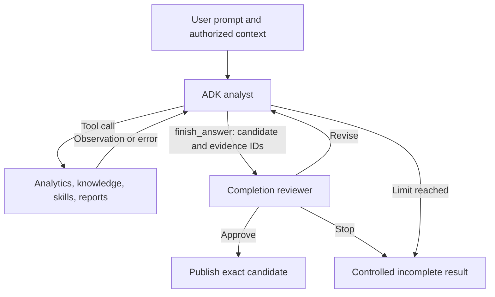
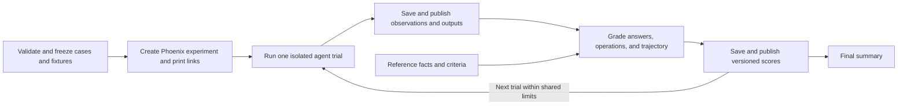

# Retail agent architecture

Updated: 2026-11-22.

## Scope

The application is a Python CLI built on Google ADK and Gemini for TheLook analytics in BigQuery, conversational follow-ups, and report management. A single analyst controls tool selection, SQL generation, and response composition. Application code enforces authorization, execution limits, and publication contracts; business questions have no predefined workflows.

This document describes the current implementation. Requirements are recorded in the [client Q&A](task/q&a.md); setup and commands are in [Quick Start](../QUICK_START.md).

## Runtime and completion protocol

[`Analyst.ask`](../src/retail_agent/runtime.py) creates an ADK `LlmAgent`, `Runner`, and in-memory session for each prompt. The initial context contains trusted brand scope, the UTC instant and date, bounded approved conversation history, result handles, and skill summaries. The reviewer receives the same trusted clock source to validate as-of reporting independently of source timestamps. Follow-ups reuse application context with a new ADK session and budget; conversation state does not survive CLI restarts.

The analyst executes an iterative tool loop and submits Markdown through `finish_answer`, referencing supporting evidence. It selects prose, lists, or tables according to the request.

[`reviewer.evaluate`](../src/retail_agent/reviewer.py) invokes a separate, tool-free `LlmAgent` with the candidate and evidence. Its structured decision covers task coverage, grounding, metrics, presentation, and operations:

- **Approve:** publish the exact candidate.
- **Revise:** return findings to the existing analyst loop for further queries or edits.
- **Stop:** terminate with an incomplete status.

All published analytical answers require approval. Input rejection, provider failure, and exhausted limits may produce application status messages without review. Reviewer approval is a quality control, not an independent correctness guarantee.

## Tool interface

The [registry](../src/retail_agent/tools/registry.py) exposes composable capabilities:

| Capability | Tools |
|---|---|
| Data discovery and queries | `describe_data`, `query_data`, `query_state_summary` |
| Result inspection and calculation | `read_result`, `analyze_results` |
| Runtime guidance | `load_skill`, `load_skill_resource` |
| Golden Knowledge | `list_golden`, `read_golden` |
| Report and answer retrieval | `search_reports`, `read_report`, `read_answer` |
| Report operations | `stage_report_save`, `preview_report_deletion`, `cancel_report_deletion` |
| Reviewed completion | `finish_answer` |

Adapters in `tools/` expose model-facing schemas and delegate to `services/`. New analytical questions can compose existing tools; additional capabilities require implementation changes.

Report retrieval, deletion previews and cancellations register their actual observations as
typed evidence. The analyst can submit those evidence handles to the reviewer without a
warehouse query. Historical report contents do not become current business facts, and private
deletion confirmation tokens are excluded from model-visible observations.

## Knowledge and evaluation assets

| Resource | Role | Location |
|---|---|---|
| Skills | Analytical and writing procedures, loaded on demand | [`src/retail_agent/skills/`](../src/retail_agent/skills/README.md) |
| Golden Knowledge | Reusable question/SQL/answer examples | [`knowledge/golden/`](../knowledge/golden/README.md) |
| Evaluation references | Frozen cases, criteria, numeric facts, and fixtures; never supplied to the analyst | [`evaluation/datasets/`](../evaluation/datasets/README.md) |
| Authored conversations | 20 fixed questions and follow-ups, with acceptance criteria kept outside agent context | [`evaluation/scenarios/`](../evaluation/scenarios/README.md) |
| Judge calibration | Labeled candidate answers for testing the independent evaluator | `evaluation/datasets/judge_calibration/` |

The analyst receives skill metadata and selects relevant instructions. The reviewer always receives the analytical-review skill. Skills neither execute scripts nor grant permissions.

`list_golden` returns up to 20 summaries per page with a continuation offset. The analyst selects examples for `read_golden` or proceeds without them. Eligibility checks enforce approval, visibility, scope, schema/metric compatibility, and content integrity before disclosure.

`--golden-bootstrap` enables 11 synthetic examples. These provide methods, not current business facts or company-approved reports; current facts require query evidence. Evaluation references remain outside the runtime catalog.

## Data and authorization

The query gateway exposes three logical relations:

| Relation | Semantics |
|---|---|
| `sales` | Purchases excluding Cancelled/Returned at both item and order levels |
| `transactions` | Purchases across all statuses for explicit alternative definitions |
| `products` | Product catalog, including unsold products |

Brand scope is applied before joins, customer histories, and aggregations. The gateway accepts supported read-only SQL and rejects raw source access, writes, and prohibited columns. BigQuery execution requires a dry run and byte limit. Local result calculations use a bounded DuckDB subprocess with external access disabled.

Metric contracts:

- Revenue sums `sale_price`; order and customer counts use distinct IDs.
- UTC periods use half-open intervals, such as `[2026-01-01, 2026-04-01)` for Q1.
- Current statuses cannot reconstruct historical status transitions.
- Customer names, contact details, and individual geography are excluded; internal customer IDs are permitted.
- `query_state_summary` exposes state aggregates only for groups with at least five distinct customers. The synthetic fixture contains no geography.

Managers are restricted to assigned brands; the CEO has cross-brand analytical access. Identities are simulated. Application scope enforcement over public TheLook data is not production authentication or BigQuery IAM isolation.

## Report lifecycle

Reports are saved only on explicit request. `stage_report_save` records intent; `finish_answer` persists approved content to local SQLite after review and save authorization, then returns an operation receipt. Ownership remains private to the creator, including against CEO access.

Deletion requires an exact preview and the user's `/confirm TOKEN`, handled outside the model loop. Validation checks ownership, expiry, report versions, and token reuse. Stale or cancelled previews cannot delete data. Deletion removes selected stored content and clears the current conversation's in-memory context; other CLI sessions and external exports are outside its scope.

## Execution limits and observability

Each prompt receives an independent budget. Analyst calls, runtime review, retries, and repairs share that prompt's allowance.

Defaults in [`config.py`](../src/retail_agent/config.py): $1, 120 seconds, 12 model calls, 8 queries, and 24 tool calls, with 30 seconds and execution capacity reserved for review.

Model calls reserve estimated input and maximum output cost. Complete usage settles input, output, and thinking tokens at configured rates, releasing unused reservations. Unknown usage retains its reservation; query reservations remain conservative at the maximum-byte allowance. These values are estimates, not provider invoices.

Recoverable errors return to the analyst within the same limits. Exhaustion produces an incomplete status; `/details` exposes completed evidence. The CLI updates elapsed time and activity independently. Metadata-only diagnostics record timing, usage, and outcomes without raw prompts, result contents, credentials, or hidden reasoning.

`--phoenix` on `chat` or `ask` enables local OpenTelemetry tracing. Each prompt has a separate root span and turn ID; a stable session ID links follow-ups. Analyst and reviewer provider attempts report usage once, while the budget ledger remains authoritative. Automatic ADK payloads are hidden, and an exporter allowlist also strips exception details and arbitrary attributes. Trace failures are nonfatal; shutdown waits at most two seconds.

Synthetic evaluation capture is a separate opt-in observer. It records initial context, actual tool responses, candidates entering review, review decisions, and final outcomes. Capture removes credentials, hidden thoughts, and deletion tokens. Analyst-visible result previews are kept distinct from the full evidence bundle available to the reviewer. An injected UTC clock freezes prompt dates, report timestamps, and SQL clock expressions; monotonic deadlines remain real. Trusted physical BigQuery datasets can be configured outside tool arguments for snapshot evaluation.

Phoenix runs locally at `http://127.0.0.1:6006` with persistent SQLite storage. The [Compose configuration](../infra/phoenix/README.md) disables automatic telemetry and external-resource fetching. Synthetic traces may include evaluation content; normal chat remains metadata-only.

The exporter derives Phoenix Input/Output previews from explicit sanitized application events.
Evaluation context labels identify run, scenario, turn, and phase without entering model context.
Runtime and judge spans expose standard execution statuses; quality verdicts remain separate.
Provider/judge token counts and configured-rate estimates are recorded only when usage is known.
Phoenix's native cost display uses its own registered pricing and span filters; root spans do
not duplicate child model costs. Metadata-only tracing continues to omit business content.

Prompt definitions are shared between inference and Phoenix publication through
`src/retail_agent/prompt_catalog.py` and `evaluation/prompt_catalog.py`. Git remains the source
of instructions. Evaluation startup publishes the analyst, reviewer (including its mandatory
review skill), answer judge and trajectory judge to Phoenix Prompts. Normal CLI and manual
tracing publish the two runtime definitions. Content hashes prevent duplicate versions and
associate provider/judge calls with the exact synchronized definition. `prompts.json` records
version IDs alongside run artifacts. `retail-eval sync-prompts` publishes without inference.
Playground edits do not alter the application; adopting a change requires updating the repository.
Playground tests prompt variants but does not run the application's ADK tools or attribution checks.

## Modules

Python paths below are relative to `src/retail_agent/`.

| Module | Responsibility |
|---|---|
| `cli.py`, `terminal.py` | CLI commands, completion menu, progress, Markdown rendering |
| `runtime.py`, `turn.py` | Analyst orchestration, conversation context, per-prompt state |
| `reviewer.py`, `prompts/` | Completion review and model instructions |
| `tools/`, `services/` | Tool contracts and domain implementations |
| `skills/` | Runtime skill catalog and loader |
| `budget.py`, `provider.py` | Limits, provider retries, usage settlement |
| `observability.py` | Optional tracing, export redaction, synthetic capture |
| `config.py`, `contracts.py`, `privacy.py` | Configuration, shared types, privacy controls |

Repository-level `knowledge/` contains runtime examples and fixtures. `evaluation/` contains the independent evaluation system; `tests/` contains deterministic contracts and integration tests. Original assignment material remains in `docs/task/`.

## Independent evaluation

Status: the end-to-end evaluation runner, incremental local Phoenix publication, answer and trajectory graders, synthetic references, and offline test suite are implemented. Pilot references still require human review; judge calibration and a sealed holdout have not been approved. Code-only results do not establish semantic correctness or production reliability.

The main Phoenix workspace holds the authored 20-conversation dataset and one shared trace
project, `retail-conversations-20`. Three complete historical phases and three targeted retests
retain both answers, original traces, and attributed assistant reviews. The latest full phase
passed 39/40 answers; partial retests are not a new full-suite result.
`retail-eval run-conversations` captures independent reference rows and pins every agent/reference
source table to the same BigQuery timestamp. It publishes numerical, grounding, completion,
operation, and trajectory scores after each conversation. Reference facts for both turns live in
versioned dataset Output; observed answers live in experiment results. Conditional follow-ups bind
to the entities actually shown initially, including valid alternative ties.
`evaluation/runners/authored.py` coordinates capture, grading, and publication;
`conversation_references.py` defines independent facts; `graders/conversations.py` grades the two
turns; `reporting/conversation_experiment.py` publishes incremental results.
`publish-conversations` preserves historical assistant reviews without relabeling them as
automatic grades or overwriting their dataset versions.

The controlled fixture workflow below uses a separate Phoenix instance, such as port 6007.
Fixture publication rejects the main port 6006 endpoint. Collector tests require an explicit
disposable endpoint; the SDK pytest plugin is disabled to prevent automatic test datasets.

The runtime reviewer and offline evaluator have different responsibilities. The reviewer can request corrections before publication. The offline evaluator assesses saved executions independently, using references the analyst never sees.

- **Execution:** each repetition gets isolated report storage and conversation state. Follow-up steps share only their case's context. Trial artifacts freeze fixture, dataset, runtime, prompt, dependency, and configuration hashes. Each prompt retains its own budget; one experiment cost ceiling and deadline cover execution and independent grading. `retail-eval run` validates the selected cases, checks or starts local Phoenix, creates the experiment, and prints links before model calls.
- **Ground truth:** independent Python arithmetic derives expected facts from synthetic fixtures. Numeric checks bind values to entity, metric, period, and scope; SQL text and number occurrence alone are insufficient.
- **Grounding:** a separate structured judge labels material claims against the observations actually available to the analyst. References support correctness checks but do not substitute for observed evidence. Unsupported explanations and causal claims can fail even when the reported numbers are correct.
- **Trajectory:** a separate structured judge evaluates captured tool availability, calls, results, review feedback, and subsequent actions. Event-bound findings assess selection, argument use, evidence use, recovery, and progress without requiring one tool sequence. These scores are diagnostic and do not alter task success; human calibration remains pending.
- **Operations and safety:** deterministic checks inspect report ownership, saved content, deletion receipts, final state, output format, and execution boundaries. Adversarial cases cover scope requests, injected instructions, and recovery.
- **Regrading:** grading reads saved trials without running the agent again. New grader versions append results. Scores retain `PASS`, `FAIL`, `ERROR`, `UNJUDGEABLE`, and `NOT_APPLICABLE`; missing judgment is not a pass. Candidate grades can expose false approvals by the runtime reviewer.
- **Reporting:** repeated-trial summaries include task success, claim support and coverage, cost, latency, observed reliability, and separate trajectory results. Phoenix receives each completed trial and its scores incrementally. Startup must succeed before model calls; later publication failures preserve canonical local artifacts and can be retried without repeating execution or grading.

See [Testing and evaluation](evaluation.md) for offline checks, live runs, grading, and Phoenix commands. The [rebuild plan](plans/EVALUATION_REBUILD_PLAN.md) and [review](plans/EVALUATION_REVIEW.md) retain the rollout and acceptance criteria.

Outstanding production work includes real identity and authorization infrastructure, managed storage, persistent chat recovery, operational retention policies, Golden Knowledge publishing, and validated release thresholds. Synthetic tests and a mandatory reviewer reduce specific failure modes; they do not guarantee absence of hallucinations.
