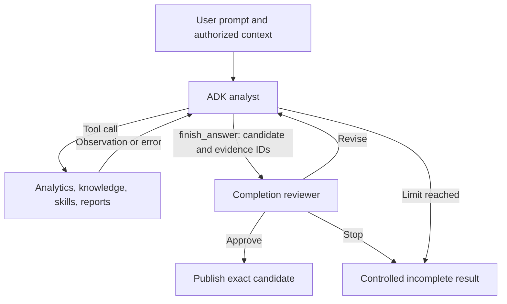

# Retail agent architecture

Updated: 2026-11-22.

## Scope

The application is a Python CLI built on Google ADK and Gemini for TheLook analytics in BigQuery, conversational follow-ups, and report management. A single analyst controls tool selection, SQL generation, and response composition. Application code enforces authorization, execution limits, and publication contracts; business questions have no predefined workflows.

This document describes the current implementation. Requirements are recorded in the [client Q&A](task/q&a.md); setup and commands are in [Quick Start](../QUICK_START.md).

## Runtime and completion protocol

[`Analyst.ask`](../src/retail_agent/runtime.py) creates an ADK `LlmAgent`, `Runner`, and in-memory session for each prompt. The initial context contains trusted brand scope, the UTC date, bounded approved conversation history, result handles, and skill summaries. Follow-ups reuse application context with a new ADK session and budget; conversation state does not survive CLI restarts.

The analyst executes an iterative tool loop and submits Markdown through `finish_answer`, referencing supporting evidence. It selects prose, lists, or tables according to the request.

[`reviewer.evaluate`](../src/retail_agent/reviewer.py) invokes a separate, tool-free `LlmAgent` with the candidate and evidence. Its structured decision covers task coverage, grounding, metrics, presentation, and operations:

- **Approve:** publish the exact candidate.
- **Revise:** return findings to the existing analyst loop for further queries or edits.
- **Stop:** terminate with an incomplete status.

All published analytical answers require approval. Input rejection, provider failure, and exhausted limits may produce application status messages without review. Reviewer approval is a quality control, not an independent correctness guarantee.

## Tool interface

The [registry](../src/retail_agent/tools/registry.py) exposes composable capabilities:

| Capability | Tools |
|---|---|
| Data discovery and queries | `describe_data`, `query_data`, `query_state_summary` |
| Result inspection and calculation | `read_result`, `analyze_results` |
| Runtime guidance | `load_skill`, `load_skill_resource` |
| Golden Knowledge | `list_golden`, `read_golden` |
| Report and answer retrieval | `search_reports`, `read_report`, `read_answer` |
| Report operations | `stage_report_save`, `preview_report_deletion`, `cancel_report_deletion` |
| Reviewed completion | `finish_answer` |

Adapters in `tools/` expose model-facing schemas and delegate to `services/`. New analytical questions can compose existing tools; additional capabilities require implementation changes.

## Knowledge and evaluation assets

| Resource | Role | Location |
|---|---|---|
| Skills | Analytical and writing procedures, loaded on demand | [`src/retail_agent/skills/`](../src/retail_agent/skills/README.md) |
| Golden Knowledge | Reusable question/SQL/answer examples | [`knowledge/golden/`](../knowledge/golden/README.md) |
| Offline evaluation | Reference cases, checks, and recorded runs | [`evals/`](../evals/README.md) |

The analyst receives skill metadata and selects relevant instructions. The reviewer always receives the analytical-review skill. Skills neither execute scripts nor grant permissions.

`list_golden` returns up to 20 summaries per page with a continuation offset. The analyst selects examples for `read_golden` or proceeds without them. Eligibility checks enforce approval, visibility, scope, schema/metric compatibility, and content integrity before disclosure.

`--golden-bootstrap` enables 11 synthetic examples. These provide methods, not current business facts or company-approved reports; current facts require query evidence. Evaluation references remain outside the runtime catalog.

## Data and authorization

The query gateway exposes three logical relations:

| Relation | Semantics |
|---|---|
| `sales` | Purchases excluding Cancelled/Returned at both item and order levels |
| `transactions` | Purchases across all statuses for explicit alternative definitions |
| `products` | Product catalog, including unsold products |

Brand scope is applied before joins, customer histories, and aggregations. The gateway accepts supported read-only SQL and rejects raw source access, writes, and prohibited columns. BigQuery execution requires a dry run and byte limit. Local result calculations use a bounded DuckDB subprocess with external access disabled.

Metric contracts:

- Revenue sums `sale_price`; order and customer counts use distinct IDs.
- UTC periods use half-open intervals, such as `[2026-01-01, 2026-04-01)` for Q1.
- Current statuses cannot reconstruct historical status transitions.
- Customer names, contact details, and individual geography are excluded; internal customer IDs are permitted.
- `query_state_summary` exposes state aggregates only for groups with at least five distinct customers. The synthetic fixture contains no geography.

Managers are restricted to assigned brands; the CEO has cross-brand analytical access. Identities are simulated. Application scope enforcement over public TheLook data is not production authentication or BigQuery IAM isolation.

## Report lifecycle

Reports are saved only on explicit request. `stage_report_save` records intent; `finish_answer` persists approved content to local SQLite after review and save authorization, then returns an operation receipt. Ownership remains private to the creator, including against CEO access.

Deletion requires an exact preview and the user's `/confirm TOKEN`, handled outside the model loop. Validation checks ownership, expiry, report versions, and token reuse. Stale or cancelled previews cannot delete data. Deletion removes selected stored content and clears the current conversation's in-memory context; other CLI sessions and external exports are outside its scope.

## Execution limits and observability

Each prompt receives an independent budget. Analyst calls, runtime review, retries, and repairs share that prompt's allowance.

Defaults in [`config.py`](../src/retail_agent/config.py): $1, 120 seconds, 12 model calls, 8 queries, and 24 tool calls, with 30 seconds and execution capacity reserved for review.

Model calls reserve estimated input and maximum output cost. Complete usage settles input, output, and thinking tokens at configured rates, releasing unused reservations. Unknown usage retains its reservation; query reservations remain conservative at the maximum-byte allowance. These values are estimates, not provider invoices.

Recoverable errors return to the analyst within the same limits. Exhaustion produces an incomplete status; `/details` exposes completed evidence. The CLI updates elapsed time and activity independently. Metadata-only diagnostics record timing, usage, and outcomes without raw prompts, result contents, credentials, or hidden reasoning.

## Modules

Python paths below are relative to `src/retail_agent/`.

| Module | Responsibility |
|---|---|
| `cli.py`, `terminal.py` | CLI commands, completion menu, progress, Markdown rendering |
| `runtime.py`, `turn.py` | Analyst orchestration, conversation context, per-prompt state |
| `reviewer.py`, `prompts/` | Completion review and model instructions |
| `tools/`, `services/` | Tool contracts and domain implementations |
| `skills/` | Runtime skill catalog and loader |
| `budget.py`, `provider.py` | Limits, provider retries, usage settlement |
| `config.py`, `contracts.py`, `privacy.py` | Configuration, shared types, privacy controls |

Repository-level `knowledge/` contains runtime examples and fixtures; `tests/` and `evals/` contain current tests and evaluation artifacts. Coding-agent skills in `.agents/skills/` are separate from runtime skills. Original assignment material is preserved in `docs/task/`.

## Verification and planned work

Run the offline suite with `uv run --locked pytest`. Controlled fixtures and fake providers exercise analytics, scope, report state, accounting, runtime protocols, and CLI behavior. [Recorded live evaluations](../evals/rewrite/runs/README.md) provide behavioral evidence; reviewer approval alone is not a passing test, and small runs do not establish production reliability.

The [evaluation rebuild plan](plans/EVALUATION_REBUILD_PLAN.md) specifies a replacement suite, independent reference datasets, and local Phoenix integration. That migration is not implemented.

Other outstanding capabilities include production identity and hosting, managed storage and monitoring, persistent chat recovery, Golden Knowledge publishing, inferred preferences, and persona administration with an automated quality gate. Production deployment also requires the retention policies and operational targets defined in the client Q&A.
