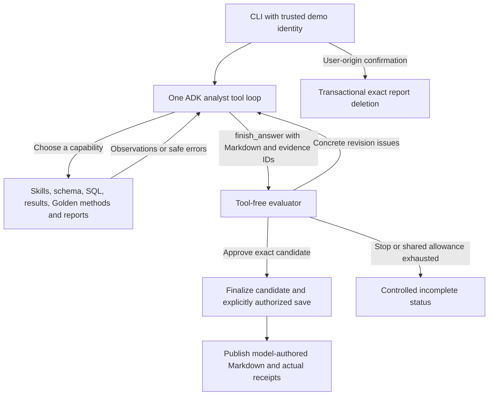

# Retail analyst architecture

Updated: 20 November 2026. The **local replacement runtime is implemented** in the canonical `src/retail_agent/` package; the production deployment below remains a proposal. See [technical reasoning](technical_reasoning.md), the [from-scratch design decisions](from-scratch-agent-plan.md), and [recorded rewrite observations](rewrite-test-observations.md) for the implementation and its measured limits. The older HLD is preserved under [legacy documentation](../legacy/runtime-2026-11-20/docs/architecture.md).

## Confirmed scope and client decisions

The [client Q&A](task/q&a.md) defines the requirements. Analysis is on demand against existing TheLook data; transaction ingestion, scheduled retail analysis and historical access-revocation workflows are excluded. The initial design target is roughly 1,000 questions and 100 saved reports daily, with a few concurrent users. Simple answers target 10–30 seconds and reports 1–2 minutes. These are client targets, not measured service guarantees. The configurable USD 1 cap applies to variable model/query work; it excludes fixed infrastructure.

| Area | Required behavior and current boundary |
|---|---|
| Identity and scope | Managers analyze assigned brands; the CEO can analyze all brands. Purchase history is scoped before spend, acquisition, cohort or inactivity calculations. Local identities simulate authentication. |
| Privacy | Source projections omit names, emails, addresses, postal codes and coordinates before model access. Internal customer IDs are allowed. State demographics use a separate aggregate-only service. |
| Metrics | Document sensible defaults and permit explicit overrides. UTC half-open periods are standard; clarify materially missing years/periods. Current statuses do not reconstruct historical status changes. |
| Reports | Generation does not imply saving. Libraries belong to their creators, including against CEO access. Exact preview and user confirmation precede permanent deletion. |
| Golden Knowledge | No real source corpus was supplied. Synthetic examples are labelled. The user's rewrite request makes working retrieval required, superseding its optional prototype status in the original Q&A. |
| Persona | Nontechnical changes should publish through an automatic quality gate without redeployment or manual approval. This administration capability remains a production proposal. |
| Retention | Chats: at most 90 days; saved reports: until deletion; content-free mutation audit: one year. The prototype keeps conversation context only in process memory. |

## Implemented local architecture

The analyst decides which tools to call, which SQL to write, whether another investigation is useful, and how to present its answer. The model writes ordinary Markdown and can choose prose, lists or tables. The renderer displays that Markdown; it does not append evidence tables, choose columns or replace numbers with a separate rendering language.

The [runtime skill library](runtime-skills.md) supplies five analyst methods through metadata-first discovery and optional instruction/reference reads. A sixth skill provides the evaluator rubric on every review. Skills do not prescribe a fixed tool sequence or grant capabilities. Model-facing adapters live in `tools/`; database and storage implementations live in `services/`.

A question uses one ADK `LlmAgent` tool conversation. An isolated reviewer call sees the candidate, original request, bounded relevant conversation, trusted result artifacts and proposed save. A rejection returns issues to the same analyst conversation. The reviewer has no query, report or execution tools and does not rewrite approved text. Application code publishes the exact accepted candidate using the completion tool's skip-summarization action. Direct final prose cannot bypass the gate.

Each new user turn starts a fresh ADK session with application-held approved context and result handles. Follow-ups therefore preserve useful facts without carrying an unbounded transcript of intermediate reasoning. The `read_answer` tool can fetch an exact previous approved answer when the context contains an explicitly marked excerpt.

| Local component | Responsibility |
|---|---|
| Typer/Rich CLI | English chat, model Markdown, actual progress, library commands, trusted preview/confirmation UI |
| Analyst runtime | ADK assembly, bounded context, result IDs, staged operations and completion gate |
| Gemini provider adapter | Shared admission accounting, bounded transient retry, sanitized provider failures and token usage |
| Query gateway | Logical-source validation, scoped SQL compilation, BigQuery dry run/execution and cancellation |
| Local result worker | Isolated DuckDB calculation over explicit result snapshots; no filesystem/network access |
| Golden store | In-memory SQLite FTS5/BM25 index of eligible, version-compatible methods |
| Report store | Owner-scoped SQLite artifacts, idempotent saves, exact deletion snapshots and content-free audit |
| Runtime trace | Metadata-only JSONL events; no general logging of questions, SQL rows or hidden reasoning |

## Data and execution boundaries

The analyst sees three logical relations: `sales`, `transactions` and `products`. `sales` excludes Cancelled/Returned statuses at both item and order level. `transactions` retains statuses for explicit analytical overrides. `products` includes unsold catalog products. The gateway resolves nested sources and applies trusted brand scope at physical leaves before the model's joins, windows, histories or aggregates.

The gateway accepts composable read-only analytical SQL, including CTEs, unions, joins and windows. It rejects raw table paths, writes/scripts, unauthorized columns, unscoped relation access, external IO and unknown/custom routines. Its pure-function capability allowlist controls executable operations; it does not enumerate business questions or metric plans. Supporting a new approved pure function may require gateway work; composing a new metric from existing SQL does not require an intent route.

The fourth required source, `users`, is available only inside `query_state_summary`. That tool returns state aggregates with at least five distinct customers and never customer/state associations. Five is a chosen prototype suppression rule, not a client-mandated threshold. The fixture backend has no geography and reports that limitation explicitly.

BigQuery queries use local application credentials supplied by the developer/reviewer. SQL is dry-run before submission and receives a maximum-byte cap, stable job identity and bounded wait. Local fixture and result calculations run in a spawned process with DuckDB external access disabled, one thread, bounded memory and no spill space. A timed-out local worker is terminated. These controls protect execution and scope; they do not establish that a query computes the intended metric.

The public TheLook dataset is publicly readable. A safe view or shared local credential does not create per-user IAM isolation over that public source. The prototype trusts the local machine owner and enforces user scope in the application gateway. Production needs restricted execution identities and private, controlled source views in addition to the same application checks. [BigQuery authorized views](https://docs.cloud.google.com/bigquery/docs/authorized-views)

## Golden Knowledge: publication and retrieval

The [bootstrap corpus](../knowledge/golden/README.md) contains 11 assistant-authored synthetic Question → SQL query/queries → analyst-answer examples, with frozen fixture evidence, versions and provenance. They are not company reports, human-approved records or current numerical evidence.

The store filters scope, schema/metric compatibility, review state and visibility before indexing. Default production eligibility requires approved publication metadata, different editor/reviewer identities and a matching content digest. The synthetic collection is disabled by default and requires explicit bootstrap mode; it cannot silently become approved production knowledge. The loader validates trusted publication records, but no authenticated editor/reviewer administration service is implemented yet.

`search_golden` returns a few summaries; `read_golden` returns the full eligible example. Retrieval is optional for each question and controlled by the analyst. The model may adapt, combine or ignore examples, then query fresh numbers. The baseline is lexical FTS5/BM25 with stemming, not semantic embedding search. Corpus and entry hashes, revisions and index version provide provenance. Invalid corpus integrity fails closed.

Production publication remains editor draft → privacy/numerical/compatibility checks → separate reviewer approval → immutable revision → index update. Corrected agent work can propose drafts but cannot approve itself. Add embeddings or a hybrid index only if measured retrieval recall justifies the complexity. Evaluation prompts, expected results and grading rubrics stay outside the knowledge index.

## Reports and deletion

An explicit save request can stage a new candidate or a previous approved answer. The evaluator checks the current user's authorization and target. After approval, application code saves the exact Markdown and evidence idempotently by owner and answer ID, then displays the actual storage receipt. A failed save does not become a success message. Natural-language authorization remains an LLM judgment; storage ownership and transaction rules are code-enforced.

A deletion tool can only request a preview or cancel it. The application displays database-backed report IDs and titles and holds the confirmation token outside the model response. `/confirm TOKEN` checks owner, conversation, expiry, one-use state, report versions and content signatures in one transaction. New reports matching the old search are not added to the selection. Expired, stale, cancelled or replayed confirmations delete nothing. Successful deletion removes the stored Markdown, evidence and imported payload, keeps only content-free mutation audit, and clears active model context/result copies.

`reports-v2.sqlite3` is separate from the old library. Explicit legacy import reads owner-tagged SQLite/JSON records without modifying their source; original answer JSON remains attached as a historical artifact and is not newly reviewed. Deleting an imported copy affects the new library. A separately preserved old database or user-created export remains outside that transaction; migration must not claim those copies were erased.

## Resilience, budgets and observability

One ledger covers analyst calls, evaluator calls, retries, queries and tools. A common deadline and conservative variable-cost cap cannot reset during a repair. Admission holds back 30 seconds of review time, a model-call slot, a completion-tool slot and bounded review-input/output cost. The provider can make one bounded transient retry; malformed reviewer output has a bounded schema-repair path. Large supporting evidence is rejected for narrowing rather than silently omitted from review. Repeated unchanged rejected candidates cannot spin indefinitely.

The CLI shows real stage events and elapsed time. Failure to obtain review produces a controlled incomplete status with completed artifacts available through `/details`; it does not publish an unreviewed draft. BigQuery cancellation remains best effort and an asyncio cancellation does not forcibly stop a Python worker thread; provider-side bounded waits and job IDs remain necessary. The local DuckDB subprocess can be terminated separately.

General trace events contain conversation ID, timings, usage, tool/status categories, result IDs, review outcomes and approved-answer hashes. Raw questions, result bodies, provider exception text, credentials and hidden reasoning are excluded. A local file is not a managed production logging platform. Diagnostic retention/rotation, dashboards and alerts remain deployment work. SQLite mutation auditing is transactional and pruned after one year.

Input and model-boundary screening detects common contact patterns, but it is not complete named-entity recognition. Arbitrary names, unusual addresses and obfuscated PII can escape the regex. Warehouse projection is the structural protection for source data. Reviewer approval is a probabilistic quality check, not a numerical proof; independent oracles, adversarial boundary tests and observed model runs remain necessary.

## Production deployment proposal

The workload can begin with one authenticated agent service, rather than a distributed agent team. An HTTPS frontend authenticates the user, resolves scope from a server-side mapping and streams progress. The service owns the same analyst/tool loop and query gateway. Restricted Google Cloud credentials access controlled BigQuery views; secrets come from managed secret configuration. Managed PostgreSQL can replace local report/confirmation metadata storage, with owner checks in every operation; a versioned object store can hold larger evidence/corpus artifacts. Minimized structured events go to managed logging and metrics.

Chats would have a 90-day TTL; saved report artifacts would remain until confirmed hard deletion; content-free mutation audit would have a one-year TTL. Backup erasure, diagnostic retention and region requirements need explicit operational decisions. The CLI currently keeps chat/result state only in memory and drops it on exit, which is shorter than the permitted retention period; it does not implement cross-process conversation recovery.

Long requests stay inside bounded interactive execution initially. Add durable jobs only if measured demand exceeds that model, retaining the same owner/scope/budget and exact-result rules. Any future result cache must key on scope, SQL/parameters, schema and metric versions, and a stated freshness policy; no shared application result cache is implemented now.

Persistent preference learning and a nontechnical persona editor remain design-only. Explicit preferences in the current conversation guide the model. Future inferred preferences should be inspectable, correctable and resettable. Persona drafts should pass an automatic gate for factual preservation, privacy, required caveats and style before publication; failure keeps the previous version. Persona configuration cannot change permissions or tool capabilities, and this workflow does not replace the human approval required for Golden publication.
