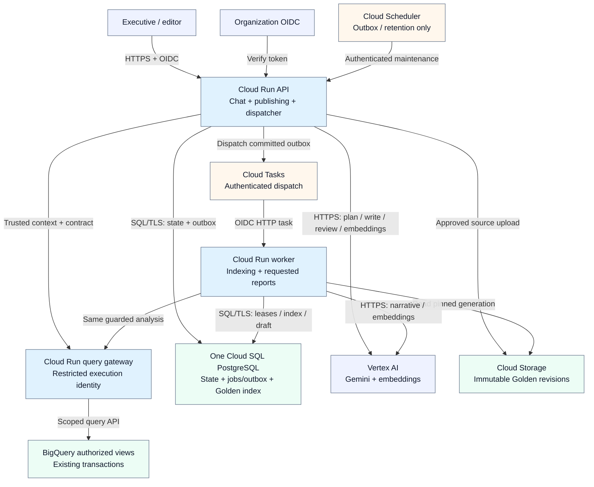
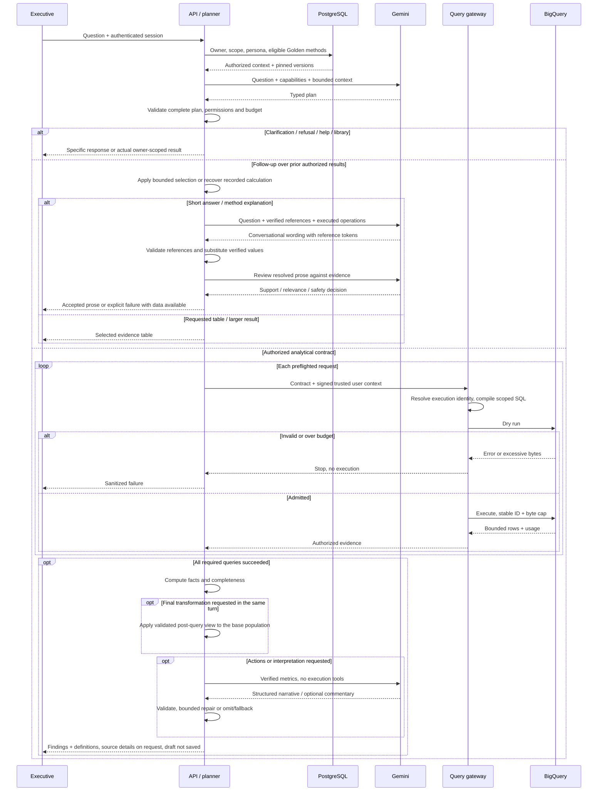
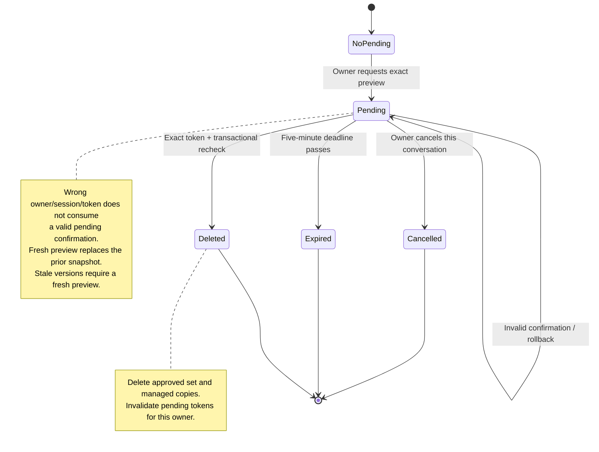

# Production high-level design

**Design proposal, not deployed infrastructure.** The [implemented prototype](technical_reasoning.md#implemented-prototype) is a local CLI with SQLite, Gemini Developer API and BigQuery. The [coverage map](technical_reasoning.md#assignment-coverage) distinguishes working features from design-only requirements.

The confirmed workload is roughly 100 managers × 10 questions/day, 100 saved reports/day, a few concurrent users and an existing dataset growing by about 1M rows/day. Targets are 10–30 seconds for simple answers and 1–2 minutes for reports. The configurable $1 question cap covers variable model/query work, not fixed infrastructure. Analysis is on demand; transaction ingestion, scheduled analysis and historical brand-revocation workflows are out of scope. [Client decisions](architecture.md#confirmed-scope-and-client-decisions)

Read by topic: [scope](#confirmed-scope-and-client-decisions) · [components](#components-and-trust-boundaries) · [request flow](#request-flow) · [Golden Knowledge](#golden-knowledge-publication-and-retrieval) · [persona and learning](#learning-and-persona-changes) · [deletion](#reports-and-deletion) · [resilience](#resilience-budgets-and-asynchronous-jobs).

## Confirmed scope and client decisions

Source: [client Q&A and explicitly unresolved questions](task/q&a.md).

The assignment asks for a production HLD, detailed technical reasoning, and a runnable CLI prototype using the four TheLook tables (`orders`, `order_items`, `products`, `users`). The four mandatory implemented requirements are safety/privacy, destructive-operation confirmation, resilience and observability. All eight requirements are mapped in the [technical reasoning](technical_reasoning.md#assignment-coverage). Golden retrieval, learning and persona administration are production design requirements.

| Topic | Confirmed decision or explicitly identified assumption |
|---|---|
| Credentials | Developers and reviewers supply their own GCP project, Gemini key and application credentials. No personal credentials are shipped. |
| Access | Managers are brand-scoped; CEO analytics can span brands. Customer spend and churn use only authorized-brand history. Demo mappings may be local. |
| Privacy | Never send names, emails, addresses, postal codes or exact coordinates to the model or output. Internal customer IDs/pseudonyms are permitted; state appears only in aggregates. The five-customer cohort threshold is our proposed safeguard, not a client-specified number. |
| Metrics | Document defaults and allow supported explicit overrides. Revenue excludes Cancelled/Returned orders/items; inactivity defaults to 90 days. UTC calendar quarters are accepted; clarify material missing periods/years. |
| Reports | Save only on explicit request. Libraries are private to creators, including from the CEO. Exact preview and explicit confirmation precede permanent hard deletion. “Client X” may mean an entity such as a brand/category; literal matching is our chosen default. |
| Knowledge | No supplied bucket or analyst examples. Define the Trio format and illustrative seeds; working retrieval is optional for the prototype. Human editor/reviewer approval applies to Golden examples. |
| Persona | Nondevelopers change tone without redeployment. Automated quality gate before publication; no manual approval requirement. |
| Retention | Chats: 90 days. Saved reports: until hard deletion, no recovery window. Audit: one year. Diagnostic retention and physical backup erasure are design choices needing operational agreement. |
| Workload | Approximately 100 managers, 1,000 questions and 100 reports daily, a few concurrent users, 1M new source rows/day. Simple answers target 10–30 seconds, reports 1–2 minutes. Configurable USD 1/question ceiling; no required region. |
| Exclusions | On-demand analysis of existing data only; no transaction-ingestion project or scheduled analysis. Historical brand-access revocation is outside assignment scope. |
| Demo priorities | Separate bestseller rankings by revenue and customers, verification of a claimed churn spike, and a Q1 report with Q2 actions. “Why” answers distinguish measured associations from hypotheses; transaction data alone does not establish causes. |

The client did not supply the referenced FAQ, fixed company metric definitions or production editor identities. The assignment estimates 6–12 hours of work; that is an expectation, not a claim about actual effort. These summaries preserve confirmed scope without treating unanswered proposals as requirements.

## Components and trust boundaries

<!-- diagram:architecture:start -->

<!-- diagram:architecture:end -->

All boxes in this diagram are proposed production containers or external services. API-internal planning, rendering and publication handlers are components of the same Cloud Run application, not separate agent services. One Cloud SQL instance hosts operational tables and the Golden index. Arrows show calls/data exchange, not permission inheritance. [Editable sources and export commands](architecture.md#diagram-maintenance)

| Container | Responsibility and identity |
|---|---|
| Cloud Run API, FastAPI + ADK | Validate organization OIDC; screen input locally for PII; resolve owner/brand entitlements; typed planning, rendering, report library, publication/persona endpoints and outbox dispatcher. No raw-table access or query-account impersonation. |
| Cloud Run query gateway | Independently validate signed caller/user context, resolve approved entitlement mapping, compile authorized queries and enforce budget/byte/result limits. Only this identity can impersonate approved query accounts. |
| Gemini / embedding endpoints | Vertex AI managed APIs over HTTPS using workload identity. Evaluate regional model availability and quality before promotion; pin the evaluated model/version in each request. |
| Cloud SQL PostgreSQL | Separate schemas for reports/chats/confirmations/preferences/personas; jobs/outbox; approved Golden metadata, full text and pgvector. SQL/TLS, bounded connection pools and separate API/worker permissions. |
| Cloud Storage | Immutable Golden source objects, pinned by object generation and content digest. Private to publication/indexing services; not a shared saved-report library. |
| Cloud Tasks + Cloud Run worker | Authenticated HTTP delivery for indexing and user-requested report jobs. Worker uses the same planner/gateway and resource accounting as synchronous requests; never arbitrary SQL. |
| Cloud Scheduler | Authenticated outbox recovery and retention maintenance calls only. It does not schedule retail analysis. |
| Cloud Logging/Trace/Monitoring | OpenTelemetry spans and restricted diagnostics from API, gateway and worker. Secret Manager stores non-workload-identity secrets; service accounts use short-lived credentials. These cross-cutting services are omitted from the main diagram for readability. |

Cloud Run suits intermittent demand; cap instance count/concurrency and connection-pool sizes using load tests. Cloud SQL has fixed cost but supplies transactional ownership/deletion and the small retrieval index in one store. No Kubernetes, additional agent team, Redis or separate vector database is justified initially. Propose US-region compute/Cloud SQL near the existing US BigQuery dataset; verify endpoint availability before deployment. Authorized views and their source datasets must use the same BigQuery location. [Authorized views](https://docs.cloud.google.com/bigquery/docs/authorized-views)

## Request flow

<!-- diagram:request-flow:start -->

<!-- diagram:request-flow:end -->

The sequence expands only an authorized analytical route. Clarification, refusal, help and owner-scoped library operations return before analytics; confirmation is a separate application endpoint. One plan may require several queries, all preflighted before execution. Fresh factual tables are rendered without a second model call. Follow-ups over prior authorized evidence can reuse that data without querying BigQuery; short replies and method explanations use a tool-free writer, reference checks and a separate semantic review. Failed writing returns the verified table or an explicit explanation failure. Requested actions use optional tool-free narration; a failed narrative gate allows one repair, then a clearly labelled evidence-only fallback. Optional interpretation uses the same reviewed prose boundary. User-facing answers omit technical evidence IDs by default; source and query diagnostics remain available on request. Neither a valid schema nor successful quality checks prove arbitrary semantic correctness.

The gateway maps the verified subject to an execution account for an approved brand entitlement set. Each account has job-creation permission and access only to **authorized, PII-free views** for that set; the data-owner account owns underlying tables and view definitions. The CEO maps to an all-brand safe view account. The general API/worker identities cannot select an execution account or access source tables directly. The gateway validates the propagated user context instead of trusting model arguments or a caller-supplied brand list. Provision mappings with cross-brand denial tests.

Brand scope applies before item aggregation and customer-history calculations. The SQL compiler is the first boundary; restricted database views independently contain a missing application filter. The local public-data prototype has only the application boundary and trusted local ADC, not these deployed IAM guarantees. Models, retrieved methods, prior messages and catalog strings remain untrusted. The prototype uses lightweight English contact-pattern checks with explicit gaps for arbitrary names and addresses; no local entity model is required. Production free-text privacy needs separate evaluation before making broader guarantees. Source-column minimization remains mandatory. [ADK identity guidance](https://adk.dev/safety/)

## Golden Knowledge: publication and retrieval

There is no client bucket. [Three illustrative trios](golden-trios.json) and their [schema](golden-trio.schema.json) show Question → SQL → Analyst Report methods; their synthetic numbers are not reusable facts or approved production entries.

Publication uses the API, PostgreSQL and the indexing worker:

1. An analyst drafts a revision. Validate privacy, query/metric meaning and a fixture replay; a different reviewer approves it. Human review applies to Golden methods, not persona publication.
2. Write the immutable source object first. Then commit its generation/digest, approved revision and an outbox row in one PostgreSQL transaction. An upload without a committed revision is not retrievable; maintenance removes orphan objects after a grace period.
3. The API dispatcher enqueues Cloud Tasks using an idempotency key derived from Trio ID/revision, then records delivery. A one-minute Scheduler invocation retries unsent outbox rows. A crash after enqueue can cause duplicate dispatch; worker idempotency, not task-name deduplication alone, prevents duplicate publication.
4. The worker verifies approval and object digest, strips excluded content, creates embeddings and transactionally upserts the indexed revision. A stale task cannot replace a newer active revision. Mark the job complete before returning success. Deprecation/rejection removes eligibility immediately and queues index cleanup.

Cloud Storage does not directly enqueue a task. The dispatcher explicitly calls the [Cloud Tasks API](https://docs.cloud.google.com/tasks/docs/creating-http-target-tasks). Delivery can be duplicated; persist job state, attempt count, lease, deadline, spent budget and failure category. Exhausted queue retries delete the task, so a PostgreSQL failed-job record and operator redrive are the durable failure mechanism, not an assumed native DLQ. Recovery marks overdue leases failed and alerts; redrive is explicit, preserves accounting and creates a new attempt identity. [Task delivery](https://docs.cloud.google.com/tasks/docs/common-pitfalls), [retry configuration](https://docs.cloud.google.com/tasks/docs/configuring-queues)

Use Vertex AI text embeddings, initially `gemini-embedding-001` with a configured 768-dimensional output, subject to regional availability and retrieval evaluation. Embed approved question/method/definition text using the document retrieval task; embed user queries with the corresponding query task. Record model ID, dimensions, preprocessing revision and source digest. Never mix embedding versions: build a new index version, evaluate recall, then atomically switch the active version. [Embedding API](https://cloud.google.com/vertex-ai/generative-ai/docs/embeddings/get-text-embeddings)

Start with exact cosine similarity over a **materialized SQL subset** filtered by authorized scope, approval, schema/metric and embedding versions. Combine its top candidates with PostgreSQL text-search candidates using reciprocal-rank fusion; return at most three eligible methods with provenance. Authorization is enforced before content leaves the store. A miss falls back to documented definitions or clarification, never to invented company policy. Always query fresh business data; retrieved SQL is a method, not executable authority.

At this small corpus size, exact search is easier to verify than ANN. If measured latency requires an approximate index, evaluate recall under selective filters and use partitioning/iterative scans as appropriate; do not promise physical prefiltering merely because a WHERE clause exists. [pgvector filtering](https://github.com/pgvector/pgvector#iterative-index-scans), [Cloud SQL support](https://docs.cloud.google.com/sql/docs/postgres/extensions)

## Learning and persona changes

Persist explicit per-user presentation preferences immediately and expose reset. Inferred preferences carry confidence/evidence and are suggested before persistent adoption. Preferences cannot suppress scope, metric definitions or safety controls. Opt-in corrections and feedback become candidate regression cases and Golden drafts; no model response automatically promotes itself into trusted knowledge.

A nontechnical editor changes constrained style settings in an authenticated API/UI. Store a draft persona version, then run deterministic number/reference/privacy checks plus model/human-rubric-derived automated style evaluations. The **publication gate is automatic**, with no human approval step. Failure or unavailable evaluation keeps the current version active. Publish via an atomic pointer; pin the version for each request and allow rollback. Release model/prompt/compiler changes through offline checks, frozen held-out evaluations and a limited canary. This production workflow is not implemented in the CLI.

## Reports and deletion

Reports are private to their owner, including from the CEO. Drafting, persisting conversation content and explicitly saving a report are distinct operations. Async report results are drafts until the user explicitly saves them. Store report owner, version, provenance and immutable answer/evidence together.

<!-- diagram:deletion:start -->

<!-- diagram:deletion:end -->

The diagram describes the current pending-confirmation lifecycle, not all possible outcomes of a confirmation attempt. An invalid token/owner/session or stale version returns an error and rolls back; it does not consume a separate valid pending confirmation. A stale preview must be replaced before it can succeed. Cancellation is owner/conversation-scoped. Successful confirmation hard-deletes the exact rechecked snapshot and invalidates pending confirmations for that owner.

Production uses a separate authenticated, CSRF-protected confirmation action; the model cannot confirm deletion. Store only token hashes, exact report IDs/versions and five-minute expiry. Lock/recheck/consume/delete in one transaction; newly matching reports never join a snapshot. Purge managed chat/cache copies and clear active context. Terminal output and user exports cannot be recalled.

Chats expire after 90 days, saved reports persist until explicit hard deletion, and content-free mutation audit expires after one year. Production maintenance enforces retention independently of analysis. Backups have a bounded expiration policy and a durable deletion ledger applied before restored data becomes accessible. Exact physical backup expiry requires an operational agreement; do not promise instant erasure of historic media. Brand-revocation lifecycle handling remains outside assignment scope.

## Resilience, budgets and asynchronous jobs

One request/job owns model attempts, query attempts, bytes, cost and deadline. A worker retry inherits that accounting rather than a fresh $1 allowance. Preflight capabilities/auth/query count; allow one bounded plan repair and one syntax-only dry-run reserialization, never broaden permissions or change metrics. Empty data is a valid result; no diagnostic query silently changes the requested scope. Provider failures have one bounded retry before partial output, then a specific availability error. Production circuit breakers reduce repeated outage calls; deterministic library controls remain available.

Stable BigQuery job IDs support recovery after uncertain submission. Dry run and `maximum_bytes_billed` constrain work; cancellation is best effort. A small LIMIT does not itself bound scanned bytes. Production response deadlines match the client targets; no latency guarantee is inferred from the sample runs.

For long requested reports, commit owner/scope/version/budget snapshot and an outbox entry, return job ID/progress, and deliver to the worker. Persist leases and results, return 2xx only after durable completion, and make retries resume/check state. Jobs end as complete, failed or cancelled; an owner-authenticated status/read endpoint returns drafts or sanitized errors. Explicit saves use a separate idempotency key. Task HTTP deadlines fit the 1–2 minute target but cannot exceed the platform's 30-minute maximum. [HTTP task limits](https://docs.cloud.google.com/tasks/docs/creating-http-target-tasks)

Initially use only BigQuery's own cache; no application answer cache is planned. Any later cache must key by owner/authorized scope, normalized contract, metric/schema/model/persona versions and data freshness, and participate in deletion invalidation. Track actual token/byte usage separately from conservative reservations and fixed Cloud SQL/storage/hosting cost. Measure workloads before introducing additional caching or scaling services.

## Observability and quality

Track task success and intent satisfaction separately: latency, schema repairs, refusals, empties, provider retries, fallback rate, tokens/bytes/budgets, denial counts, save/confirm outcomes, retrieval recall and user feedback. Alert on provider bursts, p95 regressions, failed deletion transactions and stuck jobs. Expected policy denials are not outages.

Separate three data classes: mutation audit (owner/action/count/time, no report bodies), restricted diagnostics (versions, job/query IDs, minimized typed plans and sanitized validation reasons), and owner-scoped analytical answers. Typed plans include date/brand/product/customer filters; diagnostics are not content-free. Never log raw contact data, raw prompts, provider exception bodies or hidden reasoning. Prototype events are local files with private permissions and no managed expiry; production proposes seven-day debug retention, separate from the client's one-year mutation audit policy. Restrict access and filter payloads before export.

Trace IDs connect planner, gateway, model, evidence and response. Production debugging can show a redacted structured correspondence view; prototype diagnostics and stored answers do not provide a full raw-conversation replay. Validate intent, numerical meaning, authorization, mutation state and UX separately. Representative executive tasks should measure completion, time, errors, understanding of scope/confirmation and perceived usefulness. See [current evidence and reproducible commands](technical_reasoning.md#evaluation-and-limitations); small successful samples are not production reliability estimates.


## Diagram maintenance

Four diagrams accompany the submission:

| Diagram | Scope | Preview |
|---|---|---|
| Architecture | Proposed production deployment and service dependencies | [SVG](diagrams/architecture.svg) |
| Prototype | Implemented local CLI, typed planning and direct execution | [SVG](diagrams/prototype.svg) |
| Request flow | Proposed production request, validation and report draft | [SVG](diagrams/request-flow.svg) |
| Deletion | Confirmation lifecycle; invalid attempts leave pending state intact | [SVG](diagrams/deletion.svg) |

`architecture.json` is the canonical graph for production architecture. It generates `architecture.mmd` and the editable native [draw.io file](diagrams/architecture.drawio). Edit labels, edges and draw.io coordinates in that JSON; manual changes to the generated draw.io file are overwritten on regeneration. The other three `.mmd` files are canonical sources. Generated Mermaid blocks are embedded in the HLD and technical design; SVGs are portable previews.

From the repository root:

```sh
uv run python scripts/diagrams.py
uv run python scripts/diagrams.py --check
uv run python scripts/diagrams.py --render
```

Rendering requires Node/npm and uses pinned Mermaid CLI 12.0.0. Puppeteer needs its matching browser installed; alternatively set `PUPPETEER_EXECUTABLE_PATH` to an installed Chrome executable. The command may download the CLI/browser dependencies. See [Mermaid CLI](https://github.com/mermaid-js/mermaid-cli).

`--check` verifies generated sources, draw.io and Markdown synchronization; it does not compare SVG pixels. After source changes, regenerate SVGs and visually review all affected diagrams. GitHub's Mermaid renderer may differ from the pinned local renderer. Colors distinguish external actors/services, application services, data stores and operational services; labels and arrows convey the actual responsibilities. The architecture diagram is a deployment overview, not a claim that the prototype deploys those services.