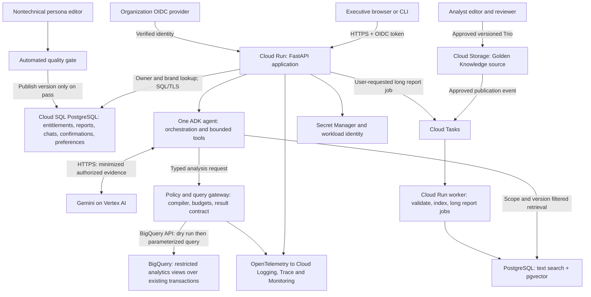
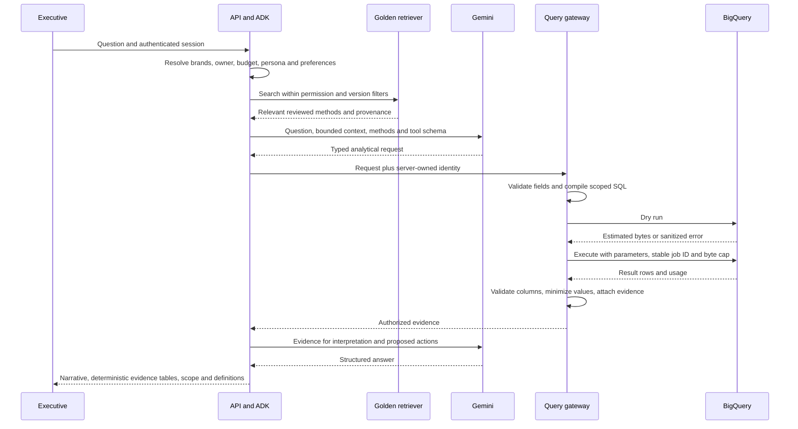
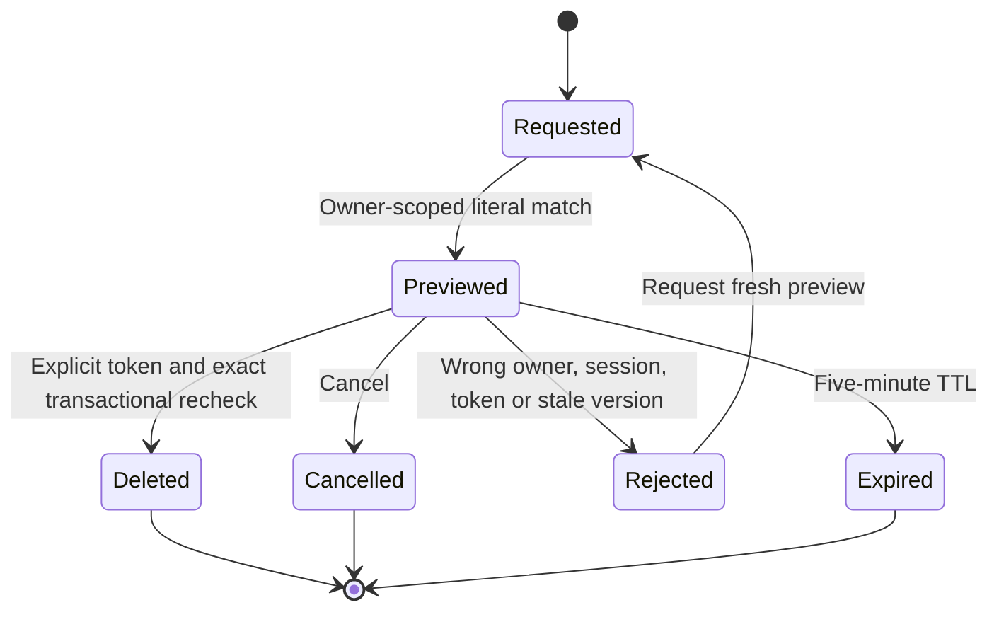

# Production high-level design

This document describes the production proposal. [Technical implementation](technical-design.md) and [requirement mapping](requirements.md) distinguish the working local prototype from design-only capabilities. The client expects about 100 active managers × 10 questions/day, 100 saved reports/day, a few concurrent users, and an existing transaction dataset growing by approximately 1M rows/day. Analysis is triggered by user requests; no transaction ingestion or scheduled analysis pipeline is in scope. Brand access-revocation lifecycle handling is also out of scope.

## Components and trust boundaries

An editable [draw.io source](diagrams/architecture.drawio) accompanies this diagram. The local prototype is a single process, local SQLite, Gemini Developer API, and BigQuery; it does not deploy these cloud services.

| Block | Choice and reason | Boundary / stored data |
|---|---|---|
| Application | Cloud Run with FastAPI and one ADK agent; scales for intermittent demand without a cluster | Verifies OIDC signature, issuer, audience and expiry; derives user and permissions outside prompts |
| Model | Gemini on Vertex AI for workload identity and organization policy; evaluate model version before promotion | Receives permitted analytical evidence and minimized conversation context; never raw customer contact fields |
| Analytics | BigQuery against the existing source; curated projections and restricted execution identities | Item-grain revenue, brand filtering before joins/aggregation, UTC periods, dry-run and billing bounds |
| Operational state | Cloud SQL PostgreSQL | ACID report deletion, ownership, confirmation token hashes, preferences, persona versions; backup/restore policy below |
| Knowledge | Versioned Cloud Storage trios plus pgvector and PostgreSQL text search | Human-reviewed analytical methods and reports; permission metadata, definitions and schema versions |
| Background work | Cloud Tasks and a Cloud Run worker | Event-driven indexing and explicitly requested long reports, with idempotency keys; no scheduled retail analyses |
| Secrets | Secret Manager and service-account workload identity | No keys in prompts, application logs, source, or browser |
| Diagnostics | OpenTelemetry and Cloud observability | Correlated spans, timings, usage, error taxonomy and restricted sanitized trace payloads |

Cloud SQL is a deliberate fixed-cost tradeoff for transactional deletion plus shared state and filtered retrieval; the tiny prototype uses SQLite instead. A separate vector service, Redis cache, Kubernetes, and multiple cooperating agents are unnecessary at this scale. Start Cloud Run with bounded concurrency and maximum instances; tune from load tests instead of claiming that a diagram establishes latency targets.

## Request flow

Authentication, result contracts and confirmation are application controls, independent of persona and model decisions. Treat questions, catalog values, retrieved documents and prior messages as untrusted data. Tool execution never accepts a user ID or role supplied by the model. Every tool checks its own authorization; hiding a tool in a prompt is not a security boundary.

In production, do not give the general orchestration service direct source-data credentials. A separate gateway identity can query only curated safe views. Restrict source dataset access to a data-owner identity, prohibit exports/UDFs/remote functions, and use row-level policies with per-scope execution identities or an equivalent identity-aware analytics tier. A shared service account and a `WHERE` clause alone do not provide database-enforced end-user isolation. The prototype uses the candidate's ADC against public data and enforces the typed compiler boundary in application code; it does not claim enterprise IAM isolation.

## Golden Knowledge and learning

There is no client-provided bucket. [Seed trios](golden-trios.json) are explicitly illustrative, with a [schema](golden-trio.schema.json). Each records question, SQL template and parameters, analyst report, definitions, permitted scope, schema version, provenance, review state and revision. Sample numbers are synthetic; they must never be reused as current facts.

Production lifecycle: an analyst drafts a Trio from a useful interaction; strip PII, verify SQL and numeric claims, replay it on an authorized fixture, assign metric/schema tags, then have a different reviewer approve it. Write the immutable version to Cloud Storage. A publication event queues idempotent indexing keyed by Trio ID and version. Only approved compatible versions become retrievable. Rejection, deprecation, deletion and reindexing events update the search index; retries are bounded and poison events go to a failure queue. Preserve provenance and a superseded-by reference.

At question time, filter by authorized brands, approval state, schema version and metric version BEFORE retrieving content. Combine keyword search (metric/brand/definition terminology) with vector similarity, rerank a bounded shortlist, and include at most three methods with provenance. A CEO's broader analytics scope does not grant access to private saved reports. Knowledge retrieval is over separately approved knowledge, not everyone's report library. A miss is recorded; ask for clarification or use explicit documented definitions, rather than inventing company policy. Always run fresh analytics; SQL/examples are data, not executable instructions. Retrieved methods cannot override the compiler or identity.

User preferences: store explicit presentation choices immediately per user (tables/bullets, detail, charts), show them in settings and support reset. Inferred preferences carry evidence, confidence and timestamps; suggest changes before applying persistent inferences. Preferences cannot suppress metric definitions, privacy controls or caveats. Production system improvement uses opt-in feedback, corrected plans and failure cohorts to propose new tests and trios. No autonomous prompt rewriting or automatic promotion of a model's own answers to trusted knowledge. Model/prompt/compiler releases pass offline fixtures, adversarial cases and a frozen holdout set before a small canary rollout. Compare quality, cost and latency; rollback on regression.

## Persona changes without deployment

A nontechnical editor changes constrained style settings or tone text in an authenticated admin UI. Store a draft version in PostgreSQL. Run an automated gate that verifies numeric and evidence preservation, privacy, required caveats, refusal behavior, prompt-injection resistance and representative UX examples. Deterministic checks are mandatory; model grading adds a semantic/style signal rather than deciding security alone. If any gate fails or the evaluation service is unavailable, retain the current published version and show the reason. On success, atomically advance the active-version pointer. Requests pin that version at their start; new requests pick up changes without deployment. Keep audit history and one-click rollback. There is no human approval step for persona publication. Golden Knowledge still has human editor/reviewer approval.

## Reports and deletion

Reports are private by creator, even for the CEO. Generation is separate from saving. The database stores structured answer/evidence, report ID, owner, conversation, version, creation time and retention metadata.

Store only a token hash and exact report ID/version snapshot. Confirmation must come through a separate application action, with CSRF protection in a web UI. Lock/recheck rows and consume the token in the same transaction as hard deletion; concurrent changes fail closed. Newly matching reports are not added. Purge dependent chat/cache copies, never report bodies in audit logs. The prototype clears affected conversation records and in-memory context after deletion; terminal scrollback cannot be recalled.

Retention: chats up to 90 days; reports until explicitly deleted; content-free audit events one year. Production purge jobs implement retention independently of analysis. No recovery window for deleted reports. Backups require a documented expiration policy and a durable deletion ledger applied before any restored service is made available; cryptographic erasure using per-report content keys can additionally prevent backup-content recovery. Cloud backup snapshots are not instantaneously rewritten. Do not promise instantaneous physical erasure of all historic media or user-exported copies. Final backup expiry SLA requires operational agreement.

## Resilience and cost

One request owns model-call, tool-attempt, query-byte, token and deadline budgets. Reserve conservative cost before work; defaults target $1 variable model/query cost, excluding fixed hosting. Rates are configurable and must be reviewed with model/region changes. Explicitly reject unaffordable work rather than silently escalating to a costly model. Use bounded output and result rows; no free-form Python, shell or arbitrary SQL tool.

Invalid requests get one repair opportunity; authorization is never repaired by broadening scope. Empty results trigger at most one diagnostic with the same scope/period and may be a valid answer. Transient model failures get one backoff retry under the original budget; no retries after partial response. Query submissions carry stable job IDs; recover the same job on uncertain submission instead of creating duplicate paid jobs. Deadline cancellation is best effort; the submitted byte cap still bounds server work. A circuit breaker prevents repeated provider calls during a sustained outage; explain degraded capability while keeping local library and confirmation actions available.

For long user-requested reports, persist an idempotent task with owner, scope and versions, enqueue it, return progress and an authenticated retrieval link. Workers enforce the same budgets and owner checks; task retries cannot duplicate report saves. Simple queries remain synchronous/streamed. Meet the 10–30 second simple / 1–2 minute report targets through measured workload tests, not optimistic defaults.

## Observability and quality

Track outcome and latency per question/tool/model/query; clarification/repair/empty/refusal rates; authorization denials; PII block counts; tokens, bytes, cache hits, budget rejections; save/deletion confirmation outcomes; retrieval hit/relevance/stale-version rates; feedback, numeric correctness and completion rate. Alert on provider error bursts, rising p95 latency, cost overruns, failed deletion transactions and privacy incidents. Separate expected policy denials from service failures.

Trace IDs connect session, request, model-call sequence, tool plan, query hash/job ID, evidence IDs and final response. Record model, compiler, metric, prompt, persona and knowledge versions. A restricted debugging view shows sanitized message/tool correspondence with redacted values and bounded retention; never expose chain-of-thought or raw sensitive payloads. Production observability exporters need explicit payload filtering. Prototype logs are content-free; durable answers contain the plan and evidence linked by trace ID, while the raw user prompt is not retained.

Before deployment, combine deterministic behavioral tests, synthetic numerical oracles, BigQuery dialect checks, live model task evaluations and human executive review. Evaluate intent satisfaction and factual correctness separately from fluent writing. UX checks cover scope visibility, asking the right clarification, understandable progress/failures, explicit save state, and whether users understand the deletion set. Run task-based sessions with representative nontechnical users, record completion/time/error/confidence, and revise wording. Small automated samples are not proof of production reliability; see [evaluation](evaluation.md).
