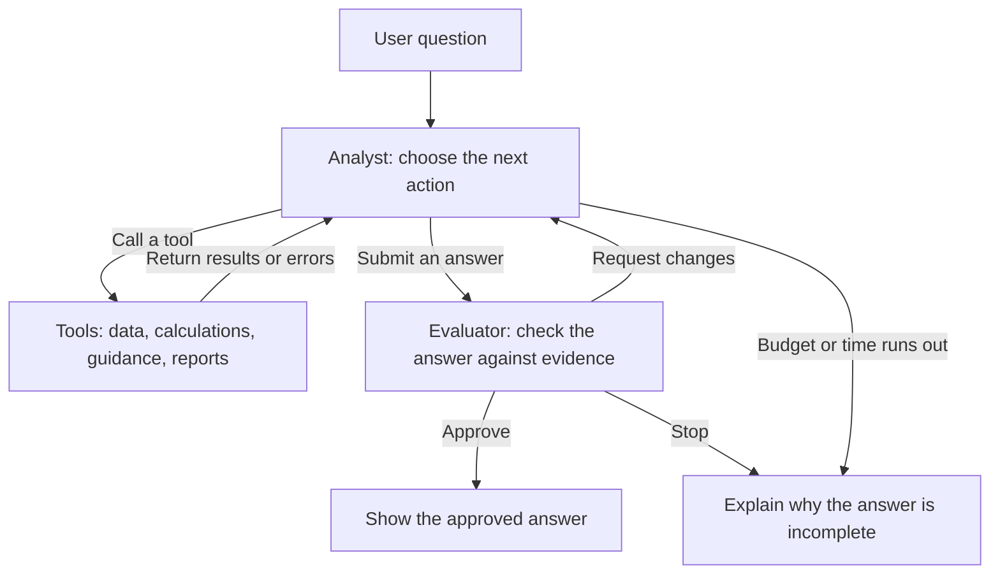

# Retail agent architecture

Updated: 21 November 2026.

## Overview

This is a Python command-line assistant for retail analysis. It uses Google ADK and Gemini to answer questions about TheLook data in BigQuery, handle follow-ups, and save reports when asked.

**The LLM decides how to investigate and explain an answer. Application code controls what data and actions it can access.** There are no predefined routes for individual business questions.

The sections below describe the current implementation. Unfinished production features are listed at the end. See the [client Q&A](task/q&a.md) for requirements and [Quick Start](../QUICK_START.md) for setup and commands.

## How a question is answered



1. **Start the question.** The app supplies the user's allowed brands, useful previous context, and a fresh budget.
2. **Investigate.** One ADK analyst chooses tools, reads results, and decides what to do next. It can write SQL, calculate from previous results, consult guidance, or ask for clarification.
3. **Submit an answer.** The analyst writes Markdown and calls `finish_answer`, identifying its supporting evidence. It chooses prose, lists, or tables to fit the request.
4. **Review.** A separate LLM evaluator checks whether the answer addresses the question, agrees with the evidence, and avoids unsupported explanations. It can approve, request specific changes, or stop. It cannot run tools.
5. **Respond.** Approved Markdown is displayed unchanged. Revision requests return to the same analyst loop, which can query again or rewrite its answer.

For example, finding no overlap between two product rankings supports a statement about those rankings. It does not establish that price caused the difference. The evaluator should request more evidence or a narrower explanation.

Every published assistant answer passes this review. Failures can end earlier with an application status message. Review reduces mistakes; it does not prove correctness.

A follow-up starts a fresh ADK session and budget, with bounded context from approved answers and previous result handles. Conversation state lives in memory and ends when the CLI exits.

## Tools

The [tool registry](../src/retail_agent/tools/registry.py) exposes these capabilities:

| Purpose | Tools |
|---|---|
| Understand and query data | `describe_data`, `query_data`, `query_state_summary` |
| Inspect and calculate from existing results | `read_result`, `analyze_results` |
| Read analytical guidance | `load_skill`, `load_skill_resource` |
| Find worked examples | `search_golden`, `read_golden` |
| Read saved reports or previous answers | `search_reports`, `read_report`, `read_answer` |
| Request report actions | `stage_report_save`, `preview_report_deletion`, `cancel_report_deletion` |
| Submit an answer for review | `finish_answer` |

Tools are small Python adapters in `tools/`. Their database and storage logic lives in `services/`. New questions can combine existing capabilities without adding a new workflow. New capabilities require a tool or service change.

## Skills and Golden examples

These give the model reusable guidance while leaving the next action to the analyst.

| Resource | What it contains | Location |
|---|---|---|
| Runtime skills | Instructions for rankings, comparisons, revenue changes, retention, report writing, and review | [`src/retail_agent/skills/`](../src/retail_agent/skills/README.md) |
| Golden examples | Worked question → SQL → answer examples | [`knowledge/golden/`](../knowledge/golden/README.md) |
| Evaluation cases | Test prompts, expected facts, and checks | [`evals/`](../evals/README.md) |

The analyst sees skill summaries and can load relevant instructions on demand. The evaluator always receives the review skill. Skills do not grant permissions or execute scripts.

The Golden bootstrap contains 11 synthetic examples and is enabled with `--golden-bootstrap`. Search uses SQLite full-text retrieval. The analyst may adapt or ignore an example, but must query current data for current facts. Synthetic examples are not company-approved reports. Evaluation answers stay outside the retrieval index.

## Data access

The analyst queries three allowed relations:

- **`sales`:** purchases excluding cancelled and returned items and orders.
- **`transactions`:** purchases across all statuses, for explicit alternative definitions.
- **`products`:** the product catalog, including unsold products.

The query service applies the user's brand scope before joins, histories, and aggregations. It accepts supported read-only SQL and rejects raw source-table access, writes, and prohibited columns. BigQuery queries receive a dry run and a maximum-byte limit. Calculations over local results run in a bounded DuckDB subprocess with external access disabled.

Revenue uses `sale_price`; orders and customers use distinct IDs. Dates use UTC and an inclusive start, exclusive end—for example, Q1 is `[2026-01-01, 2026-04-01)`. Current statuses cannot reconstruct past status changes.

Customer names, contact details, and individual geography are excluded from query results. Internal customer IDs are allowed. `query_state_summary` separately returns state aggregates with at least five distinct customers. The synthetic fixture has no geography.

Managers see assigned brands; the CEO can analyze all brands. These are local demo identities, not production authentication. TheLook is public data; the app's scope checks do not create private BigQuery permissions.

## Reports

Generating an answer does not save it. An explicit save request stages a report; after evaluation, application code writes the approved content and displays the actual receipt. Reports persist in local SQLite and belong only to their creator, including when the reader is the CEO.

Deletion requires an exact preview followed by the user's `/confirm TOKEN`. Code checks ownership, expiry, report versions, and whether the token was already used. The model cannot confirm deletion. Stale or cancelled previews delete nothing. Deletion removes the selected stored content and clears active application copies; separately exported files are outside that operation.

## Budgets and failures

**Every prompt gets its own allowance, including follow-ups.** Analyst work, evaluation, retries, and repairs share that prompt's limits.

Defaults in [`config.py`](../src/retail_agent/config.py) are $1, 120 seconds, 12 model calls, 8 queries, and 24 tool calls. The app reserves 30 seconds and capacity for review.

Before a model call, the app temporarily reserves enough allowance for its estimated input and maximum output. When complete token usage arrives, it accounts for the reported input, output, and thinking tokens at configured rates and releases the unused amount. Unknown usage keeps its reservation. Queries keep conservative maximum-byte reservations. These are budget estimates, not provider invoices.

Recoverable errors return to the analyst for repair within the same limits. If review cannot finish, the app explains the incomplete outcome; `/details` shows completed evidence. The CLI displays elapsed time and current activity. Diagnostic traces record timings, usage, and outcomes without raw questions, result contents, credentials, or hidden reasoning.

## Code layout

| Location | Responsibility |
|---|---|
| `src/retail_agent/cli.py`, `terminal.py` | Chat, slash-command menu, progress, and Markdown display |
| `runtime.py`, `turn.py` | Analyst loop, conversation context, and per-question state |
| `reviewer.py`, `prompts/` | Evaluation and base model instructions |
| `tools/`, `services/` | Model-facing capabilities and their implementations |
| `skills/` | Runtime guidance and its loader |
| `budget.py`, `provider.py` | Limits, model calls, retries, and usage accounting |
| `config.py`, `contracts.py`, `privacy.py` | Settings, shared data types, and privacy checks |
| `knowledge/` | Golden examples and synthetic data |
| `tests/`, `evals/` | Automated checks and recorded model evaluations |
| `docs/task/` | Original task material |

Python module paths above are relative to `src/retail_agent/` unless otherwise shown. Coding-assistant skills in `.agents/skills/` are separate from the app's runtime skills.

## Testing

Offline tests cover calculations, data scope, report ownership and deletion, budgets, the tool loop, and CLI behavior. They use controlled fixtures and fake providers. Run them with:

```bash
uv run --locked pytest
```

[Live evaluation instructions and captures](../evals/rewrite/runs/README.md) show actual model behavior. Check the answer against its SQL results and the request; evaluator approval alone is not a passing test. Small recorded runs do not establish production reliability or latency guarantees.

## What is not implemented

Production authentication, a hosted service, managed storage and monitoring, and cross-restart chat recovery remain future work. So do a Golden-example publishing UI, persistent preference learning, and a nontechnical persona editor with an automatic quality gate.

A production deployment can reuse this loop inside an authenticated service, with private controlled data access, owner-scoped report storage, and managed logs. It would need the retention rules and operational targets in the [client Q&A](task/q&a.md). The current local CLI is not that deployment.
