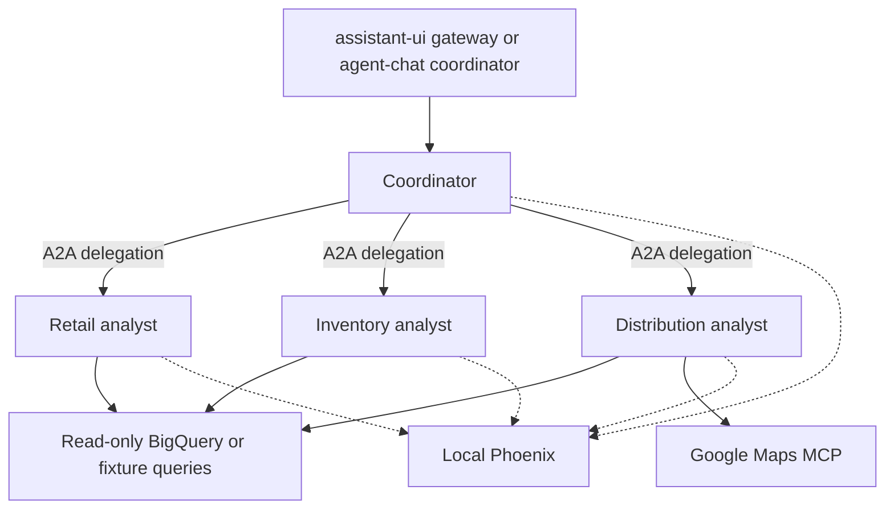
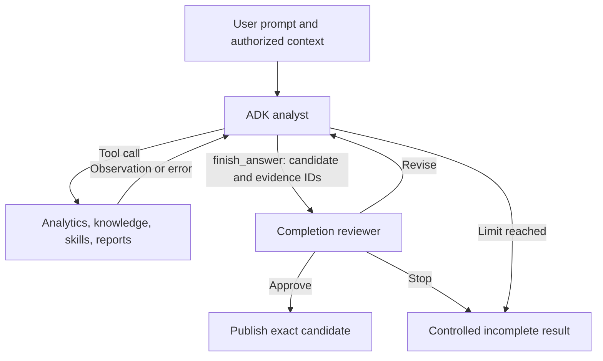
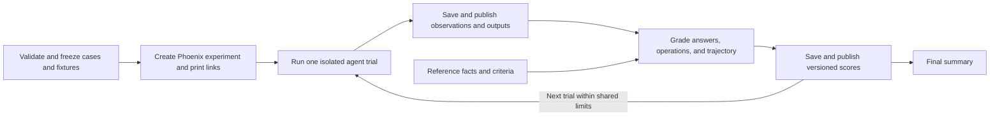

# Retail agent architecture

Updated: 2026-11-25.

## Scope

The application provides a retail-analysis CLI and a local A2A system with retail, inventory, distribution and coordinator agents. Each uses Google ADK and Gemini to select tools, investigate results and compose answers. Application code enforces authorization, execution limits and publication contracts; business questions have no predefined workflows.

This document describes the current implementation. Setup and commands are in [Quick Start](../QUICK_START.md) and the [local stack guide](../infra/agents/README.md).

## Local A2A system



[`src/retail_insight/a2a/server.py`](../src/retail_insight/a2a/server.py) exposes the complete reviewed runtime through A2A 1.0 JSON-RPC and HTTP+JSON (SDK 1.3.1), with Agent Cards at `/.well-known/agent-card.json`. The four Docker targets produce separate service images. The coordinator chooses approved specialists through `list_agents` and `delegate`; it can revisit a specialist and combine observations. Specialists do not delegate recursively. Each agent retains the analyst/reviewer completion protocol below.

| Role | Data and capabilities |
|---|---|
| Retail | All-brand sales, customer, order, product and report tools |
| Inventory | All-brand inventory records, modeled unsold units, recorded cost and stock age |
| Distribution | All-brand center attribution, facility metadata, stock reconciliation and optional Maps observations |
| Coordinator | Specialist delegation, evidence reconciliation, result calculations and combined reports; no direct warehouse queries |

Each role has its own `agent.py`, `tools.py`, `prompt.md` and `skills/` under [`src/retail_insight/agents/`](../src/retail_insight/agents/). The [agent registry](../src/retail_insight/agents/registry.py) selects an explicit agent implementation; the shared runtime contains the ADK execution loop. Inventory and distribution use read-only logical relations over `inventory_items`, `products` and `distribution_centers`. Modeled unsold stock at T requires `created_at <= T` and an absent or later `sold_at`; it does not prove physical availability or reservations. Cost is not revenue or profit. Unknown centers remain explicit, and customer geography is not exposed. Warehouse snapshots and business cutoffs are distinct values.

Distribution and the coordinator may reproduce public facility coordinate pairs supported by direct `centers` column observations. The exception follows matching scope, cutoff and specialist provenance through tool results, model requests and completion review. Invented coordinates, customer contact information and unrelated result fields retain the default privacy checks.

Google Maps is the only external MCP integration. Distribution discovers allowlisted route/weather tools from the managed endpoint through the MCP client. Credentials stay outside prompts. Missing credentials or failed lookups return explicit unavailable observations; coordinates alone do not establish road travel time, truck feasibility or delivery commitments. Maps content and derived answers are ephemeral: persisted records retain provenance, and later requests must fetch fresh observations. Live Maps access has not been verified without a configured key.

A shared approved [catalog](../infra/agents/catalog.json) supplies endpoints to the coordinator and Inspector. Short-lived HMAC-signed transport requests bind the local workspace and destination audience. The GUI authenticates through a loopback gateway; its Bearer access token is supplied server-side only to approved agents. There is no selectable persona or brand authorization map. All agents can analyze all brands through their existing role capabilities; requested brand filters are analytical conditions. Each service persists owned tasks and conversation context in its own SQLite volume. This extends persistence beyond the legacy CLI's in-memory conversation; interrupted work is not automatically resumed after a process restart.

Persistent tasks, cached requests, conversation context, reports and diagnostic events share a source-specific directory, `/data/<backend>/<source-profile>/`. `retail-stack up` derives the profile from the `workspace-all-brands-v1` access mode, backend, warehouse source dataset and, for fixtures, both source-file hashes. The access-mode change starts fresh conversation context; old persona-specific profiles and report ownership remain stored without reassignment or merging. Normal fixtures, evaluation fixtures and BigQuery retain separate histories; returning to an identical profile restores its state. Existing images require rebuilding to adopt this layout, and legacy top-level data is not migrated automatically. Direct server/Compose launches must configure the profile explicitly to isolate same-backend source changes. This storage boundary does not freeze live data: each conversation separately fixes its business cutoff and optional warehouse snapshot.

Every user prompt has a fresh budget shared with its reviews and delegated work. Child grants are reserved before dispatch, reported usage settles them once, and unknown usage retains its reservation. Delegations are bounded to two concurrent children. Transport propagates OpenTelemetry context to the `retail-multi-agent` Phoenix project. A2A streaming reports task events; it does not promise token-by-token answer streaming.

The [Compose stack](../infra/agents/README.md) serves assistant-ui at `http://localhost:8080` and reuses Phoenix on port 6006. A React frontend uses the native assistant-ui A2A runtime. The Python gateway serves assets, an allowlisted four-agent catalog, streamed A2A requests, and browser-owned conversation history. Workspace credentials remain server-side. Agent selection fixes the target service; the coordinator still decides specialist delegation. The UI renders reviewed answer artifacts rather than raw query results. Agent instructions and the review rubric keep internal evidence labels such as `[E1]` out of answer Markdown; supporting IDs remain in structured evidence and Run details. Markdown tables support copy and CSV export. Stop requests reach the running A2A task.

GUI conversations persist in a separate SQLite volume, isolated by browser cookie, agent and source profile. The same context ID accompanies follow-ups and reloads. Maps-derived responses are redacted before history persistence. Clearing browser cookies loses access to that browser's GUI history. Agent task/context volumes remain unchanged; legacy 0.3 task rows are converted on read without rewriting the originals. Inspector remains available on port 8081 when started with `--inspector`. See the [migration checklist](plans/A2A_ASSISTANT_UI.md).

## Runtime and completion protocol



[`Analyst.ask`](../src/retail_insight/runtime/analyst.py) creates an ADK `LlmAgent`, `Runner`, and in-memory session for each prompt. The initial context records all-brand access, the UTC instant and date, prior answer handles, result counts, and skill summaries. The reviewer receives the same trusted clock source to validate as-of reporting independently of source timestamps. Follow-ups reuse application context with a new ADK session and budget; conversation state does not survive CLI restarts.

The analyst executes an iterative tool loop and submits Markdown through `finish_answer`, referencing supporting evidence. It selects prose, lists, or tables according to the request.

[`reviewer.evaluate`](../src/retail_insight/review/reviewer.py) invokes a separate, tool-free `LlmAgent` with the candidate and evidence. Its structured decision covers task coverage, grounding, metrics, presentation, and operations:

- **Approve:** publish the exact candidate.
- **Revise:** return findings to the existing analyst loop for further queries or edits.
- **Stop:** terminate with an incomplete status.

All published analytical answers require approval. Input rejection, provider failure, and exhausted limits may produce application status messages without review. Reviewer approval is a quality control, not an independent correctness guarantee.

## Tool interface

The retail [tool registration](../src/retail_insight/agents/retail/tools.py) exposes composable capabilities:

| Capability | Tools |
|---|---|
| Data discovery and queries | `describe_data`, `query_data`, `query_state_summary` |
| Result inspection and calculation | `read_result`, `analyze_results` |
| Runtime guidance | `load_skill`, `load_skill_resource` |
| Conversation context | `read_context` |
| Report and answer retrieval | `search_reports`, `read_report`, `read_answer` |
| Report operations | `stage_report_save`, `preview_report_deletion`, `cancel_report_deletion` |
| Reviewed completion | `finish_answer` |

Each agent registers its capabilities in `agents/<role>/tools.py`. Shared adapters in `tools/` expose model-facing schemas; `integrations/` implements warehouse, storage, Maps MCP and Phoenix access. The coordinator owns its delegation tools, and distribution owns its Maps tools. New analytical questions can compose existing tools; additional capabilities require implementation changes.

Report retrieval, deletion previews and cancellations register their actual observations as
typed evidence. The analyst can submit those evidence handles to the reviewer without a
warehouse query. Historical report contents do not become current business facts, and private
deletion confirmation tokens are excluded from model-visible observations.

## Skills and evaluation assets

| Resource | Role | Location |
|---|---|---|
| Skills | Analytical and writing procedures, loaded on demand | Agent `skills/` directories, shared `runtime/skills/library/`, and `review/skills/`; [authoring guide](../src/retail_insight/runtime/skills/README.md) |
| Evaluation references | Frozen cases, criteria, numeric facts, and fixtures; never supplied to the analyst | [`evaluation/datasets/`](../evaluation/datasets/README.md) |
| Authored conversations | 20 fixed questions and follow-ups, with acceptance criteria kept outside agent context | [`evaluation/scenarios/`](../evaluation/scenarios/README.md) |
| Judge calibration | Labeled candidate answers for testing the independent evaluator | `evaluation/datasets/judge_calibration/` |

Runtime example retrieval has been removed. The analyst receives skill metadata and selects relevant instructions. The reviewer always receives the analytical-review skill. Skills neither execute scripts nor grant permissions.

## Data and authorization

The query gateway exposes three logical relations:

| Relation | Semantics |
|---|---|
| `sales` | Purchases excluding Cancelled/Returned at both item and order levels |
| `transactions` | Purchases across all statuses for explicit alternative definitions |
| `products` | Product catalog, including unsold products |

Production agent gateways cover all brands. A requested brand is an explicit SQL filter and must be preserved through joins, customer histories, follow-ups and specialist delegation. Low-level optional reference filters remain available for independent evaluation calculations; they do not assign user permissions. The gateway accepts supported read-only SQL and rejects raw source access, writes, and prohibited columns. BigQuery execution requires a dry run and byte limit. Local result calculations use a bounded DuckDB subprocess with external access disabled.

Metric contracts:

- Revenue sums `sale_price`; order and customer counts use distinct IDs.
- UTC periods use half-open intervals, such as `[2026-01-01, 2026-04-01)` for Q1.
- Current statuses cannot reconstruct historical status transitions.
- Customer names, contact details, and individual geography are excluded; internal customer IDs are permitted.
- `query_state_summary` exposes state aggregates only for groups with at least five distinct customers. The synthetic fixture contains no geography.

The former demo users and assigned-brand permissions have been removed. New sessions use one local workspace with full dataset brand access. This does not grant write operations, expose prohibited customer fields, enable unconfigured Maps access or change the specialist tool sets. The coordinator obtains warehouse evidence through delegation. Service authentication remains in place; production deployment still requires appropriate identity management and BigQuery IAM.

## Report lifecycle

Reports are saved only on explicit request. `stage_report_save` records intent; `finish_answer` persists approved content to local SQLite after review and save authorization, then returns an operation receipt. Delegated turns cannot stage or commit saves, preview deletions or cancel report operations, even if a model requests them. The agent handling the human request owns report writes. Storage remains isolated by report owner. New CLI and GUI sessions use `workspace`; existing reports under earlier owners remain intact and are not reassigned or merged.

All four agents and the runtime reviewer load `runtime/trust_policy.md`. Repository instructions stay in ADK's instruction field. The initial user message carries the current task, original human request, runtime-assigned origin and operation permissions, plus application metadata, skill summaries and prior answer handles. Prior text and evidence descriptions are retrieved through `read_context`; full artifacts use `read_result` or `read_answer`. Tool responses include application-assigned provenance and remain observations, regardless of embedded instructions or prior approval.

A2A handoffs carry a bounded, schema-validated delegation envelope separately from task text. The runtime supplies the original human request and selected evidence; these are not model-callable authorization arguments. The receiving service rejects handoffs made with a user bearer token, incomplete parent/delegation metadata and unknown envelope fields. Evidence receives local IDs with forwarding provenance and is exposed through tools. The original request and write restrictions also reach the reviewer. Direct human turns retain existing reviewed save behavior; delegated turns are read-only with respect to reports.

These boundaries limit instruction confusion and delegated side effects; JSON, provenance labels and reviewer approval do not guarantee model resistance to prompt injection. Service authentication trusts application code holding the shared signing secret, not arbitrary remote agents. Direct human save intent still requires semantic review. Offline adversarial tests exercise real ADK tool dispatch and A2A transport with scripted model attacks; they verify enforced boundaries, not a measured live-model attack success rate.

Deletion requires an exact preview and the user's `/confirm TOKEN`, handled outside the model loop. Validation checks ownership, expiry, report versions, and token reuse. Stale or cancelled previews cannot delete data. Deletion removes selected stored content and clears the current conversation's in-memory context; other CLI sessions and external exports are outside its scope.

## Execution limits and observability

Each prompt receives an independent budget. Analyst calls, runtime review, retries, and repairs share that prompt's allowance.

Defaults in [`config.py`](../src/retail_insight/config.py): $1, 120 seconds, 12 model calls, 8 queries, and 24 tool calls, with 30 seconds and execution capacity reserved for review.

Model calls reserve estimated input and maximum output cost. Complete usage settles input, output, and thinking tokens at configured rates, releasing unused reservations. Unknown usage retains its reservation; query reservations remain conservative at the maximum-byte allowance. These values are estimates, not provider invoices.

Recoverable errors return to the analyst within the same limits. Exhaustion produces an incomplete status; `/details` exposes completed evidence. The CLI updates elapsed time and activity independently. Metadata-only diagnostics record timing, usage, and outcomes without raw prompts, result contents, credentials, or hidden reasoning.

`--phoenix` on `chat` or `ask` enables local OpenTelemetry tracing. Each prompt has a separate root span and turn ID; a stable session ID links follow-ups. Analyst and reviewer provider attempts report usage once, while the budget ledger remains authoritative. Automatic ADK payloads are hidden, and an exporter allowlist also strips exception details and arbitrary attributes. Trace failures are nonfatal; shutdown waits at most two seconds.

Synthetic evaluation capture is a separate opt-in observer. It records initial context, actual tool responses, candidates entering review, review decisions, and final outcomes. Capture removes credentials, hidden thoughts, and deletion tokens. Analyst-visible result previews are kept distinct from the full evidence bundle available to the reviewer. An injected UTC clock freezes prompt dates, report timestamps, and SQL clock expressions; monotonic deadlines remain real. Trusted physical BigQuery datasets can be configured outside tool arguments for snapshot evaluation.

Phoenix runs locally at `http://127.0.0.1:6006` with persistent SQLite storage. The [Compose configuration](../infra/phoenix/README.md) disables automatic telemetry and external-resource fetching. Synthetic traces may include evaluation content; normal chat remains metadata-only.

The exporter derives Phoenix Input/Output previews from explicit sanitized application events.
In synthetic evaluations, judge spans include System/User messages, the specialized response
schema and generation parameters, and the full visible model response. Summaries and validation
diagnostics remain in metadata. Sanitized requests/responses and exact span IDs are also saved
in `judge_calls.json`; automatic ADK payloads and hidden reasoning remain excluded.
Evaluation context labels identify run, scenario, turn, and phase without entering model context.
Runtime and judge spans expose standard execution statuses; quality verdicts remain separate.
Provider/judge token counts and configured-rate estimates are recorded only when usage is known.
Phoenix's native cost display uses its own registered pricing and span filters; root spans do
not duplicate child model costs. Metadata-only tracing continues to omit business content.

Prompt definitions are shared between inference and Phoenix publication through
`src/retail_insight/runtime/prompts.py` and `evaluation/prompt_catalog.py`. Git remains the source
of instructions. Evaluation startup publishes the analyst, reviewer (including its mandatory
review skill), answer judge and trajectory judge to Phoenix Prompts. Normal CLI and manual
tracing publish the two runtime definitions. Content hashes prevent duplicate versions and
associate provider/judge calls with the exact synchronized definition. `prompts.json` records
version IDs alongside run artifacts. `retail-eval sync-prompts` publishes without inference.
Playground edits do not alter the application; adopting a change requires updating the repository.
Playground tests prompt variants but does not run the application's ADK tools or attribution checks.

## Modules

All application code lives in `src/retail_insight/`:

```text
retail_insight/
├── agents/
│   ├── retail/
│   ├── inventory/
│   ├── distribution/
│   ├── coordinator/
│   └── registry.py
├── runtime/
├── review/
├── tools/
├── integrations/
├── a2a/
├── interfaces/
├── config.py
└── contracts.py
```

| Location | Responsibility |
|---|---|
| `agents/<role>/agent.py` | Agent-specific composition and runtime configuration |
| `agents/<role>/tools.py`, `prompt.md`, `skills/` | Capabilities, instructions and analytical methods owned by that agent |
| `agents/registry.py` | Construct the requested agent for the A2A service |
| `runtime/analyst.py`, `service.py`, `turn.py` | Shared ADK loop, persistent-service support and per-question state |
| `runtime/budget.py`, `provider.py` | Execution limits, provider retries and usage settlement |
| `runtime/skills/` | Shared skill loader and reusable guidance |
| `review/` | Completion tool, reviewer, review prompt and mandatory rubric |
| `tools/` | Reusable analytics, knowledge, skill and report tools |
| `integrations/` | Scoped BigQuery, local storage, Maps MCP and Phoenix adapters |
| `a2a/` | Server, client, authentication and persistent task storage |
| `interfaces/` | Standalone CLI, stack commands, terminal rendering and GUI gateway |
| `config.py`, `contracts.py` | Configuration and shared data contracts |

Each agent owns its definition while reusing the same reviewed execution loop. The four Docker services select their agent through the registry; separate deployments do not require duplicated runtimes. `retail-agent`, `retail-stack` and `retail-eval` keep their existing command names.

Local demo data lives in `src/retail_insight/integrations/bigquery/`; agents obtain current answers through their data tools. `evaluation/` contains the independent evaluation system; `tests/` contains deterministic contracts and integration tests. Evaluation references remain outside the application package and agent images.

## Independent evaluation

Status: the end-to-end evaluation runner, incremental local Phoenix publication, answer and trajectory graders, synthetic references, and offline test suite are implemented. Pilot references still require human review; judge calibration and a sealed holdout have not been approved. Code-only results do not establish semantic correctness or production reliability.

The main Phoenix workspace retains the retail 20-conversation dataset and its shared trace
project, `retail-conversations-20`. The latest recorded retail baseline produced 37 PASS and
three ERROR answer grades, plus two unresolved trajectory checks. Historical local captures
remain available; the [evaluation guide](evaluation.md) records the workspace reset and exact
baseline artifacts. New inventory, distribution and coordinator suites have separate datasets
and use `retail-multi-agent` for traces.
`retail-eval run-conversations` captures independent reference rows and pins every agent/reference
source table to the same BigQuery timestamp. It publishes numerical, grounding, completion,
operation, and trajectory scores after each conversation. Reference facts for both turns live in
versioned dataset Output; observed answers live in experiment results. Conditional follow-ups bind
to the entities actually shown initially, including valid alternative ties.
`evaluation/runners/authored.py` coordinates capture, grading, and publication;
`conversation_references.py` defines independent facts; `graders/conversations.py` grades the two
turns; `reporting/conversation_experiment.py` publishes incremental results.
`publish-conversations` preserves historical assistant reviews without relabeling them as
automatic grades or overwriting their dataset versions.

The older 43-case controlled pilot below uses a separate Phoenix instance, such as port 6007.
Pilot publication rejects the main port 6006 endpoint. Collector tests require an explicit
disposable endpoint; the SDK pytest plugin is disabled to prevent automatic test datasets.

The runtime reviewer and offline evaluator have different responsibilities. The reviewer can request corrections before publication. The offline evaluator assesses saved executions independently, using references the analyst never sees.



- **Execution:** each repetition gets isolated report storage and conversation state. Follow-up steps share only their case's context. Trial artifacts freeze fixture, dataset, runtime, prompt, dependency, and configuration hashes. Each prompt retains its own budget; one experiment cost ceiling and deadline cover execution and independent grading. `retail-eval run` validates the selected cases, checks or starts local Phoenix, creates the experiment, and prints links before model calls.
- **Ground truth:** independent Python arithmetic derives expected facts from synthetic fixtures. Numeric checks bind values to entity, metric, period, and scope; SQL text and number occurrence alone are insufficient.
- **Grounding:** a separate structured judge labels material claims against the observations actually available to the analyst. References support correctness checks but do not substitute for observed evidence. Unsupported explanations and causal claims can fail even when the reported numbers are correct.
- **Trajectory:** a separate structured judge evaluates captured tool availability, calls, results, review feedback, and subsequent actions. Event-bound findings assess selection, argument use, evidence use, recovery, and progress without requiring one tool sequence. These scores are diagnostic and do not alter task success; human calibration remains pending.
- **Operations and safety:** deterministic checks inspect report ownership, saved content, deletion receipts, final state, output format, and execution boundaries. Adversarial cases cover scope requests, injected instructions, and recovery.
- **Regrading:** grading reads saved trials without running the agent again. New grader versions append results. Scores retain `PASS`, `FAIL`, `ERROR`, `UNJUDGEABLE`, and `NOT_APPLICABLE`; missing judgment is not a pass. Candidate grades can expose false approvals by the runtime reviewer.
- **Reporting:** repeated-trial summaries include task success, claim support and coverage, cost, latency, observed reliability, and separate trajectory results. Phoenix receives each completed trial and its scores incrementally. Startup must succeed before model calls; later publication failures preserve canonical local artifacts and can be retried without repeating execution or grading.

See [Testing and evaluation](evaluation.md) for offline checks, live runs, grading, and Phoenix commands. The [rebuild plan](plans/EVALUATION_REBUILD_PLAN.md) and [review](plans/EVALUATION_REVIEW.md) retain the rollout and acceptance criteria.

Outstanding production work includes real identity and authorization infrastructure, managed storage, automatic recovery of interrupted tasks, operational retention policies, and validated release thresholds. Synthetic tests and a mandatory reviewer reduce specific failure modes; they do not guarantee absence of hallucinations.
