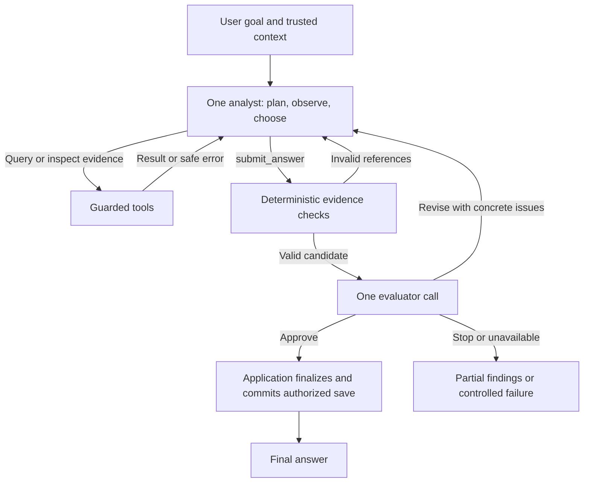

# Autonomous retail analyst: single-loop architecture

**Superseded for future implementation by the [from-scratch replacement plan](from-scratch-agent-plan.md).** This document records the retired prototype's incremental design; its source is preserved in `legacy/runtime-2026-11-20/`. Its numeric-reference contract and automatic evidence presentation are not the target of the rewrite.

**Updated: 19 November 2026.** This replaces the earlier proposal for separate Planner, Executor and Evaluator agents with nested loops.

The active design has **one main analyst agent**. Planning, tool selection, observation and revision happen inside its ADK tool-use loop. Evaluation is a tool-free review call invoked when the agent submits a candidate. Rejected candidates return feedback to that same agent; approved candidates are finalized by application code.

## 1. Control flow

There is one autonomous decision-maker and one ongoing tool conversation. A separate review call does not create a separate agentic loop. The evaluator cannot choose tools, run SQL, modify identity, or save reports. The main agent cannot bypass evaluation by emitting plain final text.

## 2. Responsibilities

| Component | Responsibility |
|---|---|
| Main agent | Interpret the question, maintain a working plan, choose queries, inspect observations, revise strategy, and submit a candidate |
| Tools | Validate arguments, enforce scope, execute bounded work, return evidence or safe errors |
| Evaluator | Check the candidate against the original question, history, query evidence and pending operation; return approve/revise/stop |
| Application | Own identity, budgets, context, termination, artifact metadata and final save transaction |
| CLI | Retain deterministic library commands and exact deletion confirmation |

All natural-language submissions are reviewed, including help/clarification. This keeps a model-authored “help” classification from bypassing the answer boundary. Slash commands bypass the models and retain code-owned authorization and validation.

## 3. Example of an adaptive investigation

For “Why did inactivity increase last month?”:

1. The agent queries comparable snapshots with eligible and inactive counts.
2. It inspects whether the premise is true. If there is no increase, it prepares a correction rather than inventing causes.
3. If there is an increase, it chooses a breakdown based on those results, such as acquisition cohorts.
4. It submits a candidate with evidence references.
5. The evaluator may identify an omitted denominator comparison. That issue becomes the next tool observation in the same conversation.
6. The agent obtains the missing comparison or corrects its explanation, then resubmits.
7. Approval ends the loop. Shared limits or unavailable evidence end it with an explicit limitation or partial result.

The exact investigation is not a Python template. Changed observations can change the next query. Ordinary transport retries are separate from these model-directed decisions.

## 4. Runtime contracts

`QueryEvidence` records ID, SQL, purpose, definitions, scope, rows, job/hash/bytes, timestamp and optional parent evidence IDs. Queries and deterministic selections register evidence before it enters a candidate. A timestamp describes query execution, not guaranteed upstream freshness.

`Evaluation` has `decision: approve | revise | stop`, bounded actionable issues, and independent save-authorization fields. Approval must have no issues; nonapproval must explain a correction or blocker. Unknown/malformed review output cannot approve an answer.

`Answer` keeps `quality_status` for compatibility and adds `evaluation_status: not_reviewed | approved | incomplete` plus `artifact_version`. Old stored reports remain readable. Semantic approval is a model judgment; it is not a guarantee of numerical or causal correctness.

No model can set trusted identity, confirmation authorization, query credentials, spent budget or actual operation receipts. Analyst-declared query definitions remain claims to be checked against SQL and evidence.

## 5. Tool surface

| Tool | Use |
|---|---|
| `describe_data` | Discover virtual schema, definitions and limits |
| `run_analysis` | Compose SQL over scoped sales, transactions and products; observe results before choosing another query |
| `read_result` | Reuse existing bounded evidence |
| `select_result` | Select/reorder rows and columns within the previous population; record provenance |
| `analyze_states` | Aggregate-only geographic analysis with code-owned cohort suppression |
| `search_reports`, `read_report` | Owner-only library access |
| `save_report` | Stage an explicit save proposal without writing |
| `preview_deletion`, `cancel_deletion` | Prepare/cancel an exact preview; no hard-delete tool |
| `submit_answer` | Check references and request review; return feedback or approval |

Measured prose values use registered cell references. Code renders those values and selected tables; semantic review checks whether the claim is actually supported. ISO dates, years and quarter labels can appear directly. Grouped citations and list ordinals are normalized, and exact source labels can contain digits. The remaining digit check is conservative and can still reject valid prose formatting; it is only one grounding check, not proof of truth.

## 6. Data and mutation boundaries

The SQL compiler admits one supported read-only query, resolves nested relations/columns, and substitutes code-owned scoped sources before joins, histories and aggregates. Prohibited source columns, raw paths, external functions and model parameters are unavailable. BigQuery dry runs, maximum bytes billed and bounded scalar results remain mandatory.

State demographics use a separate aggregate query. Customer IDs may appear in nongeographic analysis; contact details and individual location associations may not. The existing input pattern filter is not comprehensive name/address recognition; its limitations remain documented.

Natural-language saving is staged, independently reviewed against the user's original message, and committed after approval. The exact authorization quote must exist in that message. Interpretation is still probabilistic; deterministic `/save TITLE` remains available. Rejection and additional investigation do not commit drafts or duplicate writes.

Only `/confirm TOKEN` can permanently delete the exact previewed owner-scoped report versions. An evaluator approval is never deletion authorization. Report transactions, expiry/replay checks, chat-copy purging and context clearing remain in application code.

## 7. Limits and failure behavior

One turn owns all analyst/reviewer/provider attempts, queries, cost reservations and elapsed time. Defaults are eight model attempts, six query attempts, twenty tool calls, three distinct reviewed candidates, a USD 1 reservation cap and 120 seconds. Default low thinking effort, 4,096 actor output tokens and zero fixed pacing reduce interactive latency. The agent receives its remaining allowance on every call; the CLI shows progress and elapsed time. The actor leaves one call slot for review; actual review cost is checked before dispatch. No budget exhaustion is interpreted as approval.

Only one tool call per model response is accepted. Identical successful queries in a turn reuse evidence; identical rejected candidates stop as no progress. Revised wording alone can be useful when it removes an unsupported claim, but distinct revisions remain capped.

Review failure, invalid review output, stop decisions and exhausted limits preserve completed evidence with `evaluation_status=incomplete`. Without evidence, return a controlled error. Raw final model prose cannot escape the review boundary. Saving does not occur on these failure paths.

## 8. Code migration implemented

| Previous approach | Current approach |
|---|---|
| Fixed `TurnPlan` and `execution_requests` | Main agent dynamically chooses analytical tools |
| Tool-free final narrator | Tool-enabled analyst submits an evidence-bound candidate |
| Completion tool directly saves and exits | `submit_answer` reviews; application finalizes metadata and saves afterward |
| Separate Planner/replanning proposal | Working-plan revision inside the same agent conversation |
| Reference validation alone | Reference checks plus tool-free semantic review |
| Typed fixed analytical outputs | Scoped composable SQL and bounded result selection |
| No explicit review status on stored answer | Versioned artifacts with approval/incomplete status |

The active path is `cli.py → agent.py → tools.py`, with `evaluator.py` called by submission. No alternate production runtime is selectable. Existing fixed-plan helpers remain for legacy report models, old standalone regressions and historical scripts; they are not called to control the active agent.

## 9. Acceptance and remaining work

Offline acceptance covers real ADK dispatch with a scripted provider, result-dependent next actions, evaluator rejection followed by new evidence, invalid-reference repair, no-progress termination, shared model accounting, privacy canaries, owner-scoped persistence and deterministic confirmation. SQL fixtures independently cover cohort calculations, histories, status overrides and nested admission attacks.

The scripted provider establishes application control flow, not the live model's ability to reason. Opt-in Gemini/BigQuery tests remain necessary to assess live SQL generation, answer quality and latency under the configured account's quota. Historical captured successes must not be reported as new-runtime results. New live smoke results and the reported latency regression are documented in [the dated test record](../evals/single-loop-live/README.md).

Future improvements should be driven by measured failures: richer result transformations, more expressive scalar SQL support, better ingress PII detection, durable sessions, and calibration of evaluator false positives/negatives. A separate Planner agent or nested orchestration is not a prerequisite.

For current commands, behavior, and limitations, see [technical reasoning](technical_reasoning.md), [Quick Start](../QUICK_START.md), and [production architecture](architecture.md). Production Golden Knowledge, persona publication, SSO and background jobs retain their confirmed scope; this refactor adds no cron-based retail analysis or access-revocation lifecycle.
