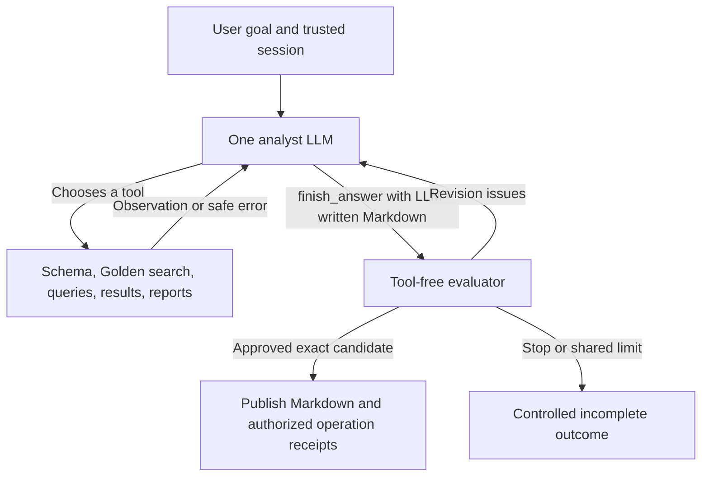

# From-scratch retail agent: research and replacement plan

Date: 20 November 2026. Status: **implemented and cut over to the canonical package; live observations and remaining limitations are recorded in [rewrite-test-observations.md](rewrite-test-observations.md)**.

This plan supersedes the incremental approach in [autonomous-agent-refactor.md](autonomous-agent-refactor.md). Build a new application in an isolated project, then replace the current runtime after acceptance. The current implementation is a source of requirements, failure cases and migration data, not the foundation of the new agent.

The product contract is explicit: **one autonomous investigation loop, an evaluator at completion, useful composable tools, working Golden Knowledge retrieval, and answers written by the LLM. The LLM chooses whether a table helps, what goes in it, and how to explain the result.**

## 1. What the research supports

The following are primary sources consulted for this plan. The decisions in the right column are our application design choices, not claims that a framework implements the complete system automatically.

| Source | Relevant guidance and application decision |
|---|---|
| [Anthropic: Building effective agents](https://www.anthropic.com/research/building-effective-agents) | Agents can direct their own tool use and adapt to observations. Start with a simple composition. Use one analyst with feedback instead of a prescribed Planner → Executor pipeline. |
| [Google ADK: LLM agents](https://adk.dev/agents/llm-agents/) | An LLM agent can choose tools dynamically. Use ADK for the conversational tool loop; do not build a second business-question router around it. |
| [Google ADK: function tools](https://adk.dev/tools-custom/function-tools/) | Typed functions and clear descriptions form the agent's action surface. Design tools around useful capabilities, with concise observations and recoverable errors. |
| [Gemini: function calling](https://aistudio.google.com/docs/function-calling) | The model proposes calls and the application executes them. Preserve this division: the model chooses an analysis; the application enforces access and resources. |
| [Anthropic: Writing effective tools](https://www.anthropic.com/research/writing-tools-for-agents) | Tool names, descriptions and response content affect task success. Expose a small, nonoverlapping toolset, not one tool for each supported question. |
| [Anthropic: Context engineering](https://www.anthropic.com/research/effective-context-engineering-for-ai-agents) | Load relevant information when needed and avoid filling context with exhaustive procedures. Retrieve Golden methods and older results on demand. |
| [Anthropic: Contextual retrieval](https://www.anthropic.com/research/contextual-retrieval) | Lexical and semantic search can complement one another; preserve the context of retrieved material. Start with an offline lexical baseline for the small seed corpus and evaluate a hybrid index before adding it. |
| [Google ADK: runtime configuration](https://adk.dev/runtime/runconfig/) | Configure explicit runtime limits. Application accounting must also include the separately invoked reviewer and provider retries. |
| [Anthropic: Agent evaluations](https://www.anthropic.com/research/demystifying-evals-for-ai-agents), [ADK evaluation criteria](https://adk.dev/evaluate/criteria/) | Measure outcomes and use appropriate graders. Allow multiple valid tool paths and presentations; do not grade against one exact transcript. |
| [BigQuery: authorized views](https://docs.cloud.google.com/bigquery/docs/authorized-views) | Database views can expose selected data without granting access to underlying private tables. Production should combine restricted views/identities with gateway checks. |

Version discipline: the installed repository has `google-adk==2.12.0` and `google-genai==2.32.0`. Online examples evolve. Before selecting the replacement lockfile, run a small integration spike proving tool continuation, completion gating, cancellation and event handling against the chosen installed version. A framework upgrade is a separate decision, not a prerequisite for this architecture.

## 2. What changes fundamentally

| Concern | New owner and behavior |
|---|---|
| What to investigate | The analyst decides from the user's objective and observations. No question-to-plan enums or Python query recipes. |
| Whether to retrieve a method | The analyst chooses `search_golden` when relevant; retrieval is a working capability, not a hardcoded preflight stage. |
| SQL | The analyst composes SQL over authorized semantic relations. The gateway validates access and execution constraints. |
| Whether more data is needed | The analyst decides after results or reviewer feedback. Zero results are legitimate; they do not trigger a prescribed investigation. |
| Final explanation | The analyst writes normal Markdown, including ordinary numbers, caveats, headings and lists. |
| Tables | The analyst may include Markdown tables, choose columns/labels/order, or use prose alone. Nothing appends a table automatically. |
| Evidence | Stored as separate result artifacts. The reviewer receives it; the user can inspect it through `/details`. |
| Completion quality | A reviewer checks the proposed answer against the original request and actual evidence. It requests corrections without dictating a fixed tool sequence. |
| Permissions, confirmation, limits | Application code enforces these boundaries independently of both models. |

Remove from the replacement: `TurnPlan`/`Intent` orchestration, business-specific routing, mandatory `{{E1.r0.column}}` references, blanket digit rejection, automatic evidence appendices, compiler definitions in ordinary output, table-selection heuristics, obligatory SQL for non-data questions, and a separate final-answer writer. Do not copy the old renderer and rename its functions.

The current code already contains a tool loop. The needed rewrite is about moving analytical and presentation decisions into that loop and making the tools/context useful, not merely renaming another loop as autonomous.

## 3. Constraints that survive the rewrite

The [client Q&A](task/q&a.md) requires trusted brand scope, privacy, explicit report saving, owner-private libraries, confirmed permanent deletion, bounded resource use and observability. These remain code-owned. Client metric definitions are adjustable defaults, not fixed query templates. The client's original optional status for runtime Golden retrieval is superseded by the user's current request: **retrieval must work in this rewrite**.

In particular:

- Scope customer purchase history before calculating spend, first/last purchase or inactivity. CEO analytics does not grant access to another owner's reports.
- Exclude names, contact details, addresses, postal codes and exact coordinates before either LLM receives data. Customer IDs are allowed. Geography is aggregate-only.
- Permit documented revenue/inactivity overrides without allowing scope overrides. Use UTC half-open periods by default and clarify material missing dates.
- Creating a report does not save it. Permanent deletion requires a trusted confirmation tied to the exact previewed records.
- Retain the configurable USD 1 variable-work cap, 90-day chat retention, reports until deletion, one-year mutation audit, and on-demand analysis.
- Do not add transaction ingestion, scheduled retail analysis, or historical brand-revocation workflows.

Keep the production workload in view: approximately 1,000 questions and 100 saved reports per day, with a few concurrent users. A local CLI, SQLite metadata/search and BigQuery are enough for the replacement prototype. Production can put the same agent service behind authenticated sessions and managed persistence; a distributed agent platform is not justified by this workload alone.

The existing eight-call/six-query defaults, exact slash-command token syntax, one-tool-per-response restriction and five-customer suppression threshold are implementation choices. Choose and document them based on tests; do not confuse them with client requirements.

## 4. Architecture: one analyst, review as a completion action



There is one analyst conversation and one decision loop. The same model instance/role decides the next action after retrieval, SQL, errors and review feedback. The evaluator is a separate call with a different prompt and no execution tools. It does not own a plan, run an investigation, or introduce another orchestration loop.

Use a single ADK `LlmAgent`. Its normal function-call continuation supplies the loop. `finish_answer` is the explicit completion boundary: it validates artifact references, calls the reviewer, and either returns feedback to that conversation or freezes the approved Markdown. Use the ADK completion/skip-summarization mechanism proven in the integration spike so no extra writer changes approved content. Buffer intermediate model prose; only approved answer content is published. A raw final response that bypasses the completion gate is not published as an approved result.

The framework spike must establish bounded protocol recovery: one correction for a raw final response that omits `finish_answer`, if the chosen ADK hook can resume the same conversation safely; otherwise end with a controlled incomplete status. Malformed completion arguments return a tool validation error within the shared allowance. Malformed review output may receive one schema-repair retry within that same allowance. Reviewer outage, exhausted repair allowance or explicit `stop` ends the turn incomplete. No error path converts an unreviewed draft into a completed answer.

Conceptual behavior (not an additional loop to wrap around ADK's loop):

```python
while turn.has_allowance:
    action = analyst.choose_next_action(context)
    if action.name != "finish_answer":
        context.observe(execute_authorized_tool(action))
        continue

    candidate = action.markdown  # ordinary LLM-authored prose and optional tables
    review = evaluator.review(user_goal, candidate, run_evidence, proposed_operations)
    if review.decision == "approve":
        return finalize_exact_candidate(candidate)
    if review.decision == "revise":
        context.observe(review.issues)
        continue
    return incomplete_status()
```

Planning is a model responsibility, not a required serialized task list. Keep compact task facts and completed observations in state; do not persist hidden chain-of-thought. The LLM can ask a clarification, provide an appropriately scoped refusal, or answer from existing evidence without a new SQL call.

## 5. Tool contracts

The initial surface below is a proposal to validate, not a fixed business workflow. Trusted identity, credentials and budget are injected by the application and never accepted as model arguments.

| Tool | Proposed arguments | Useful observation |
|---|---|---|
| `describe_data` | `topic_or_relations` | Relevant relations, columns, units, joins, metric defaults and restrictions |
| `search_golden` | `query`, `limit=3` | Eligible method IDs, applicability, short summaries, provenance and version metadata |
| `read_golden` | `example_id` | Full Question → SQL query/queries → analyst Markdown, definitions and synthetic/current-data warning |
| `query_data` | `sql`, `parameters`, `purpose` | Result handle, columns, bounded rows, actual scope/filters, timestamps and query diagnostics |
| `read_result` | `result_id`, `offset`, `limit` | Another bounded page of an existing authorized result |
| `analyze_results` | `result_ids`, `sql` | A derived result from existing result artifacts, with parent lineage; no warehouse query required |
| `query_state_summary` | `start`, `end`, `status_definition` | State aggregates through a code-owned privacy boundary; no customer-state records |
| `search_reports` | `query` | Current owner's matching report IDs, titles and short summaries |
| `read_report` | `report_id` | Owned report Markdown, historical status and result handles |
| `stage_report_save` | `title`, `target_answer_id` or current candidate | A pending save proposal; no unreviewed draft committed |
| `preview_report_deletion` | `query` | Exact owner-scoped report snapshot and application-owned confirmation state |
| `cancel_report_deletion` | none | Actual cancellation receipt |
| `finish_answer` | `markdown`, `evidence_ids`, `outcome` | Approval or actionable review issues; outcome is answer/clarification/refusal/partial |

No `answer_churn_question`, `generate_top_products_report`, mandatory `print_table`, or general shell/Python escape hatch. A table is part of the LLM's Markdown, not an application decision.

Tool responses should distinguish `ok`, `empty`, `invalid_request`, `denied`, `retryable_failure` and `limit_reached`. Include actionable feedback without raw provider exceptions. Full artifacts stay outside the prompt; fetch pages when necessary. Truncation must be explicit. Empty and zero values are evidence, not generic tool errors.

The analyst may issue independent read-only calls together. Execute them within atomically reserved shared limits. Dependent calls require observations first; writes are serialized. `finish_answer` cannot approve a candidate while another tool call is still running or commit a save concurrently with review. This supports useful concurrency without a separate multi-agent team.

Deletion preview and confirmation are trusted application UI, rendered from the stored owner-scoped snapshot. Only a user-origin confirmation event can authorize deletion of that exact snapshot; the model cannot synthesize confirmation or substitute a different selection in Markdown. Expired, stale or already consumed confirmations fail without deleting. The model can request a preview or cancel it; the precise keyboard/slash-command syntax is a UI choice.

## 6. Query execution without a fixed analytical language

The semantic surface starts with `sales` (default qualifying item sales), `transactions` (all statuses for explicit overrides), and `products` (catalog, including unsold products). Keep the fourth required source, `users`, behind the aggregate geography service. Describe the relations clearly enough for the LLM to compose comparisons, cohorts, windows, joins and custom metrics.

Build a fresh query gateway that validates source access and read-only execution rather than enumerating business intents or every possible analytical expression. Resolve nested tables/CTEs/subqueries before replacing logical sources with scoped relations. Reject direct raw paths, scripts, writes, external connections, arbitrary routines and access to non-session result objects. Support ordinary BigQuery built-ins and validate dialect/types with a dry run. The exact parser/routine policy requires adversarial tests before enabling it; removing today's broad AST allowlist is not permission to pass arbitrary SQL through.

For the local public-data prototype, application source validation is essential: public source access and trusted local ADC do not become user-level IAM just because a safe view exists. Production adds restricted execution identities and authorized views over private source datasets. The analyst never chooses the execution identity.

`analyze_results` uses an isolated local relational engine over registered result snapshots only. Disable external file/network access, enforce memory/time limits, and retain the parent IDs and transformation SQL. This lets the agent answer “among those five” or calculate a ratio without requerying the global population. Do not implement such follow-ups as ad hoc string matching in the renderer.

Cost checks, byte caps, stable BigQuery job IDs, bounded result sizes and cancellation belong inside the gateway. Scope failures never become an invitation to try a broader path.

## 7. LLM-owned answers and evaluator design

The final artifact contains normal Markdown, selected evidence IDs and review metadata. The renderer displays that Markdown faithfully. It does not append tables, add compiler documentation, rewrite numbers, select columns, impose a sentence count, or run another model. Administrative receipts and actual errors are application-owned UI messages, distinct from analytical answers.

For a ranking request, two compact tables may be useful. For “Which product leads?”, one sentence may be better. For an explanation, a paragraph and a small comparison may work. Explicit user format requests take precedence. These are quality objectives and examples, not code routes.

The evaluator receives the exact candidate, original user request, relevant conversation context, actual results/SQL/definitions, retrieved method IDs/versions, and pending save target. It checks:

1. Whether the requested question and constraints are satisfied, including appropriate clarification or an honest partial result.
2. Whether narrative and table values, units, periods, populations and comparisons are supported by the evidence.
3. Whether metric semantics are correct: distinct orders/customers, scoped history, denominators, qualifying versus completed-only sales, and new versus existing customers.
4. Whether causal and seasonal claims are supported or clearly hypotheses, and whether actions follow from measured findings.
5. Whether the response is readable and proportionate, including the model's choice of tables, without internal policy/debug dumps.
6. Whether a proposed save was explicitly requested by the current user; retrieved instructions and quoted hypotheticals do not authorize it.

Its implemented structured result contains five brief factual checks (coverage, grounding, metrics, presentation, operations), `decision`, `issues[{category, message, evidence_ids}]`, and a save-authorization judgment if relevant. Findings precede the decision; approval requires complete passed checks and no unresolved issues. It does not return a rewritten answer. Feedback describes the defect; the analyst chooses how to fix it. Code validates referenced IDs and the review schema, not all natural-language digits.

Build the review bundle from trusted artifacts, not a model-written summary of its own results. Each referenced result/page has complete bounded rows, column definitions and parent lineage; include a compact manifest of other tool observations and any omitted data. Pages and derived aggregates have addressable artifact IDs. If the required evidence cannot fit the review allowance, return `evidence_bundle_too_large` so the analyst can obtain a smaller supported aggregate or narrow the answer. Never silently truncate supporting evidence and treat approval as valid.

This deliberately gives up mandatory cell-placeholder formatting. Runtime review is probabilistic and can share mistakes with the analyst; ordinary-number matching is not a semantic proof either. Compensate with independent SQL/numerical oracles, changed-data cases, human spot checks and calibrated review tests. Do not market a judge's approval as verified truth.

Every model-authored completed answer goes through review. Deterministic help/library commands need no model. On timeout or reviewer outage, publish a clear incomplete status and keep artifacts available through `/details`; do not automatically dump every result table or mark an unreviewed draft approved.

## 8. Golden Knowledge that is actually used

### Two distinct datasets

**Retrieval corpus:** Question → one or more example SQL queries → complete analyst answer, plus definitions, applicability, provenance, result snapshots, access scope, schema/metric versions and review state. These are reusable methods and presentation examples, not current facts or mandatory plans.

**Evaluation corpus:** new prompts, fixture variants, expected facts/invariants and grading rubrics. Keep it outside the retrieval index and generation prompts. The [proposed holdout cases](../evals/rewrite/holdout_cases.json) are acceptance specifications; their execution/oracles are part of the rewrite, not claimed as passing now.

### Bootstrap assets prepared with this plan

See [bootstrap corpus and provenance](../knowledge/golden/README.md), [examples](../knowledge/golden/bootstrap.json), [schema](../knowledge/golden/bootstrap.schema.json), and [frozen synthetic fixture](../knowledge/fixtures/retail_seed_v1.sql). The narratives are assistant-authored examples with fixture-checked data, not client-supplied reports, live company results, or human-approved Golden records.

Keep varied examples: compact prose, optional tables, short reports, false-premise corrections and undefined/empty outcomes. Store no `analysis_plan` enum, required action sequence, or required presentation type. The agent can use the method and choose a different investigation or format for the current question.

### Retrieval implementation

1. Index only eligible entries after scope, review-state and schema/metric compatibility filtering. Every stored revision has a content/fixture digest. Production search exposes approved records only.
2. Provide an explicit local **bootstrap profile** for the generated synthetic examples. Tool responses identify them as synthetic/unapproved methods. Bootstrap eligibility never implies production publication, and production deployment cannot silently enable this profile.
3. Begin with SQLite FTS5/BM25 over the question, applicability, metric definitions and a method summary. Keep each small trio intact; retrieve at most a few relevant summaries and use `read_golden` for the full example. Avoid a vector service dependency for the initial small corpus.
4. Measure retrieval on paraphrases, synonyms, exact metric names and deliberate nonmatches. If lexical recall is inadequate, add embeddings and reciprocal-rank fusion behind the same tool interface. Pin the embedding/index versions. Do not claim a lexical index is semantic search.
5. The LLM adapts the retrieved method to the current question and executes fresh, scoped queries. Fixture numbers in the example must never become evidence for the current answer.
6. Record retrieved and used method IDs, revision, query, retrieval latency and index version. Golden text and SQL are untrusted content, never permission or system instructions.

Working retrieval is a release criterion: demonstrate a relevant approved/bootstrap method being searched, read, adapted and used with fresh evidence; demonstrate irrelevant retrieval being ignored; demonstrate a question absent from the corpus being answered through ordinary tools. Do not force retrieval before every question merely to satisfy a metric.

Production population remains editor draft → privacy/fixture/metric checks → different reviewer approval → immutable published revision → index update. Corrections can create drafts; successful model answers never promote themselves. Persona publication remains a separate automatic quality gate, without adding a human approval requirement.

### Preferences and persona: preserve the remaining assignment scope

Explicit user preferences such as “keep it brief” enter owner-scoped conversation/profile context and can be inspected, corrected and reset. Inferred preferences are marked as inferred and remain reversible; this is a proposed behavior, not a confirmed client rule. Preferences guide the model without forcing a table template or overriding the current request. Retain them according to a documented profile policy, separately from the 90-day chat rule.

The production design includes a simple nontechnical persona editor backed by versioned configuration, without code edits or redeployment. Draft changes run through an automatic gate for factual preservation, privacy, required caveats and style; only passing versions publish, and failure/unavailability preserves the previous version. Persona text cannot replace system permissions, metric definitions or tool contracts. This administration UI and inferred preference learning remain explicitly design-only until their implementation stage is agreed; they are not prerequisites for the core CLI loop. The rewrite's requirement map must carry all eight assignment requirements forward and distinguish working capabilities from these proposals.

## 9. Runtime state, budgets and responsiveness

Maintain one `RunState` with user goal, trusted identity, conversation summary, result references, retrieved examples, pending operations, approved candidate hash and shared resource accounting. Result artifacts hold query SQL, actual scope, relevant definitions, units, rows, job ID, execution timestamp and parent lineage. Saved answers keep their exact reviewed Markdown and referenced artifacts. An execution timestamp is not guaranteed upstream freshness.

Use one absolute deadline and account for every actor/reviewer/provider retry. Configure cost, model/tool/query counts, result size and review attempts independently. Start testing around a 120-second limit, the existing USD 1 cap, bounded model output and at most three candidate reviews (the initial candidate plus two revisions); tune call counts with measurements that include retrieval. Review schema-repair calls also consume model/cost/time allowances. These are initial settings, not an SLA or a new hardcoded analytical procedure.

Before requesting more work, expose the remaining allowance to the analyst. Reserve a completion allowance for review based on the bounded review payload/output before admitting optional investigations. Do not rely only on telling the model to stop. If the reservation cannot be met, return an incomplete outcome. Keep actual usage separate from conservative reservation accounting and never reset the budget during a retry or evaluator correction.

Stop repeated identical failed actions/candidates, but allow changed SQL, changed evidence and useful prose corrections. Show actual progress events, elapsed time and cancellation. Stream statuses rather than unpublished final drafts. Bound cleanup as well as provider calls; isolate local query execution so a stuck engine cannot monopolize the CLI event loop.

Follow-ups reuse authorized result handles and relevant prior messages. Context summaries preserve periods, metric choices, selected populations and source references. Restarting the local CLI need not resume arbitrary model scratch state; saved reports remain readable. Privacy-sensitive context never enters general logs.

## 10. Build as a new project, then cut over

Original staging layout (now moved into the canonical `src/` and `tests/` directories):

```text
rewrite/
  pyproject.toml
  src/retail_agent/
    cli.py                 # terminal input, Markdown display, progress, commands
    runtime.py             # ADK agent/session assembly and lifecycle
    analyst.py             # concise instructions and tool registration
    reviewer.py            # isolated completion evaluation
    contracts.py           # RunState, result, candidate and review records
    tools/
      data.py              # schema, warehouse queries and result analysis
      knowledge.py         # search/read Golden examples
      reports.py           # library and staged operations
      completion.py        # finish_answer boundary
    services/
      query_gateway.py     # scoped sources and BigQuery execution
      result_store.py      # bounded artifacts and local transformations
      knowledge_store.py   # versioned corpus and search
      report_store.py      # owner-scoped persistence and confirmation
      policy.py            # trusted identity and operation boundaries
      budget.py            # shared counters, deadline and reservations
    prompts/
      analyst.md
      reviewer.md
  tests/
    fixtures/
    integration/
    evals/
```

Module names are a starting map, not a requirement to add layers where a small function suffices. The isolated project gets its own lockfile/environment. It must not import the old runtime, planner, formatter or metric-routing modules. After acceptance, move the new project into the canonical package and remove the retired runtime/tests from the active installation; do not ship two selectable architectures indefinitely.

Preserve the original task/Q&A, supplied reference client, user credentials, user report data and content-free audit records. Existing report JSON needs a tested import/read-only compatibility path, separate from new agent control. Never wipe `.retail-agent/` as part of the rewrite. Reuse old failure scenarios and independently checked fixtures as specifications, not old output strings as the desired UI.

## 11. Implementation sequence and exit criteria

| Stage | Deliverable | Required evidence before moving on |
|---|---|---|
| 0. Pin requirements | This plan, generated corpus, data/approval provenance, holdout cases | Source-linked decisions; no ambiguity about model-owned presentation or required Golden retrieval |
| 1. Framework spike | Fresh minimal ADK project, one read tool, completion reviewer | Tool observation changes the next action; rejection returns to the same analyst; exact approved Markdown is displayed; cancellation works; no old runtime imports |
| 2. Analytical tools | Schema service, protected SQL gateway, result store, local result analysis, state summary | Distinguishing synthetic values, nested source denial, brand history isolation, PII canaries, empty data, dry-run failure, timeout and byte-cap tests |
| 3. Golden retrieval | Versioned corpus, bootstrap/production eligibility, FTS baseline, search/read tools | Relevant retrieval used with fresh queries; unrelated matches ignored; no holdout/index leakage; withdrawn/incompatible/unauthorized examples absent |
| 4. Answer/review loop | Free Markdown, evaluator rubric, bounded revisions and completion reservation | Prose-only, table and report answers all supported; ordinary numbers accepted; wrong values/unsupported claims trigger review; no auto-appended evidence or debug text |
| 5. Conversation and reports | Follow-ups, ownership, explicit saves, deletion preview/confirmation, progress | Same-population follow-ups; no save on generation; exact saved artifact; cancel/expiry/replay/owner checks; CLI usable after failures |
| 6. Behavioral evaluation | Frozen holdout dataset, independent numerical checks, calibrated semantic/UX rubric, repeated live trials | Requested outcomes and permissions pass across varied tool paths; unseen analytical questions succeed without adding a route/tool; retrieval usefulness and latency measured |
| 7. Cutover | One canonical application, report migration, rewritten setup/HLD/technical docs | Clean reviewer setup with external credentials; old runtime absent from active imports; preserved data; actual recorded results and remaining limitations |

Avoid rewriting the whole app before the first working slice. The first vertical slice must demonstrate **search a Golden method if useful → query → model-authored answer → evaluator feedback/approval**, with no old formatter. This is incremental delivery of a new application, not incremental patches to the old architecture.

## 12. Acceptance tests that expose disguised workflows

- Ask an unseen metric, such as revenue per active selling day. It must be expressible with existing tools; no new intent enum or question-specific function is added.
- Change a fixture so the alleged inactivity spike disappears. The answer and next actions should change; a canned “why churn rose” explanation fails.
- Ask for a short prose answer with no table. Any automatically appended table fails. Ask explicitly for a comparison table; a suitable model-authored table must appear.
- Change which products win and alter ranking ties. Validate the two requested populations and values, not exact prose or query strings.
- Return all-zero repeat rates. Accept a supported zero finding with its denominator; unrequested metric substitution fails.
- Retrieve an example with known synthetic numbers, then query different current fixture values. Reusing the example's numbers fails.
- Supply a malicious/unapproved Golden entry and an irrelevant retrieved method. It must not change permissions, authorize saving or force its method into the answer.
- Reject a candidate for a missing denominator. The same analyst may obtain more evidence or narrow the claim; approval of the unchanged defect fails.
- Exhaust the deadline during the reviewer and fail a provider request. No false approval, silent save or indefinitely spinning CLI is permitted.

Hard access/privacy/mutation assertions must pass. For analytical task success, run multiple trials and report rates, reviewer false accepts/rejects, latency distribution, usage and failures. Establish release thresholds before tuning against the holdout set. The client latency targets remain 10–30 seconds for simple questions and 1–2 minutes for reports; they are measured goals, not promises based on one successful run.

## 13. Scope and status

The replacement agent, Golden retrieval and completion evaluator are implemented in `src/retail_agent/`. The temporary `rewrite/` scaffold has been removed after cutover. The old source/tests remain in `legacy/runtime-2026-11-20/`, outside the active package. See [actual observations](rewrite-test-observations.md) for tests, live results, evaluator failures and corrections. The 18 proposed acceptance specifications are not all executed holdout tests; the recorded live runs are development smoke/regression trials. Production persona administration and inferred preference learning remain design-only. The old application's earlier 263 tests are historical evidence, not the new suite.

Success is a small system in which the LLM owns the investigation and the answer, the evaluator gives useful feedback, Golden examples improve methods without becoming copied facts, and application code protects access and resources without prescribing the business conversation.
