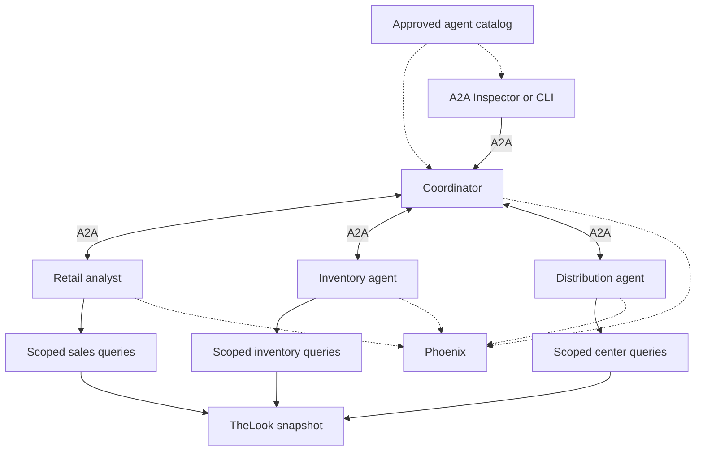

# Local A2A Retail Agents

> Historical configuration note (2026-11-25): demo users and assigned-brand permissions described below are superseded by [full dataset access](FULL_DATASET_ACCESS.md). Current commands have no `--user` option. Historical findings and captures retain their original scope.

Date: 2026-11-24. Status: implementation proposal; the services, images, commands and new datasets below do not exist yet.

## 1. Objective and decisions

Extend the existing retail analyst into a local system with four independently deployed agents: sales analysis, inventory analysis, distribution-center analysis, and a coordinator. Each agent has its own Docker image, A2A endpoint, Agent Card, prompts, skills, and runtime Golden Knowledge. A ready-made browser UI exposes the cards and conversations; Phoenix retains traces and independent evaluations.

| Decision | Initial implementation |
|---|---|
| Framework | Google ADK for all four agents, reusing the existing runtime contracts. A2A keeps a future LangGraph implementation possible without changing callers. |
| Deployment | Docker Compose; four distinct agent image tags built from explicit role-specific targets. |
| Communication | Coordinator delegates to specialists through A2A. Specialists do not recursively call one another in the first release. |
| Planning | The coordinator LLM selects specialists, asks follow-up questions, combines evidence, and decides when it has enough information. |
| Data | TheLook for sales, inventory records and center metadata; explicitly separate fixtures for optional operational assumptions. |
| GUI | A2A Inspector for cards, chat and protocol debugging; Phoenix for traces, prompts, datasets and experiments. |
| Discovery | A versioned local catalog of approved agents, shared with the coordinator and Inspector through generated configuration. |
| Completion | Tool-free review before publishing an analytical answer; deterministic checks enforce scope, evidence integrity and limits. |
| Writes | Existing report operations only. Procurement, stock transfers and warehouse changes are proposals, not executed operations. |

Local hosting does not make Gemini or BigQuery local. A fixture backend supports offline contract tests; live agent evaluations still call the configured model provider.

## 2. Current implementation to preserve

- [Analyst.ask](../../src/retail_insight/runtime/analyst.py) owns conversation context, the ADK tool loop, per-prompt budgets and reviewed publication.
- [QueryGateway](../../src/retail_insight/integrations/bigquery/retail.py) exposes scoped `sales`, `transactions` and `products`. Geography is available only through the restricted state-summary tool.
- [GoldenStore](../../src/retail_insight/integrations/knowledge.py) applies scope, version, provenance and integrity checks. Its 11 bootstrap examples are synthetic methods, not current facts or human-approved company knowledge.
- [Runtime skills](../../src/retail_insight/runtime/skills/README.md) provide optional analytical procedures and mandatory review guidance.
- [Evaluation](../evaluation.md) already separates runtime knowledge from grader-only references, captures follow-ups, and publishes to local Phoenix.

Wrap the application runtime, not just the inner `LlmAgent`. Exposing the inner agent directly could bypass `finish_answer`, publication review, budgets and report authorization.

Keep existing tests, the 20 retail conversations and historical artifacts. The documented latest baseline has unresolved grading errors; reconcile those separately before using it as an all-green migration gate. Do not delete or overwrite Phoenix history as part of this work.

## 3. Services and responsibilities



| Agent / image | Owns | Does not claim |
|---|---|---|
| `retail-analyst` | Existing revenue, customer, order, status and sales-trend analysis | Operational stock, supplier schedules or delivery guarantees |
| `retail-inventory` | Recorded stock, stock age, product-level turnover and conditional coverage calculations | Physical availability, reservations, safety stock or incoming replenishment without supporting data |
| `retail-distribution` | Center catalog, authorized stock placement, center-level allocation and concentration, geographic comparisons | Warehouse capacity, actual shipment origin, road routes, transport cost or transfer feasibility from coordinates alone |
| `retail-coordinator` | User conversation, adaptive delegation, evidence reconciliation, final answer and combined-report lifecycle | New facts inferred only from another agent's confident prose |

Each specialist maintains its own observe–act loop. The coordinator can call one specialist, several independent specialists concurrently, or revisit a specialist after discovering a gap. A fixed sales → inventory → distribution pipeline and keyword routing are explicitly out of scope.

The coordinator owns combined reports in its own persistent store, using the existing report service and ownership/confirmation contracts. Existing retail reports remain available through the retail agent's authorized operations. No two containers write the same SQLite file; migration or importing existing reports is a separate explicit operation.

## 4. Data feasibility and metric contracts

Google's TheLook-based reference implementation documents inventory records linked to products and distribution centers, including `created_at`, `sold_at` and `cost`. Verify the actual public BigQuery schemas and value distributions before implementing the contracts below; that reference also adds demo-specific fields that we must not assume exist in the public source. [Google Cloud schema reference](https://googlecloudplatform.github.io/cloud-solutions/dual-graph-system-of-action/data/)

### Source ownership

| Source | Planned use |
|---|---|
| `products` | Product identity, brand and category; shared dimension for authorized joins |
| `orders`, `order_items` | Existing sales metrics; demand observations from the retail specialist |
| `inventory_items` | Inventory item ID, product ID, recorded creation/sale timestamps, cost, center attribution |
| `distribution_centers` | Center ID, name and facility coordinates |
| `users` | Existing restricted geography tool only; no new customer-level geography exposure |

Inventory and distribution share a versioned data contract and query compiler. They expose different analytical relations over the same authorized records so totals reconcile. Center statistics must apply product-brand authorization before aggregation. Public facility coordinates do not grant access to customer addresses or coordinates.

### Inventory semantics

- Start with **modeled unsold units as of T**: distinct inventory IDs with `created_at <= T` and (`sold_at IS NULL` or `sold_at > T`). This is an explicit analytical interpretation, not a complete warehouse ledger.
- Keep `snapshot_at` (the physical table version) separate from `as_of` (the business-time cutoff). All agents in one turn use the same two values.
- For historical analysis, current table contents do not necessarily reconstruct what was known at that historical date. Do not describe a reconstructed historical stock count as a contemporaneous forecast backtest.
- Count inventory units at inventory-item grain. Sales joins must not multiply stock counts. Returned/cancelled sales do not automatically create new inventory or undo `sold_at`.
- Compute recorded stock age from `created_at` to T. Flag missing, future or inconsistent timestamps; do not silently interpret them as zero age or available inventory.
- Value stock using its recorded `cost`, explicitly stating missing-cost coverage and unspecified currency. Do not equate stock cost with sales revenue or net profit.
- Define demand as qualifying sold units per day over a stated complete interval, with calendar days including zero-sales days. Keep the retail status policy visible.
- Coverage = modeled unsold units / observed daily unit sales. Zero demand produces undefined coverage and a separate no-observed-demand label; it is not infinite certainty or a zero-day stockout.
- A projected depletion date assumes that the observed demand rate continues. Label it as a scenario estimate, not a confirmed future shortage.

### Distribution semantics

- Use inventory-item center attribution for stock placement. Product-level center assignment is a distinct catalog relationship; expose disagreements rather than silently substituting one for the other.
- Center totals plus an explicit unknown/unmapped bucket must reconcile to authorized inventory totals. Distinct products across centers are nonadditive.
- A center without authorized stock can be shown as zero stock when relevant; it must not reveal other brands' inventory through denominators or global rankings.
- Facility-to-facility distance may be calculated as great-circle distance with explicit units. It is not driving distance, transit time, transport price or proof a transfer is feasible.
- Stock age and concentration can identify candidates for investigation. They do not establish warehouse congestion, capacity utilization or operational inefficiency.
- Historical center attribution is not a history of stock movements. Shipment timestamps alone do not prove the actual fulfillment center.

### Optional operational extension

TheLook does not supply the full operational model required for purchase orders, incoming deliveries, center capacities, transport lanes, reservations and supplier lead times. The initial release must answer those requests with the missing inputs and supported analysis.

Later, add a separate, explicitly synthetic dataset with `supplier_terms`, `purchase_orders`, `center_capacities`, `transfer_lanes` and `stock_reservations`. Join only through validated TheLook IDs. Record units, validity dates and provenance. Never present these rows as public TheLook facts or combine unrelated product catalogs by name.

## 5. Agent tools, skills and completion

| Agent | Proposed capabilities | Initial runtime skills |
|---|---|---|
| Retail | Preserve existing discovery, SQL, result calculation, knowledge and report tools | Existing analytical skills |
| Inventory | `describe_inventory`, scoped `query_inventory`, result inspection/calculation, read supplied evidence, Golden retrieval | Stock grain and as-of analysis; stock aging; demand coverage; replenishment assumptions |
| Distribution | `describe_distribution`, scoped `query_distribution`, `calculate_center_distances`, result inspection/calculation, Golden retrieval | Center reconciliation; attribution quality; stock concentration; geographic limitations |
| Coordinator | `list_agents`, `delegate`, `get_task`, `cancel_task`, `read_artifact`, bounded `analyze_results`, Golden retrieval and report tools | Task decomposition; evidence reconciliation; uncertainty; multi-agent report writing |

Use composable read-only SQL over allowlisted logical relations; do not add a separate tool or route for every business question. Query schemas and calculation definitions belong to application contracts. Models choose the analysis and presentation.

Inventory and distribution consume demand observations through scoped sales artifacts supplied by the coordinator. They do not quietly query sales behind their advertised tool boundaries. When called directly without the required demand artifact, they can answer stock-only questions or request the missing input. Standalone evaluations must exercise both paths using authorized observations, never grader-only reference facts.

All agents use role-specific core prompts and skills. Core instructions require grounded claims even when no skill is loaded. Skills are application assets, not Codex skills, executable scripts or permission grants.

Each agent submits a candidate through its completion contract. A tool-free reviewer can approve, request revision or stop. Specialist review covers its own deliverable; the coordinator reviewer also checks coverage and consistency across specialists. Child approval is never treated as proof that a combined conclusion is correct. Reserve and measure review cost explicitly; avoid adding an extra planner/evaluator agent service.

## 6. A2A contract and adaptive delegation

ADK provides `to_a2a()` and `RemoteA2aAgent`. Use them where they preserve the application boundary; otherwise implement an A2A executor around the existing runtime and return typed artifacts. Current documentation recommends A2A SDK 1.x; the installed environment has ADK 2.12.0 and no A2A SDK. Run a compatibility spike and lock one tested dependency set before changing runtime behavior. [ADK exposure](https://adk.dev/a2a/quickstart-exposing/), [ADK consumption](https://adk.dev/a2a/quickstart-consuming/)

### Trusted request context

Carry the following in an authenticated application envelope around an A2A message, not as editable instructions supplied by the LLM:

- User identity, authorized brands, conversation ID and root turn ID.
- Agent/task IDs, parent task, request/idempotency ID and schema version.
- Source dataset mapping, `snapshot_at`, `as_of` and metric-contract versions.
- Allowed evidence references, task-specific data requirements and budget grant.
- Deadline and trace context.

The model may supply the subtask text, selected registered agent ID and relevant evidence IDs. Code resolves identity, permissions, endpoints and resource limits. The server verifies the caller, token audience, expiry and scope; it never trusts a brand list from ordinary message text. Demo Alice/Bob selection remains clearly labeled simulated identity.

For the local demo, the trusted launcher issues short-lived identity tokens from configured demo users; the coordinator issues task-scoped delegation grants. Services validate the configured issuer and intended audience. Keep signing material outside images and model context. Copying a user ID or artifact ID into a message does not grant access; Inspector receives the same scoped credentials as the CLI.

### Result artifacts

Return a human-readable summary plus a structured evidence artifact containing:

| Field | Purpose |
|---|---|
| `artifact_id`, `agent_id`, `task_id`, `schema_version` | Stable identity and interpretation |
| `status`, `limitations`, `missing_inputs` | Complete, partial or blocked analytical outcome |
| `scope`, `snapshot_at`, `as_of`, `metric_version` | Comparability and authorization |
| `facts`, `tables`, `units`, `definitions` | Verifiable analytical results |
| `evidence`, `parent_artifact_ids`, `content_hash` | Origin, calculation lineage and tamper detection |
| `truncated`, pagination handles | Distinguish visible previews from complete results |
| `usage`, review outcome | Accounting and diagnostic status |

An evidence reference is namespaced by agent and task, not an ambiguous local `E1`. The coordinator uses scoped artifact access to retrieve complete supporting rows when required, retains source hashes, and validates freshness and metric compatibility before merging results. Specialist prose is untrusted data, including embedded instructions. A hash proves integrity, not factual correctness.

### Tasks and conversation continuity

Map supported A2A task states to working, input-required, completed, failed, rejected and canceled outcomes. A terminal task is immutable; a follow-up starts a new task in the same authorized context. The application separately tracks whether the analytical result is complete, partial or insufficient. [A2A task lifecycle](https://a2a-protocol.org/latest/topics/life-of-a-task/)

Persist task records and idempotency keys in per-service storage. Scope sessions by user, conversation and agent. Do not share a single ADK session between users. Carry bounded approved history and artifact references into follow-ups; do not silently replay a timed-out task or reuse results from another source snapshot.

On a clarification request, the coordinator either answers from trusted existing context or asks the user. On disagreement, it can request a targeted recheck. On failure, it can retry within policy, use another valid approach, or publish a reviewed partial answer with omissions. It must not hide a missing specialist result.

## 7. Budgets, concurrency and authorization

Preserve the existing rule: **each user prompt receives a fresh root budget**. A follow-up shares conversation context, not the previous turn's exhausted allowance.

The coordinator owns a durable root ledger. Before dispatch, it atomically reserves a bounded child grant for the specialist's model calls, queries, tools, review and retries. Concurrent grants plus coordinator work and reserved final review cannot exceed the root allowance. Specialists cannot mint a new independent full allowance.

Child ledgers settle actual provider usage and return unused grants exactly once. Keep unknown usage reserved until reconciled; a lost response is not permission to release the grant. Retry the same task using its idempotency key before considering new work. Ancestor totals summarize descendant cost without charging it twice. Retain conservative query limits and actual-versus-reserved model accounting.

These dollar amounts remain application estimates at configured rates, not provider invoices. A coordinator restart reconciles outstanding grants from persisted task state before allocating more work; it does not reset the root budget.

Propagate one deadline and enforce local elapsed-time limits at each service. Cancel active child tasks when the root is canceled or expires; attempt cancellation of active BigQuery jobs. Start with at most two concurrent delegations, no specialist-to-specialist calls, and a configurable total delegation limit. These are execution bounds, not prescribed analytical paths.

Mount credentials read-only and provide them only to services that require them. The coordinator does not need warehouse credentials. Reports and task artifacts retain owner/scope checks. Direct Inspector calls to a specialist receive a standalone root budget and an explicit demo identity; they cannot bypass controls by avoiding the coordinator.

## 8. Agent Cards, discovery and GUI

### Agent Cards

Maintain a reviewed descriptor for each agent, used to generate its card for the pinned A2A version. Include its name, version, domain description, advertised interfaces, supported input/output modes, authentication requirements and actual skills. Advertise streaming/cancellation only when implemented and tested.

Publish each card at `/.well-known/agent-card.json`. Cards describe how to call an agent; they do not contain system prompts, API keys, Golden answers or evaluation references. The protocol permits direct configuration and curated discovery; it does not require a particular registry product. [A2A discovery](https://a2a-protocol.org/latest/topics/agent-discovery/)

### Local catalog

Keep `infra/agents/catalog.yaml` as the source of approved agent IDs and card locations. Generate the coordinator discovery configuration and the Inspector's AI Catalog file from it. Validate catalog IDs, card versions, endpoints and roles at startup. Record the catalog digest in evaluations.

The coordinator sees capability summaries and decides which approved agent to call. Adding a compatible specialist requires deployment and a catalog entry, not new business-question routing code. A changed or unavailable card produces a visible startup/runtime diagnostic; it cannot expand the endpoint allowlist. Do not accept arbitrary agent URLs from users or retrieved content.

### Ready-made UI

Use the official A2A Inspector. Its current repository documents card validation, chat, protocol traffic, saved agents, and shared catalogs through `--catalog`. Pin a tested release or commit-backed image digest that actually includes these capabilities; do not assume every released image matches `main`. If the shared-catalog feature is unavailable in that build, use documented catalog import/manual card registration and keep runtime discovery independent. [A2A Inspector](https://github.com/a2aproject/a2a-inspector)

Configure the four cards so the coordinator is the normal conversation entry point and specialists remain directly testable. The implemented local gateway opens the coordinator at `http://localhost:8080` and configures Alice's credentials automatically; no token copying is required. Browser-saved cards are developer convenience; the versioned application catalog controls runtime discovery. Use our coordinator, not Inspector's optional host agent, for product behavior and evaluations.

Keep Phoenix for trace inspection and evaluation. No custom frontend or registry database is needed initially. A central multi-user registry can be added later without changing the agent contracts.

## 9. Docker layout and networking

| Service | Image | Internal listener | Host access |
|---|---|---|---|
| `coordinator` | `retail-coordinator:<revision>` | `0.0.0.0:8000` | Inspector; CLI inside the Compose network |
| `sales` | `retail-analyst:<revision>` | `0.0.0.0:8000` | Inspector |
| `inventory` | `retail-inventory:<revision>` | `0.0.0.0:8000` | Inspector |
| `distribution` | `retail-distribution:<revision>` | `0.0.0.0:8000` | Inspector |
| `inspector` | Pinned A2A Inspector image | Image-defined listener | `127.0.0.1:8080` |
| `phoenix` | Reuse the pinned Phoenix service | `6006` | `127.0.0.1:6006` |

Cards advertise client-reachable internal endpoints such as `http://inventory:8000`, never `0.0.0.0` or another container's `localhost`. Inspector's backend and the containerized CLI resolve these names. A later host-native CLI needs an explicit external endpoint profile/proxy and matching cards; publishing a port alone does not make an internal hostname reachable. [Compose networking](https://docs.docker.com/compose/how-tos/networking/)

Use one multi-stage Dockerfile with four explicit final targets and four separately tagged images. Share only common runtime layers. Package each agent's tools, prompts, skills and eligible knowledge; exclude evaluation references, development captures, `.env`, credentials and the repository `.git` directory using explicit build inputs and `.dockerignore`.

Update package manifests explicitly: the current wheel includes both `retail_insight` and `evaluation`. Agent image builds must install a runtime-only distribution/target, while the evaluation runner keeps its own package and dependencies. An image-content check verifies that grader references and unrelated agents' knowledge are absent; `.dockerignore` alone cannot remove files already included in a wheel.

Add per-service readiness/liveness checks, non-root users, bounded resources, graceful shutdown and independent task/report volumes. Use locked dependencies and image digests. Fixture and BigQuery modes use separate configuration profiles; the default Compose network still needs outbound provider access for live runs.

Reuse the existing Phoenix volume and process when already running. A developer-stack launcher should attach agents to an accessible Docker network or start the existing Phoenix definition, then print Inspector and Phoenix URLs. It must not create a second conflicting port-6006 stack or remove data volumes on shutdown.

## 10. Golden Knowledge and independent golden evaluation

These are two different assets for every agent:

| Asset | Visible to the agent? | Purpose |
|---|---|---|
| Runtime Golden Knowledge | Yes, through scoped retrieval tools | Examples of methods, valid reasoning boundaries and presentation |
| Golden evaluation dataset | Only task input and permitted environment | Independent facts, expected behavior and reference answers for graders |

### Runtime collections

| Collection | Initial target | Example families |
|---|---|---|
| Retail | Preserve existing 11 examples | Rankings, cohorts, status analysis, comparisons and reporting |
| Inventory | 8 new examples | As-of stock, aging, cost coverage, unsold products, demand coverage, zero demand, missing data and unsupported replenishment claims |
| Distribution | 8 new examples | Center totals, zero-stock centers, unknown attribution, concentration, product spread, age by center, straight-line distance and missing capacity data |
| Coordinator | 8 new examples | Single-specialist delegation, combined analysis, optional concurrency, conflicting evidence, clarification, partial failure, follow-up reuse and report synthesis |

Each example records a question, method notes, input assumptions, source fixture/snapshot, observed tool results, calculation or query provenance, an **LLM-authored illustrative answer**, scope, versions and review status. Coordinator examples contain delegation/evidence methods instead of fabricated SQL. Store observed task summaries, not hidden model reasoning or a mandatory tool sequence.

Extend the Golden schema with typed query and delegation examples while accepting the existing retail schema. Make corpus roots explicit: the current loader assumes `knowledge/golden` when resolving fixture paths, so simply moving files into nested role directories would break validation. Preserve path containment and whole-corpus integrity checks.

Each agent receives only its own eligible collection and approved shared metric guidance. Use `list_golden` and `read_golden`; retain LLM selection with no keyword filter or fixed intent router. Examples may be ignored. Current claims require fresh authorized evidence, regardless of example quality.

Generate drafts against frozen knowledge fixtures, verify numbers independently, inspect every answer, and record author/model/prompt provenance. Keep generated collections labeled synthetic and not human-approved until actual human review occurs. Bootstrap access remains an explicit opt-in. Never publish runtime examples automatically from passing evaluation outputs.

### Evaluation datasets

Keep the existing retail suite and author three new suites, each with **20 initial questions and 20 follow-ups**:

| Suite | Main coverage |
|---|---|
| Inventory — 20 conversations | Stock grain, timestamps, cost coverage, zero demand, status mismatches, projections, missing inputs and brand isolation |
| Distribution — 20 conversations | Reconciliation, unknown centers, nonadditive product counts, attribution conflicts, geographic limits and unavailable operational facts |
| Coordinator — 20 conversations | One/two/three-specialist tasks, scoped follow-ups, conflicting snapshots, incomplete evidence, cancellation, timeout, cost limits and safe reports |

Together with retail, this targets 80 conversations / 160 turns. These are authored development scenarios, not production traffic and not a sealed holdout. Use suite-local `scenario-01` through `scenario-20` plus an explicit suite ID. Preserve existing retail IDs.

Evaluation records contain user steps, trusted fixture/snapshot configuration, typed expected facts, acceptance criteria, unsupported-claim checks and an illustrative reference answer for each turn. Reference wording is not an exact-match requirement. LLMs may draft questions and prose; numerical truth comes from an independent oracle over raw rows, not the agent's queries or answers.

Use distinct knowledge and evaluation fixtures, dates, entity assignments and compositions. Include mutations that preserve invariants and variants that change the correct result. Detect exact/paraphrase leakage; sharing a legitimate analytical method is allowed, exposing grader facts is not. Once a holdout result influences a prompt or example, move it to regression and replace it with a reviewed sealed case.

## 11. Tests, traces and acceptance evidence

### Deterministic checks

- Independent Decimal/set calculations for unit counts, cost, daily demand, coverage, center totals and selected-product intersections; specify rounding/tolerances and undefined values.
- Distinguishing fixtures: duplicate joins, mixed brands, future/missing timestamps, sold-after-cutoff items, returned sales, absent centers, no sales, equal rankings and truncated results.
- A2A contracts: card validation, task transitions, follow-ups, artifact schemas, identity/scope propagation, idempotency, retry reconciliation, cancellation and version mismatch.
- Shared-ledger concurrency: two specialists cannot overspend one root allowance; review capacity remains reserved; interrupted/unknown usage is not counted as free work.
- Cross-user artifact/report isolation, direct-specialist access, injected instructions in names or artifacts, unapproved endpoint attempts and forbidden customer geography.
- Real container networking: the Inspector and coordinator fetch all cards and complete a round trip through service DNS; no in-process shortcut is accepted as the A2A integration test.

### Independent model evaluation

Grade final answers against reference facts and actual observed evidence. Evaluate unsupported causal explanations, unqualified forecasts, invented suppliers/capacity/routes, unit confusion, missing limitations and task coverage. Evaluate delegation quality and recovery from observable events, accepting multiple valid sequences and valid decisions not to delegate.

Measure answer success, supported-claim rate with coverage, missing/contradictory claims, reconciliation accuracy, follow-up correctness, protocol failures, latency, query bytes, model usage and cost per turn. Report each metric's denominator and unresolved cases. Runtime review approval and A2A `completed` are not correctness scores.

Calibrate answer/trajectory judges with paired valid/flawed controls and human labels. Preserve `PASS`, `FAIL`, `ERROR`, `UNJUDGEABLE` and `NOT_APPLICABLE`; errors cannot improve the reported pass rate. Compare knowledge enabled/disabled on identical frozen cases with repeated trials for a representative subset. Record all attempts rather than selecting successful reruns.

### Phoenix

Propagate W3C `traceparent`/`tracestate` across A2A client and server boundaries; background workers restore captured context and link asynchronous tasks where parentage cannot be preserved. Instrument coordinator, delegation, specialist tools, model calls and reviews with distinct service names. Cross-process traces require this explicit propagation. [OpenTelemetry context propagation](https://opentelemetry.io/docs/concepts/context-propagation/)

Use one new trace project, `retail-multi-agent`, with suite/scenario/turn/task metadata. Publish three clearly named new conversation datasets, with Input = task, Output = both-turn references, and Metadata = identity, versions and provenance. Actual agent responses belong to experiments. Keep the existing retail dataset/project intact.

Live traces should show completed child spans during execution and task progress where supported; an open span is not guaranteed to appear before it ends. Print direct run links immediately and show elapsed time/status independently in the CLI. Phoenix receives traces over OTLP. [Phoenix tracing](https://arize.com/docs/phoenix/learn/tracing/how-tracing-works)

Continue metadata-only capture for ordinary chat and explicit sanitized content capture for evaluation. Strip credentials and hidden reasoning. Sync all role/reviewer prompts and their versions to Phoenix. Record full visible judge inputs/outputs and prompt-template metadata; do not recreate the former blank judge displays.

Save local immutable artifacts under `.artifacts/multi-agent/<run-id>/`, including image digests, dependency/prompt/card/catalog/knowledge hashes, source snapshots, user inputs, task events, evidence artifacts, answers, judgments and usage. Evaluation references are mounted only into the evaluation runner, never agent containers. Pin all participating warehouse tables to one version per trial and freeze the analytical clock separately.

### Acceptance gates

- All scope, reconciliation, protocol, budget, ownership and no-write contract tests pass.
- All 60 new conversations and their follow-ups are executed and published; manually inspect every new answer and trace. Report failures, not only averages.
- Existing retail behavior is compared against its frozen baseline. Resolve existing grader defects transparently before claiming no regression.
- No unresolved critical leakage, fabricated operational fact, evidence loss or hidden budget overrun is accepted.
- Establish numerical quality/latency/cost targets after the first measured baseline; document judge calibration and reference-review status rather than inventing a guaranteed pass rate.

## 12. Example composite tasks

These English prompts illustrate intended behavior; they are not hardcoded routes or a ready-to-use evaluation dataset.

| Initial request | Follow-up |
|---|---|
| “For our five best-selling products over the last 30 complete days, show modeled unsold units and days of coverage as of today. Identify products below seven days of coverage.” | “Which centers hold those products? Reconcile the center totals to the stock figures you just showed.” |
| “Find products with no qualifying sales in 90 days but recorded unsold inventory. Rank the five largest positions by recorded stock cost and show where they are held.” | “Now rank by oldest recorded stock instead. Explain which products change position.” |
| “Compare the authorized stock mix across distribution centers and highlight concentrations in slow-selling categories.” | “Does this prove any center is over capacity? State what additional data would be needed.” |
| “Find centers holding older units of our fastest-selling products. Show the sales period and stock cutoff separately.” | “Suggest transfer candidates, but distinguish evidence from assumptions and do not claim a shipment is feasible.” |
| “Prepare a short inventory risk report combining recent sales, stock age and center allocation.” | “Save the reviewed report, then summarize its largest data limitation in one sentence.” |

For live demos, choose periods based on observed source coverage and explicitly set `as_of`. For reproducible evaluation, use fixed timestamps and independently verified references. A source that contains no positive examples should produce an honest empty result, not a fabricated shortage.

## 13. Repository structure

```text
src/
  retail_insight/
    agents/
      retail/                   # Agent, tools, prompt and skills
      inventory/
      distribution/
      coordinator/
      registry.py               # Explicit role-to-agent construction
    runtime/                    # Shared ADK loop, turn state, budgets, provider
    review/                     # Completion tool, reviewer and rubric
    tools/                      # Shared model-facing capabilities
    integrations/               # BigQuery, Maps MCP, Phoenix and storage
    a2a/                        # Transport, authentication and task storage
    interfaces/                 # CLI and GUI gateway
knowledge/
  golden/
    bootstrap.json              # Existing retail collection remains compatible
    inventory/
    distribution/
    coordinator/
  fixtures/                     # Runtime-example fixtures only
evaluation/
  scenarios/
    manual_20.json              # Existing scenario-01 … scenario-20
    multi_agent/                # Inventory, distribution, coordinator conversations
  datasets/golden/multi_agent/  # Grader-only dev/regression/holdout references by role
  fixtures/multi_agent/         # Independent raw evaluation fixtures and oracles
  runners/                     # Extend existing execution/capture mechanisms
  graders/                     # Extend existing independent checks
infra/
  agents/
    Dockerfile                  # Four final targets / independently tagged images
    compose.yaml
    catalog.yaml
    README.md
  phoenix/                      # Reuse existing service and persistent volume
tests/
  contracts/                   # Data, artifacts, scope and budgets
  integration/                 # Containerized A2A, Inspector and Phoenix
```

The package layout above supersedes the original two-package implementation. Each role owns its definition, prompt, skills and tool registration. Shared execution, transport, review and integrations have explicit packages; see the [package refactor checklist](AGENT_PACKAGE_REFACTOR.md).

## 14. Implementation sequence

| Phase | Deliverables | Exit criteria |
|---|---|---|
| 0. Feasibility | Inspect actual BigQuery schemas and anomalies; freeze a small snapshot; verify ADK/A2A/Inspector compatibility; record the existing baseline and grader defects | Supported metrics, limitations and dependency pins are documented; minimal card/task/GUI round trip works |
| 1. Transport and contracts | A2A executor around the existing analyst, trusted context, typed artifacts, namespaced evidence, task persistence and root/child ledger | Existing retail contracts plus A2A scope, retry, cancellation and budget tests pass |
| 2. Inventory | Scoped inventory relations, calculation tools, agent, skills and reviewer adaptation | Independent oracle agrees on boundary fixtures; direct A2A demo produces grounded answers |
| 3. Distribution | Center relations, attribution/reconciliation logic, distance calculation, agent and skills | Authorized center totals reconcile; unsupported capacity/routing requests are handled correctly |
| 4. Coordinator | Discovery, adaptive delegation, artifact reconciliation, follow-up state and final review | One-, two- and three-specialist tasks work; partial failure and cancellation remain explicit |
| 5. Local stack | Four images, shared catalog, Inspector configuration, Phoenix network integration and launcher | One command starts/reuses the stack and prints working UI links; restart preserves required state |
| 6. Knowledge and evaluations | Three 8-example knowledge collections; three independent 20-conversation suites; graded references and judge controls | Corpus isolation validates; smoke suites pass; full runs and every-answer reviews are recorded |
| 7. Documentation and comparison | Setup, architecture, data definitions, evaluation commands, demo transcript and measured baseline comparison | A fresh checkout can run the demo; actual limitations and unresolved results are visible |

Author contract fixtures and small smoke cases during phases 1–4, rather than postponing all testing to phase 6. Integrate basic tracing with transport in phase 1 so early failures are diagnosable. Do not run the full costly suite on every small change; use targeted checks, then a complete frozen candidate run.

### Planned developer commands

These commands are an interface proposal, **not commands that work in the current repository**:

```bash
# Build/start agents and Inspector; start or reuse local Phoenix; print GUI URLs.
uv run retail-stack up --backend bigquery

# Use the coordinator through A2A from a client inside the Compose network.
uv run retail-stack chat --user alice --golden-bootstrap

# Run a bounded multi-agent smoke suite and publish live progress/results to Phoenix.
uv run --group evaluation retail-eval run-multi-agent \
  --suite smoke --max-cost-usd 3 --deadline-seconds 600

# Run all 60 new conversations; limits are caps, not completion guarantees.
uv run --group evaluation retail-eval run-multi-agent \
  --suite all --max-cost-usd 30 --deadline-seconds 7200

# Stop agent/Inspector services while preserving Phoenix and data volumes.
uv run retail-stack down
```

`retail-stack` should be a small Compose lifecycle wrapper, not another orchestration engine. Runtime task choices remain inside the coordinator's agent loop. Tune example evaluation caps after measuring the smoke baseline, and require an explicit BigQuery/model configuration rather than silently changing backends.
