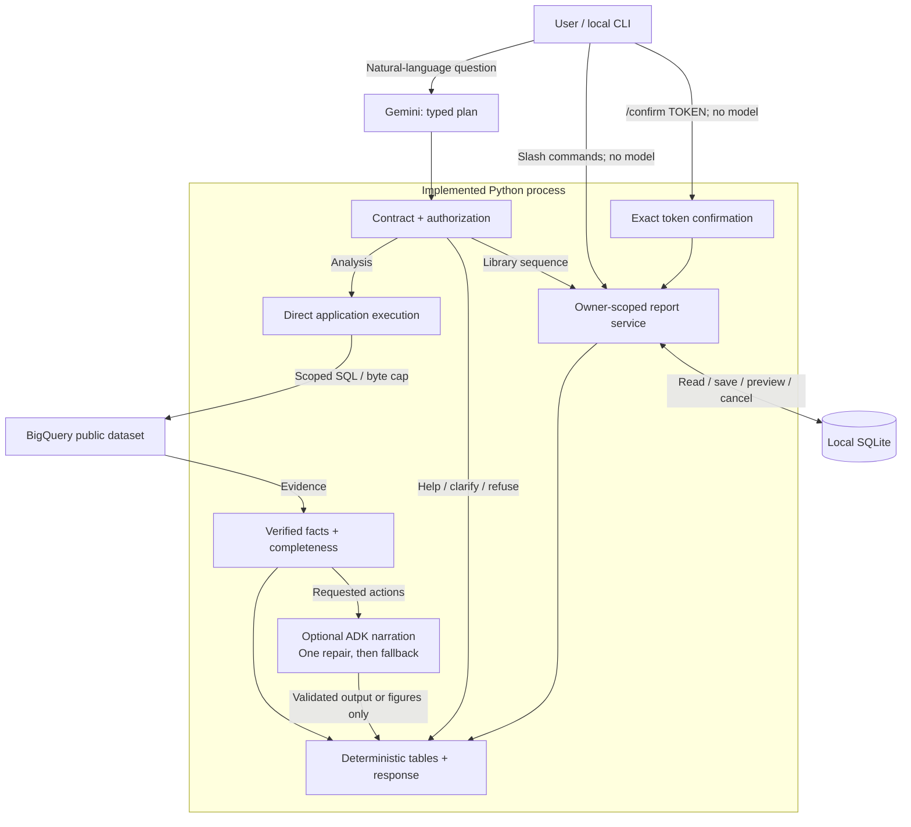

# Technical explanation of the prototype

The prototype is a local Python CLI. Gemini interprets questions and proposes typed analysis requests; a deterministic compiler constructs parameterized BigQuery SQL. Application code executes the validated plan and maintains follow-up context; an optional ADK agent narrates requested actions over verified evidence. SQLite stores private reports, sanitized analytical answers, confirmation snapshots and content-free audit records. No cloud deployment is required.

## Implemented prototype

This is the running local application. Cloud services, retrieval and persona administration in the [production HLD](architecture.md) are proposals.

<!-- diagram:prototype:start -->

<!-- diagram:prototype:end -->

CLI slash commands bypass Gemini. Natural-language routes use a typed plan; ordinary factual answers do not need a second model call.

## Implementation map

| Module | Responsibility |
|---|---|
| `cli.py` | Local identity selection, chat loop, explicit save/read/preview/confirm commands, readable failures |
| `agent.py` | Direct guarded plan execution, optional tool-free ADK narration, follow-up context |
| `planning.py`, `capabilities.py` | Tool-free plan interpretation, shared executable capability descriptions, one bounded contract repair |
| `intent.py`, `versions.py` | Deterministic plan/execution/completeness validation and prompt/source fingerprints |
| `quality.py` | Evidence-bound facts, derived metrics, action-period validation, labelled hypotheses and deterministic report rendering |
| `metrics.py` | Deterministic churn direction and percentage-point comparisons, including undefined baselines |
| `models.py` | Immutable identity and analysis contracts; unknown fields rejected; dates/filter combinations validated |
| `queries.py` | Application-owned SQL compiler, brand scope, metrics, parameter binding and SQLGlot parse verification |
| `bigquery.py` | Lazy ADC client, dry run, byte cap, stable job recovery, bounded results and safe errors |
| `model.py`, `budget.py` | One transient model retry; shared cost/call/query/deadline budget |
| `reports.py` | Owner-scoped library, exact deletion snapshots, expiry, atomic recheck/delete/consume, retention cleanup |
| `privacy.py` | Text redaction and rejection of recognizable pasted contact data; structural source minimization is primary |
| `render.py` | Tables and effective definitions rendered from evidence independently of narrative |
| `observability.py` | Correlated diagnostics with minimized typed plans and validation reasons; no raw prompts, result rows or provider exception bodies |

The project uses `src/retail_agent`, strict Pyright, Ruff, uv, and one `pyproject.toml` for dependencies and tool settings. `uv.lock` pins the tested dependency graph. No broad type-checker exclusions are enabled. A narrow annotated exception covers an untyped BigQuery SDK property.

Google ADK provides the Gemini model adapter and the optional tool-free narrative runner, session handling and callbacks. Application services execute analytical and library plans directly; there is no model-driven SQL tool loop. The candidate confirmed this is their **first ADK project**. The implementation experience demonstrated here consists of integrating and testing these capabilities for this assignment; it does not imply previous production ADK experience. One agent and independently testable application services are sufficient; additional agent frameworks would add complexity without a concrete need.

The runtime uses `gemini-3.8-flash` with `THINKING_LEVEL=medium`, configurable externally. Medium is a reasoning setting, not a separate model ID. Generation uses the thinking-level API without temperature or the old thinking-budget parameter. The tool-free report agent uses native structured output; a callback normalizes its Pydantic schema before accounting and SDK dispatch. No code execution, browsing, email, or model-controlled report confirmation is enabled.

## Query contract and access

`execution_requests(intent)` expands a validated contract into typed `Analysis` requests. Example of one resulting request:

```json
{"kind":"sales","dimension":"product","start":"2026-01-01","end":"2026-04-01","rank_by":"revenue","limit":10}
```

Supported sales dimensions: total, product, brand, category, month, state, customer. Metrics: revenue, units, distinct customers, distinct orders. Optional filters: brand list, product IDs, internal customer ID; optional Complete-only definition. Churn supports total/brand cohorts and an explicit 7–365 day inactivity window (default 90).

SQL is generated dynamically from this contract. Arbitrary model-authored SQL is deliberately not executed. Enumerated dimensions and metrics select application-owned expressions; values use BigQuery parameters. Unknown JSON fields, raw SQL fields, role claims, unsupported combinations and out-of-scope brands fail before querying. SQLGlot checks generated query structure; it is not presented as a general-purpose SQL security validator. Extending the analytical language requires adding a compiler branch, result contract and boundary tests. This limits flexibility but makes the authorized surface reviewable within the assignment.

Every query scopes `products.brand` before customer histories or aggregations. Both item and order statuses are considered. Joins include order user consistency; item-grain sums avoid multiplying revenue. A mixed-brand order contributes only authorized items. CEO skips brand restriction but does not bypass privacy or report ownership. Demo identities are hardcoded trusted local configuration: Alice/Calvin Klein, Bob/Levi's, CEO/all brands. Users cannot change roles through chat. A person with local code/database access can bypass the demo; production authentication and IAM are design work, not simulated security claims.

The compiler never selects contact names, emails, street addresses, postal codes or coordinates. Customer analysis returns internal IDs only. The users table is joined only for state aggregation; state mode rejects customer and product-ID filters and suppresses cohorts below five distinct customers. No model-visible row combines a customer ID and state. Five is a documented conservative assumption, not a client-specified threshold, and is not differential privacy: sophisticated differencing across aggregates remains a production privacy review item.

The gateway checks exact expected output columns and scalar types, caps rows, and sanitizes catalog text. Prompt instructions add defense against indirect injection, while the tool contract and confirmation boundary contain its effects. Text patterns reject obvious pasted personal data and redact recognizable contact details in narrative/catalog strings. These patterns are not comprehensive name/entity detection; users should not paste personal information, and a production ingress DLP layer needs a measured language-specific policy. The stronger guarantee is that the transactional source's prohibited columns never reach the LLM or output.

## Metrics and evidence

See [metric definitions](metrics.md). Every successful analysis carries the effective request, authorized scope, definition text, rows, SQL hash, BigQuery job ID, query timestamp and latest purchase timestamp within the returned groups. That timestamp is not a promise about upstream ingestion freshness. Tables and analytical statements are rendered directly from evidence. Code selects requested metric references for factual answers; the optional report model adds evidence-bound action/hypothesis selections. This is a deliberately bounded report language; it does not claim to validate arbitrary natural-language entailment or prove that the selected facts fully answer every user intent.

The agent asks for missing material periods, handles follow-ups using the last four turns, and can perform several requests in a question. Current conversation context is in memory; sanitized answers are persisted for retention and debugging, but interactive sessions do not resume after process restart. No automatic saving: `/save TITLE` or “save this report” explicitly persists the latest successful analysis. Natural-language deletion can prepare or cancel a preview; only the deterministic confirmation command can delete reports. CLI commands remain available during model outages.

## Intent, continuity and completeness

`planning.py` interprets natural language once using the current question, trusted identity, UTC date, relevant prior contract, four prior turns and capability schemas. The planner returns an analytical/library route, a typed unsupported constraint, or a clarification identifying missing information. There is no blanket second-model review.

`intent.py` validates the full contract and builds a minimal query set directly. It deduplicates total/monthly measures, preserves separate rankings, covers all months and retains exact filters/metric definitions. All requests are preflighted before any execution. A schema/contract error has one bounded repair; authorization denials cannot be repaired. Supported constraints and numeric bounds come from executable schemas. No natural-language matching determines the query plan.

Schema-valid interpretation can still be wrong. Live semantic tests remain distinct from deterministic contract and numerical checks. See [model planning](model-planning.md).

A library plan can contain up to four explicitly requested operations in order (list/read/save/preview/cancel). Known read IDs and save availability are preflighted. The sequence is not a transaction: if a later step fails, completed steps remain applied and the response reports where it stopped. A nonmutating help route explains operation semantics. Requests combining analytics and library mutations must be split into separate turns instead of silently dropping an operation. Cancellation removes pending confirmation for the current owner and conversation.

The accepted contract is stored with answers and version fingerprints. Legacy stored contracts remain readable through data migration. Session resumption across process restarts is still not implemented.

## Report quality boundary

Capability questions receive a business-oriented overview with the authenticated demo scope and an example question. Explicit requests for tables, fields, columns or schema receive the technical description instead. Both variants use reviewed application text, not model-written claims.

Capabilities, schema, permission/unsupported notices and library results use application-owned text or actual store results. Clarification questions are model-proposed and must identify missing information; they are not allowed to carry invented business findings. Factual answers construct a `Narrative` from requested verified measures in code; requested actions add a structured ADK narrative. Empty churn cohorts have a direct undefined-denominator response. `facts` contains exact metric IDs, not model-written values or explanations. `quality.py` builds the metric catalog from authorized query results and computes units/order, revenue/unit, revenue/order, churn percentage-point changes, and explicit-baseline total changes in code. Periods need not be adjacent, and chronological order does not select the denominator; see the [canonical comparison definitions](metrics.md#comparing-calendar-periods). Cross-period totals require identical scope, filters and definitions; they are labelled as totals, not normalized daily rates. Zero denominators remain undefined. Profit margin is not an available metric and cannot be asserted through this contract.

The application renders factual sentences with their actual values, scope, periods and evidence citations. Nonempty free-form analytical messages and unknown metric references are rejected. Hypotheses use an explicit, limited vocabulary (seasonality, promotions, availability, product mix) and templates that always label them **unverified**, including what extra evidence is needed. Referencing a query does not turn a hypothesis into a demonstrated association or cause.

Actions select from four reviewed templates: cross-selling experiments, demand investigation, assortment review, or retention experiments. Each requires a compatible, defined baseline metric, a start/end date and an optional numeric proposed target. Units/order is required for cross-selling; customer/order counts cannot substitute for basket size. Inactivity-share targets use fractions from 0 to 1. Proposed owners and targets are visibly proposals, with no promise of feasibility or impact.

The planner proposes the requested action period from the question and relevant context. Code validates ordered dates and requires every rendered action to match that accepted period exactly. There is no second natural-language date parser inside report validation. An invalid or ambiguous plan cannot execute analytics; a semantically wrong but well-formed interpretation remains a model-evaluation risk.

A rejected narrative gets **one tool-free correction attempt** using the same model, pacing, cost/call budget and remaining deadline. Only verified metric/context data and safe validation codes are supplied; failed prose is not retained in the saved answer or logs. The correction cannot run queries, save or delete reports. Provider-level transient retries still follow the shared retry policy. If correction fails, is unavailable, or cannot fit within limits, the answer explicitly states that narrative validation failed and shows verified figures; unsupported explanations/actions are withheld. `Answer.quality_status` distinguishes `validated`, `fallback`, and `not_applicable` (non-analytical replies).

This boundary trades expressive freedom for auditable output. It does not establish that a recommended intervention is wise, that a target is achievable, or that the model chose all relevant evidence. Broader analytical intent, usefulness, hypothesis relevance and UX still require independent evaluation. Extending the report vocabulary means adding typed metrics/action templates and regression cases rather than weakening the boundary with unrestricted prose.

## Saving and presentation

Saving a report, its audit record and an idempotency key happens in one SQLite `BEGIN IMMEDIATE` transaction. Any failure rolls back all three. Repeating the same owner/conversation/title/answer-trace save returns the existing report ID without a duplicate audit. Deleting a report also removes its save key.

The terminal shows customer/product rankings, comparisons and monthly trends as tables built from verified metrics. Explicit compatible total-period comparisons lead with a deterministic summary, followed by one side-by-side table of values and changes. Monetary values and percentages are rounded to two decimals for display; underlying metric precision is retained. Undefined baselines never produce a growth claim. Calendar-day differences are explained separately from total revenue changes. Scope and human-readable sales dates appear once per period; monetary amounts use two decimals without assuming a currency. Requested outputs lead the answer; auxiliary query rows remain under `/details`. Default definitions use plain language, while full SQL-oriented definitions stay in the detail view. Brief ranking observations are calculated in code. Hypothesis/action validation and visible fallback warnings remain unchanged. `/details [REPORT_ID]` reveals actual Rich tables, job IDs, hashes and reserved cost. In `/details`, when compatible primary/baseline total queries are available, code also decomposes the revenue difference into a unit-volume contribution at the selected baseline average unit value and the residual unit-value contribution. This is arithmetic attribution, not proof of pricing, mix or causal effects; it is omitted when denominators are undefined. General action feasibility remains unverified.

## Confirmation and permanent deletion

`/delete TEXT` does a case-insensitive literal search over the owner's report title and stored answer/evidence; `/delete *` selects all; `/delete-conversation` restricts to this conversation. Natural language uses the same preview service. The preview displays exact IDs, titles and conversations, plus a random token. The token itself is withheld from the LLM. The database stores SHA-256(token), owner, conversation, report ID/version snapshot and five-minute expiry.

`/confirm TOKEN` is parsed by the CLI and never delegated to the model. `BEGIN IMMEDIATE` serializes confirmation; the service checks owner, session, expiry, all report versions, then deletes exactly the snapshot and consumes pending actions atomically. New matching reports are untouched. A stale set rolls back entirely. Wrong owner/session, expiry, cancellation and replay cannot delete content. CEO is simply another report owner.

SQLite uses `secure_delete=ON`, DELETE journaling and private file permissions. Deletion also removes persisted chat answers for affected conversations and clears active model context/last answer. No report content is written to audit events. Previously displayed terminal output, OS snapshots, and user-created exports cannot be recalled. Production backup/restore requirements are in the HLD. Existing independent reports remain independent objects even if their text resembles a deleted report.

## Failure handling and budgets

Planning, contract repair and optional narration share the same budget and pacer with queries and commentary; they do not receive separate allowances. Default limits: $1 conservative model/query reservation per question, eight model attempts, six analysis attempts/queries, 120 seconds, 8,192 output tokens, 100 MB maximum bytes billed per query, and at most 50 sales rows/100 churn rows. Configuration is external. Input UTF-8 payload bytes conservatively bound input tokens for admission, including bounded context; configured rates intentionally include headroom. The output allowance includes thinking tokens; medium reasoning is enabled. Retries reserve the same configured output allowance. Reservations are not refunded, so the displayed amount is a conservative allowance consumed, **not actual invoiced spend**. Fixed infrastructure cost is outside the question budget.

BigQuery dry run estimates work; the actual job also has `maximum_bytes_billed`. A stable random job ID supports status lookup after uncertain submission; no blind resubmission. Results have bounded waits; timeouts request cancellation. Server-side cancellation is best effort. Client retries that could duplicate jobs are disabled. Source query errors are replaced by safe categories; raw exceptions/SQL are not exposed to the model or user.

Malformed or incompatible plans get schema/contract feedback and one correction opportunity. A second rejected plan aborts before queries. Provider failures do not become planning repair attempts, and authorization is never repaired. Queries are compiled and executed directly; failures do not let a model change filters or patch SQL. Genuine empty periods remain empty, with no exploratory diagnostic query. Raw total sales over no rows has NULL revenue and zero counts. The metric catalog derives zero revenue only when those counts prove an empty population; missing revenue on nonempty sales remains unknown. See [metric definitions](metrics.md#comparing-calendar-periods). All failures share the hard attempt limits. Model calls are spaced at least 13 seconds apart by default for free-tier quotas (configurable; set 0 only with suitable quota). A retry honors a provider RetryInfo delay up to the remaining deadline and a 60-second ceiling. Model 429 and transient 500/502/503/504 failures, HTTP transport timeouts and network failures retry once, with a new reservation, only before any partial response. Invalid analytical final JSON enters the bounded report-quality repair when evidence is available; unsuccessful repair returns verified figures. Other invalid responses and timeouts produce an actionable error while the CLI stays open. Slash-command library operations do not need a model call. Natural-language library requests use structured planning; generating a report still does not save it. Exhausted Gemini 429 retries or rate-limit waits beyond the deadline produce a typed, sanitized rate-limit error. The CLI displays handled errors in red and filters duplicate ADK traceback logs for those handled exceptions; unexpected errors are not blanket-suppressed. The filter applies only during CLI chat and is restored on exit. The structured diagnostic log retains a rate-limit failure category without provider payloads.

## Traceability

Each question gets a trace ID. File-system diagnostic failures degrade to in-memory events and a visible warning; they do not take down chat. SQLite mutation auditing remains mandatory and transactional. Initialization/storage errors are converted to controlled CLI failures. Logs include the minimized typed intent and content fingerprints, not the original question. Events record model version, user/conversation IDs, call sequence, usage tokens, retry status, job/hash/bytes, result row counts, evidence IDs and final outcome. Quality events include rejection codes, repair attempts, pass/fallback status and repair token usage, without rejected content. The saved answer ties its typed requests and evidence to that trace. Raw user prompts, raw tool result rows, secrets, provider exception bodies and hidden reasoning are not logged. Typed plans do contain dates, brands and product/customer ID filters; diagnostic events are therefore minimized structured context, not content-free. SQLite mutation audit records contain owner/action/count/time without report bodies. Persisted answers are a separate owner-scoped content store. Local diagnostic logs do not implement a production exporter or managed retention service; SQLite chat/audit retention cleanup runs on store startup. See the HLD for centralized monitoring, trace access, retention and incident response.

## Extension points and limits

Add a graph tool that takes validated evidence IDs rather than SQL; add email as an explicit authorized outbound action with recipient/content preview; add web trends as separately attributed untrusted context. Each capability needs its own permission, budget, trace and tests. Do not give the model a shell or generic network client.

Golden retrieval, persistent learned preferences, production SSO/IAM, nontechnical persona UI, automated promotion gates, distributed jobs/circuit breakers, managed observability, and cloud deployment are **design-only**. Illustrative Golden trios are supplied; there is no real client bucket. The optional retrieval demo was deferred to focus on mandatory prototype boundaries and evidence.

Sources checked during implementation: [ADK structured responses](https://adk.dev/agents/llm-agents/), [ADK callbacks](https://google.github.io/adk-docs/callbacks/), [ADK Python](https://github.com/google/adk-python), [Gemini model catalog](https://ai.google.dev/gemini-api/docs/models), [Gemini pricing](https://ai.google.dev/gemini-api/docs/pricing), [BigQuery cost controls](https://cloud.google.com/bigquery/docs/best-practices-costs), [Pyright configuration](https://github.com/microsoft/pyright/blob/main/docs/configuration.md).


## Optional model-written commentary

After deterministic evidence/intent validation, `commentary.py` asks the same configured model for a short executive interpretation of the rendered findings and authorized metric catalog. This tool-free call does not receive raw user text, conversation history, credentials, SQL, or raw database records. Catalog labels are still untrusted input. A distinct, tool-free review call checks support, relevance, privacy and safety against the same evidence, without seeing the writer's conversation. Both calls share the question's deadline, cost, pacing and attempt limits; no commentary-specific repair loop is added.

The structured candidate supplies text and valid supporting metric IDs. The writer can use bound reference tokens for authorized names, dates and formatted metric values. The application resolves these tokens from evidence; numeric references must be cited and row labels must have a cited metric from the same row. Deterministic checks reject literal digits outside tokens, links, markup, detected personal details, unknown references and duplicate metric references. The reviewer sees the resolved text and must assess relationships and scope: correct values alone do not make a claim true. Simple scalar answers and empty sales results skip these extra model calls unless interpretation is requested (empty results always skip them). The reviewer must approve all three criteria; invalid JSON, refusal, rejected review, timeout, unavailable API or exhausted budget omit the commentary while preserving verified findings. Accepted prose appears separately under **AI commentary** with source citations. `COMMENTARY_ENABLED=false` disables this optional layer.

Semantic model review is probabilistic and may share blind spots with the writer. It does **not** establish mathematical entailment or guarantee privacy. Source minimization and deterministic tables remain the principal controls; the answer's `quality_status` describes the structured analytical contract, not proof of every prose sentence. Regression cases and human review remain necessary. Source-generated hypotheses/actions retain their explicit caveats.

Every underlying model response emits a content-free `provider_usage` event with input, candidate output, thinking and cached token counts. This includes analytical planning, repairs, commentary and review. BigQuery completion events include bytes billed and cache status. Reservations still use conservative configurable rates ($2/M input, $12/M output by default), not current invoice prices. For measured list-price estimates, use provider usage with a dated price snapshot, including thinking at output rates and cache discounts; free tiers, credits, missing usage from interrupted calls and invoice adjustments prevent treating this as an actual bill.
