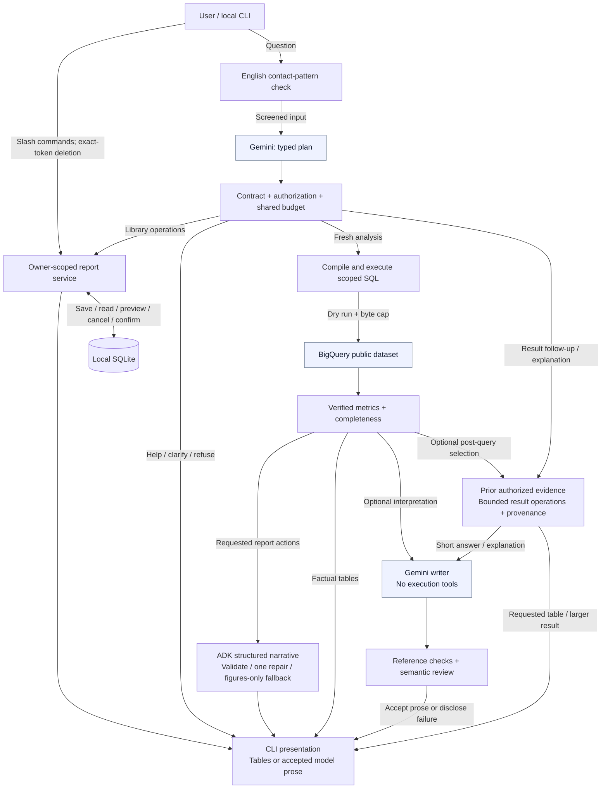

# Technical reasoning and reviewer guide

The prototype is a local Python CLI. Gemini interprets questions and proposes typed analysis requests; a deterministic compiler constructs parameterized BigQuery SQL. Application code executes the validated plan and maintains follow-up context. Gemini writes short conversational answers and explanations over verified facts, with reference validation and semantic review; an optional ADK agent selects evidence-bound report actions. SQLite stores private reports, sanitized analytical answers, confirmation snapshots and content-free audit records. No cloud deployment is required.

Read by topic: [implementation](#implemented-prototype) · [planning](#model-planning-workflow) · [metrics](#metric-definitions) · [requirement coverage](#assignment-coverage) · [quick start](../QUICK_START.md) · [evaluation](#evaluation-and-limitations). The companion [architecture](architecture.md) covers the proposed production system and confirmed client decisions.

## Implemented prototype

This is the running local application. Cloud services, retrieval and persona administration in the [production HLD](architecture.md) are proposals.

<!-- diagram:prototype:start -->

<!-- diagram:prototype:end -->

CLI slash commands bypass Gemini. Natural-language routes use a typed plan. Fresh factual tables need no separate writer call; short follow-ups and methodological explanations use a tool-free Gemini writer and reviewer. All calls share the same question budget.

## Implementation map

| Module | Responsibility |
|---|---|
| `cli.py` | Local identity selection, chat loop, explicit save/read/preview/confirm commands, readable failures |
| `agent.py` | Direct guarded plan execution, optional tool-free ADK narration, follow-up context |
| `planning.py`, `capabilities.py` | Tool-free plan interpretation, shared executable capability descriptions, one bounded contract repair |
| `intent.py`, `versions.py` | Deterministic plan/execution/completeness validation and prompt/source fingerprints |
| `result_views.py` | Bounded transformations of prior evidence, source provenance and recorded selection metadata |
| `conversation.py`, `commentary.py` | LLM-written short answers and explanations, bound references and semantic review; optional analytical commentary |
| `quality.py` | Evidence-bound facts, derived metrics, action-period validation, labelled hypotheses and deterministic report rendering |
| `metrics.py` | Deterministic churn direction and percentage-point comparisons, including undefined baselines |
| `models.py` | Immutable identity and analysis contracts; unknown fields rejected; dates/filter combinations validated |
| `queries.py` | Application-owned SQL compiler, brand scope, metrics, parameter binding and SQLGlot parse verification |
| `bigquery.py` | Lazy ADC client, dry run, byte cap, stable job recovery, bounded results and safe errors |
| `model.py`, `budget.py` | One transient model retry; shared cost/call/query/deadline budget |
| `reports.py` | Owner-scoped library, exact deletion snapshots, expiry, atomic recheck/delete/consume, retention cleanup |
| `privacy.py` | Lightweight English contact-pattern rejection and redaction; no entity model or download |
| `render.py` | Tables and effective definitions rendered from evidence independently of narrative |
| `observability.py` | Correlated diagnostics with minimized typed plans and validation reasons; no raw prompts, result rows or provider exception bodies |

The project uses `src/retail_agent`, strict Pyright, Ruff, uv, and one `pyproject.toml` for dependencies and tool settings. `uv.lock` pins the tested dependency graph. No broad type-checker exclusions are enabled. A narrow annotated exception covers an untyped BigQuery SDK property.

Google ADK provides the Gemini model adapter and the optional tool-free narrative runner, session handling and callbacks. Application services execute analytical and library plans directly; there is no model-driven SQL tool loop. The candidate confirmed this is their **first ADK project**. The implementation experience demonstrated here consists of integrating and testing these capabilities for this assignment; it does not imply previous production ADK experience. One agent and independently testable application services are sufficient; additional agent frameworks would add complexity without a concrete need.

The runtime uses `gemini-3.8-flash` with `THINKING_LEVEL=medium`, configurable externally. Medium is a reasoning setting, not a separate model ID. Generation uses the thinking-level API without temperature or the old thinking-budget parameter. The tool-free report agent uses native structured output; a callback normalizes its Pydantic schema before accounting and SDK dispatch. No code execution, browsing, email, or model-controlled report confirmation is enabled.

## Local input privacy

The prototype targets English questions and uses a lightweight local pattern filter. It requires no downloaded NLP model, privacy service, additional API key or setup command. The same filter checks questions before Gemini and new report titles before saving. Detected contact details cause a safe rejection; recognized patterns in rendered strings are redacted. Library follow-up context contains only operation kinds and owner-verified report IDs, not rendered titles/messages.

Checks cover email addresses, common formatted US phone numbers, explicitly labelled phone numbers, common numbered English street addresses, labelled names/contact fields and postal codes, IPv4-shaped strings and decimal coordinate pairs. Control/zero-width characters are stripped before inspection. Unlabelled customer IDs, ordinary analytical dates and monetary values are preserved. These expressions check contact formats; they do not parse the analytical question or choose its intent.

**Limitations:** arbitrary names such as “Jane Doe bought jeans”, nonstandard addresses such as “Flat B, The Old Mill”, obfuscated details and other languages are not reliably detected. Patterns can also cause false positives. Do not paste personal details; use internal customer IDs. Passing this filter does not certify that a question contains no PII. The compiler's exclusion of prohibited source columns remains the primary protection for BigQuery data. Production ingress privacy needs a separately evaluated policy if broader free-text detection is required.

## Query contract and access

Each output requirement separates its primary/ranking `metric` from additional displayed `measures`. Extra columns use the same selected population, so requesting orders beside a revenue ranking does not create a separate orders ranking. Derived measures use verified numerators and denominators. Completion validation checks every requested measure for each returned row, and rendering consumes those same required facts. The fact capacity supports up to 6,000 references (12 bounded queries × 50 rows × 10 measures), rather than truncating large results at 120 facts. Wide product outputs separate names into a product-ID reference table so numeric columns remain readable at 80 columns.

The provider schema retains types, enums and structure but omits numeric and array bounds to reduce constrained-decoding complexity; the original Pydantic contract enforces all bounds before execution. This follows [Google's guidance on schema complexity](https://ai.google.dev/gemini-api/docs/structured-output). JSON validity alone still cannot prove faithful interpretation of a question.

`execution_requests(intent)` expands a validated contract into typed `Analysis` requests. Example of one resulting request:

```json
{"kind":"sales","dimension":"product","start":"2026-01-01","end":"2026-04-01","rank_by":"revenue","limit":10}
```

Supported sales dimensions: total, product, brand, category, month, state, customer. Metrics: revenue, units, distinct customers, distinct orders. Optional filters: brand list, product IDs, internal customer ID; optional Complete-only definition. Churn supports total/brand cohorts and an explicit 7–365 day inactivity window (default 90).

SQL is generated dynamically from this contract. Arbitrary model-authored SQL is deliberately not executed. Enumerated dimensions and metrics select application-owned expressions; values use BigQuery parameters. Unknown JSON fields, raw SQL fields, role claims, unsupported combinations and out-of-scope brands fail before querying. SQLGlot checks generated query structure; it is not presented as a general-purpose SQL security validator. Extending the analytical language requires adding a compiler branch, result contract and boundary tests. This limits flexibility but makes the authorized surface reviewable within the assignment.

Every query scopes `products.brand` before customer histories or aggregations. Both item and order statuses are considered. Joins include order user consistency; item-grain sums avoid multiplying revenue. A mixed-brand order contributes only authorized items. CEO skips brand restriction but does not bypass privacy or report ownership. Demo identities are hardcoded trusted local configuration: Alice/Calvin Klein, Bob/Levi's, CEO/all brands. Users cannot change roles through chat. A person with local code/database access can bypass the demo; production authentication and IAM are design work, not simulated security claims.

The compiler never selects contact names, emails, street addresses, postal codes or coordinates. Customer analysis returns internal IDs only. The users table is joined only for state aggregation; state mode rejects customer and product-ID filters and suppresses cohorts below five distinct customers. No model-visible row combines a customer ID and state. Five is a documented conservative assumption, not a client-specified threshold, and is not differential privacy: sophisticated differencing across aggregates remains a production privacy review item.

The gateway checks expected columns/types, caps rows and sanitizes catalog text. The [local privacy layer](#local-input-privacy) screens user input before Gemini. Instructions defend against indirect injection, while application contracts and confirmation enforce authority. Text patterns do not recognize every entity; prohibited source columns are excluded structurally.

## Metrics and evidence

See [metric definitions](technical_reasoning.md#metric-definitions). Every successful analysis carries the effective request, authorized scope, definition text, rows, SQL hash, BigQuery job ID, query timestamp and latest purchase timestamp within the returned groups. That timestamp is not a promise about upstream ingestion freshness. Tables, ratios and comparison figures are calculated directly from evidence; conversational wording is generated by Gemini through the reviewed writing boundary. Code selects requested metric references for factual answers; the optional report model adds evidence-bound action/hypothesis selections. This is a deliberately bounded report language; it does not claim to validate arbitrary natural-language entailment or prove that the selected facts fully answer every user intent.

The agent asks for missing material periods, handles follow-ups using the last four turns, and can perform several requests in a question. Current conversation context is in memory; sanitized answers are persisted for retention and debugging, but interactive sessions do not resume after process restart. No automatic saving: `/save TITLE` or “save this report” explicitly persists the latest successful analysis. Natural-language deletion can prepare or cancel a preview; only the deterministic confirmation command can delete reports. CLI commands remain available during model outages.

## Intent, continuity and completeness

Gemini proposes one typed plan; application code checks permissions, dates, limits and evidence completeness before executing it directly. A schema-valid plan can still misinterpret the question. See the [planning workflow](#model-planning-workflow) for the complete boundary and follow-up rules.

## Report quality boundary

Application-owned text handles capabilities, schema, permission notices and unsupported requests; library results come from the actual store. Model-proposed clarifications must identify missing information and cannot carry business findings.

Factual answers select verified metric IDs in code. The optional ADK report agent supplies references, hypotheses and proposed actions, not replacement numbers. Unknown references and free-form analytical messages are rejected. The renderer binds facts to their values, scope, periods and citations. Arithmetic and [comparison roles](#comparing-calendar-periods) are deterministic; profit margin is unsupported.

Hypotheses use a limited vocabulary: seasonality, promotions, availability and product mix. They describe additional evidence needed, without claiming a cause. Actions choose cross-selling experiments, demand investigation, assortment review or retention experiments. They require a compatible baseline and dates matching the accepted action period. Cross-selling uses units/order. Numeric targets are rejected by the structured contract because no justified target source is available. Reports do not assign owners. Suggested next steps combine a verified baseline with a proposed investigation or controlled test. Demand investigations must cite monthly evidence when available; the renderer calculates its observed range. Related checks appear with the action instead of in a separate hypothesis section.

The Q4 2025 Calvin Klein report was rechecked live with Gemini and BigQuery after this change. It retained revenue of 8,985.54, all three monthly values and five products; the suggested check cited the observed monthly range (1,878.47 in October to 3,565.48 in November) and proposed a prior-year comparison without a numeric target or assigned owner. The response passed narrative validation and did not save a report. Rich text was inspected at 80 and 120 columns. This is a focused live check, not a rerun of every historical evaluation.

One tool-free narrative repair may use verified context and safe validation codes within the original deadline/call/cost budget. It cannot query or mutate reports. Failed repair yields a visible figures-only fallback; unsupported explanations/actions are withheld. `quality_status` is `validated`, `fallback` or `not_applicable` and does not certify arbitrary prose. These controls trade expressive freedom for checkable output; intent fidelity and useful recommendations still require evaluation.

## Saving and presentation

Saving a report, its audit record and an idempotency key happens in one SQLite `BEGIN IMMEDIATE` transaction. Any failure rolls back all three. Repeating the same owner/conversation/title/answer-trace save returns the existing report ID without a duplicate audit. Deleting a report also removes its save key.

The terminal shows customer/product rankings, comparisons and monthly trends as tables built from verified metrics. Explicit compatible total-period comparisons lead with a deterministic summary, followed by one side-by-side table of values and changes. Monetary values and percentages are rounded to two decimals for display; underlying metric precision is retained. Undefined baselines never produce a growth claim. Calendar-day differences are explained separately from total revenue changes. Scope and human-readable sales dates appear once per period; monetary amounts use two decimals without assuming a currency. Requested outputs lead the answer; auxiliary query rows remain under `/details`. Default definitions use plain language, while full SQL-oriented definitions stay in the detail view. Brief ranking observations are calculated in code. Hypothesis/action validation and visible fallback warnings remain unchanged. `/details [REPORT_ID]` reveals actual Rich tables, job IDs, hashes and reserved cost. In `/details`, when compatible primary/baseline total queries are available, code also decomposes the revenue difference into a unit-volume contribution at the selected baseline average unit value and the residual unit-value contribution. This is arithmetic attribution, not proof of pricing, mix or causal effects; it is omitted when denominators are undefined. General action feasibility remains unverified.

Follow-ups can also use a typed `result_view` plan over the last authorized evidence: selection, intersection, difference, union, filters, sorting, positional slicing, limits, counts and column projection. The planner receives the columns already displayed for each source and definitions of precomputed ratios such as average order value. The model interprets the question; Python matches stable entity keys, resolves source-qualified metrics and ratios, and materializes only the selected rows/columns. Larger results remain tables. Short answers and counts pass the selected facts to the conversational writer. No natural-language regex rules or model-generated arithmetic are used. The resulting subset persists for subsequent “those products” questions and explicit report saving. Original source rows remain available under `/details`; missing membership in a truncated ranking is not interpreted as zero sales. Changed periods or broader populations use the guarded query path. Invalid sources, columns and incompatible entity grains enter the existing bounded planning repair. These operations are deliberately bounded, not an arbitrary data-frame or code-execution tool. A structurally valid transformation still requires semantic evaluation against the question. A fresh analytical plan can also include one optional `post_view`: the full base population is queried first, then the same validated result operations select the final display. Preflight checks its source/column schema before querying. This supports multi-step pasted requests without parsing natural-language phrases or replacing the base ranking with a global derived-metric ranking. Report actions cannot currently be combined with this final-view route.

Standard responses omit the “Verified findings” heading, source footers and evidence-ID citations. They retain the result, relevant scope and effective definitions. Internal references remain attached to the answer: `/details` exposes source tables and diagnostics, while a question such as “How did you work that out?” asks Gemini to explain the recorded selection and calculation. Such explanations preserve the current analytical context and do not run another database query.

Input editing uses an in-memory prompt history: ↑/↓ recalls prompts and commands within the current CLI process. It is separate from model context, survives `/new`, and is not written to a history file. The waiting status is “Generating answer…”.

## Confirmation and permanent deletion

An empty deletion match produces one informational response with a `/reports` hint. It creates no pending confirmation and the CLI does not print a second preview or a token instruction. CLI regression tests cover an empty library, a nonmatching title and an existing matching report, including owner isolation.

`/delete TEXT` does a case-insensitive literal search over the owner's report title and stored answer/evidence; `/delete *` selects all; `/delete-conversation` restricts to this conversation. Natural language uses the same preview service. The preview displays exact IDs, titles and conversations, plus a random token. The token itself is withheld from the LLM. The database stores SHA-256(token), owner, conversation, report ID/version snapshot and five-minute expiry.

`/confirm TOKEN` is parsed by the CLI and never delegated to the model. `BEGIN IMMEDIATE` serializes confirmation; the service checks owner, session, expiry, all report versions, then deletes exactly the snapshot and consumes pending actions atomically. New matching reports are untouched. A stale set rolls back entirely. Wrong owner/session, expiry, cancellation and replay cannot delete content. CEO is simply another report owner.

SQLite uses `secure_delete=ON`, DELETE journaling and private file permissions. Deletion also removes persisted chat answers for affected conversations and clears active model context/last answer. No report content is written to audit events. Previously displayed terminal output, OS snapshots, and user-created exports cannot be recalled. Production backup/restore requirements are in the HLD. Existing independent reports remain independent objects even if their text resembles a deleted report.

## Failure handling and budgets

Planning, contract repair and optional narration share the same budget and pacer with queries and commentary; they do not receive separate allowances. Default limits: $1 conservative model/query reservation per question, eight model attempts, six analysis attempts/queries, 120 seconds, 8,192 output tokens, 100 MB maximum bytes billed per query, and at most 50 sales rows/100 churn rows. Configuration is external. Input UTF-8 payload bytes conservatively bound input tokens for admission, including bounded context; configured rates intentionally include headroom. The output allowance includes thinking tokens; medium reasoning is enabled. Retries reserve the same configured output allowance. Reservations are not refunded, so the displayed amount is a conservative allowance consumed, **not actual invoiced spend**. Fixed infrastructure cost is outside the question budget.

BigQuery dry run estimates work; the actual job also has `maximum_bytes_billed`. A stable random job ID supports status lookup after uncertain submission; no blind resubmission. Results have bounded waits; timeouts request cancellation. Server-side cancellation is best effort. Client retries that could duplicate jobs are disabled. Source query errors are replaced by safe categories; raw exceptions/SQL are not exposed to the model or user.

Malformed or incompatible plans get schema/contract feedback and one correction opportunity. A second rejected plan aborts before queries. Provider failures do not become planning repair attempts, and authorization is never repaired. Queries are compiled and executed directly. A structured BigQuery dry-run syntax rejection permits one deterministic SQLGlot reserialization of the same SELECT AST with BigQuery identifier quoting, followed by another dry run. Parameters, metrics and authorization predicates are preserved; there is no model-written SQL patch. Both attempts share the query-count, byte, cost and deadline limits. Schema/permission errors and execution failures are not eligible, and a second rejection stops. The evidence hash records the SQL actually executed. This narrow recovery cannot fix every compiler or schema defect. Genuine empty periods remain empty, with no exploratory diagnostic query. Raw total sales over no rows has NULL revenue and zero counts. The metric catalog derives zero revenue only when those counts prove an empty population; missing revenue on nonempty sales remains unknown. See [metric definitions](technical_reasoning.md#comparing-calendar-periods). All failures share the hard attempt limits. Model calls are spaced at least 13 seconds apart by default for free-tier quotas (configurable; set 0 only with suitable quota). A retry honors a provider RetryInfo delay up to the remaining deadline and a 60-second ceiling. Model 429 and transient 500/502/503/504 failures, HTTP transport timeouts and network failures retry once, with a new reservation, only before any partial response. Invalid analytical final JSON enters the bounded report-quality repair when evidence is available; unsuccessful repair returns verified figures. Other invalid responses and timeouts produce an actionable error while the CLI stays open. Slash-command library operations do not need a model call. Natural-language library requests use structured planning; generating a report still does not save it. Exhausted Gemini 429 retries or rate-limit waits beyond the deadline produce a typed, sanitized rate-limit error. The CLI displays handled errors in red and filters duplicate ADK traceback logs for those handled exceptions; unexpected errors are not blanket-suppressed. The filter applies only during CLI chat and is restored on exit. The structured diagnostic log retains a rate-limit failure category without provider payloads.

## Traceability

Each question gets a trace ID. Controlled failures record a content-free category and execution phase; technical failures include the trace ID in the user-facing error. Expected contact-data rejection and rate-limit messages omit that identifier, while diagnostics retain it. Diagnostic-file failure warnings also accompany nonanalytical answers. File-system diagnostic failures degrade to in-memory events and a visible warning; they do not take down chat. SQLite mutation auditing remains mandatory and transactional. Initialization/storage errors are converted to controlled CLI failures. Logs include the minimized typed intent and content fingerprints, not the original question. Events record model version, user/conversation IDs, call sequence, usage tokens, retry status, job/hash/bytes, result row counts, evidence IDs and final outcome. Quality events include rejection codes, repair attempts, pass/fallback status and repair token usage, without rejected content. The saved answer ties its typed requests and evidence to that trace. Raw user prompts, raw tool result rows, secrets, provider exception bodies and hidden reasoning are not logged. Typed plans do contain dates, brands and product/customer ID filters; diagnostic events are therefore minimized structured context, not content-free. SQLite mutation audit records contain owner/action/count/time without report bodies. Persisted answers are a separate owner-scoped content store. Local diagnostic logs do not implement a production exporter or managed retention service; SQLite chat/audit retention cleanup runs on store startup. See the HLD for centralized monitoring, trace access, retention and incident response.

## Extension points and limits

Add a graph tool that takes validated evidence IDs rather than SQL; add email as an explicit authorized outbound action with recipient/content preview; add web trends as separately attributed untrusted context. Each capability needs its own permission, budget, trace and tests. Do not give the model a shell or generic network client.

**Golden Knowledge is designed and seeded, not connected to the running agent.** The CLI does not consult the sample trios when planning or answering questions.

Golden retrieval, persistent learned preferences, production SSO/IAM, nontechnical persona UI, automated promotion gates, distributed jobs/circuit breakers, managed observability, and cloud deployment are **design-only**. Illustrative Golden trios are supplied; there is no real client bucket. The optional retrieval demo was deferred to focus on mandatory prototype boundaries and evidence.

Sources checked during implementation: [ADK structured responses](https://adk.dev/agents/llm-agents/), [ADK callbacks](https://google.github.io/adk-docs/callbacks/), [ADK Python](https://github.com/google/adk-python), [Gemini model catalog](https://ai.google.dev/gemini-api/docs/models), [Gemini pricing](https://ai.google.dev/gemini-api/docs/pricing), [BigQuery cost controls](https://cloud.google.com/bigquery/docs/best-practices-costs), [Pyright configuration](https://github.com/microsoft/pyright/blob/main/docs/configuration.md).

## Conversational writing and optional commentary

`conversation.py` handles short result follow-ups, counts and methodological explanations. The writer receives the screened current question, selected authorized metrics, source definitions and application-recorded selection metadata. Gemini writes the sentences; the application does not assemble conversational sentence templates. Tables, arithmetic, authorization and report-library/error messages remain deterministic.

Names, dates and numbers must use supplied reference tokens. `commentary.py` validates those references, rejects literal invented numbers, links and detectable contact details, and substitutes verified values. A separate tool-free model call reviews the resolved prose for support, relevance, safety, completeness and correct relationships such as highest/lowest within the actual candidate population. A valid reference alone does not establish a valid claim. Neither call receives SQL, credentials or access to execution tools.

The writer aims for one connected paragraph, without evidence tags or repetitive scope reminders. Explanation requests can describe the source and arithmetic, using recorded operations rather than hidden model reasoning. Legacy views without selection metadata do not justify an invented selection history. Failure or rejection shows a verified result table with a warning; an explanation failure instead asks the user to inspect `/details`. There is no silent fallback to canned analytical prose and no writing repair loop.

The same writing/review machinery also supports optional interpretation of a fresh analysis, shown as **AI commentary**. That optional path receives rendered findings and the metric catalog, not the raw question or conversation history; `COMMENTARY_ENABLED=false` disables that addition, not conversational follow-up writing. Empty analyses skip optional commentary.

Writing and review add up to two model calls under the original budget, deadline and pacing limits. Same-model review can share writer blind spots and is not a privacy or entailment guarantee. `quality_status` records a bounded validation outcome, not proof of every sentence. Provider usage events record input, output, thinking and cached tokens; actual invoices can differ through free tiers, credits and interrupted-call usage.

## Model planning workflow

1. Check English contact patterns before remote calls. Supply the planner with the question, up to four relevant prior turns, last analytical contract, trusted identity, UTC date and executable capabilities. It has no tools and cannot choose identity.
2. `capabilities.py` derives fields, enums and bounds from execution schemas. Every analytical field/filter must be explicit. Missing material dates require clarification; unsupported requests return schema-checked issues instead of silently substituting a metric or dropping a filter. Monthly row count means intersected calendar months.
3. Validate the entire plan, authorization and query count before execution. One sanitized contract-repair attempt is allowed; provider failures and access denials do not authorize semantic retries. No blanket model reviewer or second model query-selection loop is used.
4. `execution_requests` combines compatible totals, keeps separately requested rankings separate and preserves scope/status/ID filters. Execute the compiler/gateway requests directly; code computes facts, ratios and explicit-baseline comparisons. Empty evidence never permits broader filters.
5. Reused-result plans execute against authorized in-memory evidence, without BigQuery. Short follow-ups and `explain_result` requests use [conversational writing](#conversational-writing-and-optional-commentary); explicit table requests retain deterministic tables.
6. Actions use the [structured report boundary](#report-quality-boundary); interpretation can use [reviewed commentary](#conversational-writing-and-optional-commentary). Both share the same turn budget.

A typed library sequence supports up to four explicitly requested operations in order. Known read IDs and save availability are preflighted; completed operations are not rolled back if a later step fails. Help is nonmutating. Analysis and library mutations require separate turns. Generating a report never saves it; model routes can preview/cancel deletion but cannot confirm it. Library context carries owner-verified IDs and operation kinds rather than report titles. Stored contracts from older versions remain readable through migration.

Schema validity is not semantic correctness. The model can still choose the wrong valid interpretation, so independent intent/number/state/UX checks remain necessary. Technical patterns for PII, escaping and tokens do not parse analytical language.

### Research informing the design

- [Gemini structured outputs](https://ai.google.dev/gemini-api/docs/structured-output): typed output schemas need application-side validation; they do not prove semantic truth.
- [Gemini function calling](https://ai.google.dev/gemini-api/docs/function-calling): model proposals and application execution have separate authority.
- [ADK LLM agents](https://adk.dev/agents/llm-agents/) and [ADK safety](https://github.com/google/adk-docs/blob/main/docs/safety/index.md): explicit boundaries, output schemas and application policies. The optional report agent cannot query or mutate reports.
- [Google's ADK skills guide](https://developers.googleblog.com/en/developers-guide-to-building-adk-agents-with-skills/): progressively loaded skills were considered; this fixed analytical surface does not need dynamic skill installation.
- [Building effective agents](https://www.anthropic.com/research/building-effective-agents): use composable workflows and add model decisions where needed. The direct workflow avoids repeating a decision already captured by a validated contract.

## Metric definitions

Definitions are proposed defaults accepted by the client, not preexisting company policy. Every evidence block states the effective definition and scope. Calendar periods use UTC and half-open `[start, end)` boundaries; Q1 is January 1 through April 1. Ask for the year if absent.

| Metric | Definition |
|---|---|
| Revenue | Sum of `order_items.sale_price`, rounded to two decimal places after summing; both order and item status exclude Cancelled/Returned. This is a sales-value proxy, not accounting-recognized revenue or net profit. |
| Units | Eligible item rows, not order count. |
| Customers | Distinct `order_items.user_id` among eligible items. Repeated purchases do not add customers; counts across products cannot be summed to a global customer total. |
| Orders | Distinct order IDs among eligible items. Mixed-brand orders contribute only authorized items and count once within a result group. |
| Ranking | Separate top lists for requested metrics. Descending metric with deterministic dimension-key tie breakers. |
| Monthly sales | Eligible purchase timestamps grouped into UTC calendar months. Missing months mean no matching rows; the app does not fabricate observations. |
| Customer spend | Same scoped eligible items, grouped by internal user ID; no customer names or geography. |
| State | State from users, aggregated over authorized eligible items with at least five distinct customers. No customer/product-ID filter, no customer ID in output. |
| Churn proxy | N-day inactivity share at an exclusive as-of date, with N=90 unless explicitly overridden. Eligible customers first purchased before `as_of - N days`; inactive customers last purchased before that cutoff. All history is scoped to authorized brands before calculating first/last dates. |

Churn compares two snapshots at the requested start/end boundaries. Purchases on or after an as-of boundary cannot affect its history. A purchase exactly N days before as-of is treated as active; eligibility requires strictly earlier first purchase. State the boundary convention explicitly. If there is no eligible population, the share is undefined, not zero. A request for “last month” compares the first day of last month to the first day of this month.

This metric is **not a monthly rate of newly lost customers**. Its denominator changes as customers become seasoned, so a rising share may reflect both numerator and population changes. Always show eligible and inactive counts, compare percentage points, and verify that a supposed spike exists before explaining it. The default display uses four decimal places for inactivity percentages and percentage-point changes so small movements are visible; changes below 0.0001 percentage points use six places. When the eligible active count is unchanged but population size changes, the answer explicitly distinguishes those effects. Brand breakdowns are associations, not causal proof. Definitive causes would require additional evidence such as marketing, stock, competitor, service or experiment data.

Overrides: explicitly request Complete status only or an inactivity window such as “180 days.” They change definitions, never access permissions. The agent rejects unrequested Complete-only or inactivity-duration changes. Other definitions should be clarified or described as unsupported rather than implemented by arbitrary SQL.

Current source status is used for historical periods. Later cancellations/returns may change a rerun; the public dataset does not provide a complete historical status ledger for point-in-time reconstruction. Item creation time may differ from order creation/settlement time. Currency is assumed consistent with the dataset; tax, shipping, discounts and exchange conversion are not separately modeled. Revenue sums use source FLOAT values, so this prototype is not a financial ledger.

Brand churn breakdowns select at most 50 cohorts by their maximum eligible population across the two snapshots (then cohort name), returning both available snapshots per cohort. Missing baselines are labelled undefined. The application calculates the percentage-point change and direction independently of model prose.

### Comparing calendar periods

The primary period is evaluated relative to the explicitly selected baseline, regardless of chronological order or gaps. Absolute change is `primary - baseline`; percentage change is `(primary - baseline) / baseline × 100%`. Both periods must use identical scope, filters and metric definitions. A zero or unknown baseline makes percentage change undefined, but a known zero baseline still permits an absolute difference.

Raw SQL `SUM` over an empty sales population is NULL. When units, orders and customers are all zero, the derived revenue is zero; raw evidence remains unchanged. Missing revenue on a nonempty population remains unknown. An empty query establishes no qualifying sales in the dataset, not the absence of historical business activity outside it.

Calendar-day averages include days with no transactions. Daily-rate comparisons are separate from total changes and appear when requested. Q4 2025 has 92 days; Q1 2026 has 90. A comparison may evaluate the earlier period against the later one if that is the user's chosen baseline.

Repeated quarter references such as “Q4 2025 and Q1 2026 ... from Q4 to Q1” reuse the explicitly established year when unambiguous. If the same quarter is associated with multiple years, an unqualified reference still requires clarification.

## Assignment coverage

The four mandatory prototype requirements have working code and behavioral tests. Other production requirements are explicitly designed rather than claimed as implemented. See [architecture](architecture.md), [technical explanation](technical_reasoning.md) and [evaluation](technical_reasoning.md#evaluation-and-limitations).

| Requirement | Working prototype | Production design / remaining scope | Evidence |
|---|---|---|---|
| 1. Hybrid intelligence | Illustrative Question → SQL → Report trios and format; no runtime retrieval | Reviewed versioned bucket, permission/version-filtered hybrid retrieval, fresh query execution and stale-example retirement | `golden-trios.json`, `golden-trio.schema.json`, HLD knowledge lifecycle |
| 2. Safety, PII, product access | Trusted demo identities, brand-first compiled queries, prohibited source fields absent, aggregate-only state cohorts, English contact-pattern screening | SSO, curated-view IAM, gateway execution identities, measured DLP and privacy review | `models.py`, `queries.py`, `bigquery.py`, `privacy.py`; query/gateway/ADK boundary tests |
| 3. High-stakes oversight | Exact owner-scoped preview; permanent hard delete only via token command; expiry, replay protection, version checks, transactional mutation and managed-copy purge | Web confirmation endpoint with CSRF protection, distributed invalidation, deletion ledger and backup policy | `reports.py`, `cli.py`; deletion state tests and structured-planner library tests |
| 4. Learning loop | In-process follow-ups and structured evidence persistence | User preference store, explicit/inferred preferences, reviewed feedback to trios/evals, gated releases | HLD learning section; no claim of autonomous learning |
| 5. Resilience | Bounded malformed-plan and dry-run SQL syntax recovery, safe empty results, one transient model retry, shared budgets, query dry run and byte cap, uncertain-job recovery, timeout cancellation, usable CLI | Circuit breakers, distributed job idempotency, durable job failure state, explicit redrive and fallback operations | `budget.py`, `model.py`, `bigquery.py`; budget, provider-fault and ADK recovery tests |
| 6. Quality assurance | Synthetic numeric oracles, policy/property tests, report state tests, planning/execution tests and the optional ADK narrative runner, opt-in live scenarios | Frozen holdouts, release canaries, human review, task-based executive UX studies | `tests/`, evaluation and example-run sections below |
| 7. Observability | Correlated JSON events, model usage, job/hash/bytes, result/evidence IDs, retries/outcomes; content-free audit | OTel pipeline, restricted sanitized message correspondence, alerting, dashboards and retained debug traces | `observability.py`, planner/executor log assertions; HLD metrics |
| 8. Persona agility | Fixed versioned instructions in prototype | Nontechnical editor, automatic quality gate, atomic publish and rollback without deployment; no manual approval | HLD persona section |

Additional deliverables:

- CLI chat, follow-ups, analysis and reports/actions: `retail-agent chat`; supported analytical language documented in the technical explanation.
- BigQuery integration against all four specified tables: joins compile from typed requests; users is accessed only for state aggregates.
- Setup on another machine: the setup section below, `.env.example`, `pyproject.toml`, `uv.lock`, external ADC and API key.
- Framework rationale and experience: technical explanation explicitly records the candidate's first ADK project.
- Architecture diagram: embedded Mermaid plus editable draw.io source under `docs/diagrams/`.

Known tradeoff: this prototype does not execute arbitrary LLM-authored SQL. It dynamically compiles a bounded analysis language into SQL, covering the requested capabilities with explicit extension points. This is a conscious safety/design decision and should be explained in the interview.

## Evaluation and limitations

The [compound-request runner](../evals/compound-requests/run.py) checks the customer-value quick-start as one pasted prompt and as three separate turns, plus a product subset with the opposite sort direction. It compares final membership against ratios recomputed from the original query population, verifies retained columns and confirms no report save. Final live replays passed [3/3 scenarios, 5/5 turns](../evals/compound-requests/recorded/summary.json). Earlier development attempts rejected incorrect column names before querying; the shared fresh-result schema corrected that gap. Run with `--live --output /tmp/compound-new`; each turn uses its own configured budget.

The current [quick-start guide](../QUICK_START.md#example-conversations) contains seven conversations, each with three separately copyable prompts. The exact [21 prompts](../evals/quickstart-v2/cases.json) passed the first complete live run against Gemini and BigQuery: [results](../evals/quickstart-v2/recorded/summary.json), [settings and usage](../evals/quickstart-v2/recorded/metadata.json). Checks cover ranking intersection, customer average order value, monthly subset ordering, category calculations, quarter comparisons, inactivity definitions and explicit report saving. Subset follow-ups reuse the original evidence, explanations pass the prose reviewer, and the saved report matches the draft. Terminal output was reviewed at 80 and 120 columns. Initial completeness assertions added during execution were also checked against all seven captured initial answers. No additional application changes were needed in this run. These checks recompute selections and ratios from returned evidence; they do not independently re-query every initial aggregate or establish reliability beyond this sample. Reproduce with `uv run python evals/quickstart-v2/run.py --live --output /tmp/quickstart-v2-new`; the output directory must be new, and report storage is isolated.

The current offline suite covers the final runtime. Historical live captures below preserve their actual model/source versions and presentation; they are regression evidence, not a claim that every scenario was rerun after the latest conversational-writing changes. Commands that replay them live may produce different wording and incur additional writer/reviewer calls.

Multi-measure evaluation: [six English cases and live runner](../evals/multi-measure/run.py), with [captured results](../evals/multi-measure/recorded/summary.json). The original 20-product/full-year request and five additional complex requests ultimately passed. Four cases passed in the six-case run; the original and order-ranked cases exhausted 504 retries and passed separate replays. Checks covered requested populations, ranking criteria, row counts, all requested measures, ratios independently recomputed from returned aggregates, completed-only status, and no implicit save. No separate live SQL oracle was run. Final displays were inspected at 80/120 columns; captured raw answers retain their runtime versions. Earlier development attempts hit HTTP 400 before simplifying provider schema bounds. These results do not establish error-free interpretation of arbitrary questions.

Focused live checks used a previously captured eight-category BigQuery result and a gateway that rejects any fresh query. The highest-value follow-up and calculation explanation were generated by Gemini and passed reference validation plus semantic review. An initial explanation was withheld by the reviewer; reviewer guidance was clarified to recognize application-recorded sorting/slicing as evidence for a within-selection extremum. Offline tests also verify rejection of invented literal numbers and unsupported relationships. These small checks do not establish universal prose correctness.

A [positional follow-up regression](../evals/positions/recorded/summary.json) replays the captured category-ranking context against live Gemini. The original trace failed twice with provider 504 during planning, before any database query. A pre-fix reproduction recovered from another 504 but returned the first two rows instead of the second row. The view plan now supports a bounded zero-based `offset` (negative values count from the end), applied after filtering/sorting and before `limit`; out-of-range positions return an empty result. This is a general structured operation, not a natural-language phrase matcher. Five independent probes—second, last, positions two through four, first and out of range—passed **5/5**, with no provider retry or data query. Seven offline cases distinguish displayed order from original rank and verify range bounds without mutating source evidence. The missing operation was a functional defect; the tests do not establish that it caused Google's timeouts or that provider timeouts are eliminated. Reproduce with `uv run python evals/positions/run.py --live --context evals/positions/context.json --output /tmp/positions-new`; provider credentials are required, and the runner blocks new data queries.

A further [15 English conversation pairs](../evals/conversations-v2/questions.txt) cover ranking exclusions, subset counts, monthly thresholds, category average order value, state aggregates, CEO brand rankings, reversed comparisons, status overrides, preserved product filters, inactivity thresholds, empty results, save/cancel workflows, authorization recovery and forecast refusal. The [selected final results](../evals/conversations-v2/recorded/summary.json) pass **30/30 acceptance checks**: 28 unaffected initial responses plus a two-turn replay after correcting singular count wording (“1 customer matches”). This is a combined result, not a fresh 30-turn execution after the fix. All **29 evidence sets** match [independent sales and inactivity SQL](../evals/conversations-v2/recorded/oracle.json); SQLite checks confirm that the saved report equals its draft and survives cancellation. Outputs were reviewed at 80 and 120 columns. Initial captures, the replay and their source fingerprints are retained; the acceptance checker was also corrected to avoid evaluating unrelated selectors, without changing captured responses. One transient provider retry occurred in the initial run. Reproduce with `uv run python evals/conversations-v2/run.py --live --output /tmp/conversations-v2-new`, then `uv run python evals/conversations-v2/oracle.py --live --results /tmp/conversations-v2-new`. Offline checks use `uv run python evals/conversations-v2/check.py evals/conversations-v2/recorded`. The replay uses `--cases 2`; case 13 requires the report saved by case 12. Tests use isolated report storage, and no deletion is confirmed.

The [out-of-domain live probe](../evals/off-topic/recorded/summary.json) tests weather and personal-age questions in English, each in a fresh session and after a retail analysis. The English-only execution passed **4/4 refusals** and **6/6 total turns**, including the baseline and return to analysis. Its checks require refusals without query events or report/pending-state changes, followed by a return to the correct monthly evidence. Weather uses the fixed scope message; age uses a generic privacy message, whose wording is broader than the question. This small sample does not prove perfect routing. Reproduce with `uv run python evals/off-topic/run.py --live --output /tmp/off-topic-new`; the output directory must be new and provider credentials are required.

An earlier version of the quick-start conversations was exercised as four isolated live scenarios: **12/12 turns passed** in the [final run](../evals/quickstart/recorded/summary.json), including selected columns, subset/order preservation, computed average order value and actual report-library state. Seven evidence sets matched [independent raw-table SQL](../evals/quickstart/recorded/oracle.json), and terminal output was reviewed at 80 and 120 columns. The model now receives initial displayed-column metadata and ratio definitions, so adding measures has an explicit context. Earlier attempts retained in `evals/quickstart/` include repeated Gemini 504 failures on the add-columns question and the resulting incomplete dependent context; the final run completed without a provider retry or narrative fallback. This does not establish that the context change eliminated provider timeouts. Reproduce with `uv run python evals/quickstart/run.py --live --output /tmp/quickstart-new`, followed by `uv run python evals/quickstart/oracle.py --live --results /tmp/quickstart-new`. Credentials are required; test report storage is isolated.

A focused conversational regression run uses Gemini `gemini-3.8-flash` with medium thinking: one fresh pair of rankings followed by ten dependent questions covering intersection, added metrics/ranks, set differences, counts, union, filtering, sorting and a changed period for the selected products. The [final run](../evals/followups/recorded/summary.json) passed **10/10 follow-ups**, including answer-quality checks, with no narrative fallback. The [run metadata](../evals/followups/recorded/metrics.json) records timings, tokens, fingerprints and one recovered provider read timeout. Nine follow-ups reuse evidence; only the changed-period follow-up queries BigQuery. Set/row checks are independent of the transformation implementation; the last result also matches an [independent raw-table SQL oracle](../evals/followups/recorded/oracle.json). Terminal output was reviewed at 80 and 120 columns. Earlier attempts are retained: one unrecovered Gemini 504, and a later run whose numerical checks passed but whose empty-result warning failed subsequent presentation review. Empty sales now render as a valid result without narrative repair. This small suite does not prove arbitrary follow-up understanding or eliminate provider timeouts.

Reproduce with `uv run python evals/followups/run.py --live --output /tmp/retail-followups-new`, then `uv run python evals/followups/oracle.py --live --results /tmp/retail-followups-new`. The output directory must be new; the runner uses an isolated report database and real provider calls.

The current suite has **246 passing offline tests**, with **16 live tests deselected**; Ruff lint/format and strict Pyright pass. No privacy detector is mocked or downloaded for these tests. Coverage includes rejected email/phone/address patterns, no outbound call or raw-input log on rejection, title checks, and continued acceptance of valid retail identifiers. Tests explicitly demonstrate that bare names and nonstandard addresses remain undetected.

An earlier clean-directory/wheel-install check succeeded on macOS ARM64. It is not a second-machine or Linux/Windows certification. The simplified dependency graph and package build are checked separately; no new paid Gemini/BigQuery replay was performed for this filter replacement.

The earlier [reviewer scenarios](../evals/reviewer-readiness/cases.json) cover separate bestseller rankings, follow-ups, churn, a report/actions, explicit comparison roles, empty sales, privacy, access denial and real save/preview/cancel state. The retained historical captures contain nine English-language scenarios; out-of-scope language cases have been removed rather than translated and presented as new executions. The first attempt passes **53/54 retained checks**, with its ambiguous comparison heading preserved as a failure. The corrected replay passes **54/54 retained checks**, including all **11 independent SQL evidence sets**. Retained replay duration was 174.93 seconds, median 15.67 seconds. The original run had 12 provider responses and no rejected plans; removing a local rejection did not change provider usage. Those captures used the previous entity-model filter and remain historical numerical/workflow evidence, not proof of the current filter. New executions include the English contact-pattern case in `cases.json`. These observations are not latency guarantees.

Subsequent review found that library titles could enter follow-up context. Local title screening and ID-only library context were added, with two new offline regressions and a focused two-turn live save/preview/cancel replay. That replay reused the previously captured report as state setup; it did not run another analytical query. The ten-case captures retain the exact earlier source fingerprints rather than being relabelled as results from the later title-boundary change.

Recorded artifacts are sanitized: job/trace/report identifiers are placeholders; public numerical evidence, source fingerprints and timing remain. The retained English-only [first attempts](../evals/reviewer-readiness/first-attempt/) include the 53/54 result before heading clarification. [Recorded replay](../evals/reviewer-readiness/recorded/) verifies offline:

```sh
uv run --locked python evals/reviewer-readiness/check.py evals/reviewer-readiness/recorded
```

For a new paid run, use a new directory and retain unsuccessful attempts:

```sh
uv run --locked python evals/reviewer-readiness/run.py --live --output .retail-agent/reviewer-new
uv run --locked python evals/reviewer-readiness/oracle.py --live .retail-agent/reviewer-new
uv run --locked python evals/reviewer-readiness/check.py .retail-agent/reviewer-new --write
```

The runner isolates report state and does not confirm hard deletion. Each question retains the configured budget; the independent oracle adds eleven BigQuery queries capped at 100 MB each. Checking stored artifacts makes no provider calls. Negative checker experiments rejected missing cases, changed raw revenue and uncancelled pending deletion.

These cases become regressions once used for refinement. Continue evaluating fresh questions, semantic intent, recommendation usefulness and executive UX; no small suite proves arbitrary-question accuracy. The pattern filter has the stated detection gaps, and commentary review remains probabilistic. Production retrieval, persona publication, distributed IAM/deletion and hosted CI execution remain design or unverified deployment concerns, not implied by passing local tests.

### Recorded report excerpt

The following is an excerpt from the captured Q3 2025 report, not a new query or a forecast. Scope: Calvin Klein; excluded Cancelled/Returned orders and items; UTC. Full captured report and evidence are in [case 4](../evals/reviewer-readiness/recorded/04-report-actions.json).

| Month | Revenue |
|---|---:|
| July 2025 | 3,761.79 |
| August 2025 | 2,326.84 |
| September 2025 | 3,486.71 |
| Quarter total | 9,575.34 |

The report also lists the top three products and proposes an October–December investigation using promotion, availability and calendar records. This historical capture includes an unverified proposed target of 10,500.00. Current reports reject numeric targets and combine observations with suggested checks; the capture preserves the earlier behavior. Generating this answer did not save it.

### Reproduce the ten targeted cases

This package preserves ten questions from the completed 25 October 2026 replay. [`cases.json`](../evals/targeted-v4/cases.json) contains their exact text and expectations. [`recorded/`](../evals/targeted-v4/recorded/) contains sanitized captured responses, settings, timing summary and independent SQL results. Report IDs, trace IDs and BigQuery job IDs are replaced with placeholders; public analytical rows, SQL, fingerprints and timings are preserved. These are recorded live results, not a newly executed run or synthetic analytical fixtures.

#### Offline verification

From the repository root, after `uv sync --locked`:

```sh
uv run --locked python evals/targeted-v4/check.py evals/targeted-v4/recorded
```

Expected result: **55/55 checks passed**. Fifty original assertions check required intent fields, comparisons, answer content and report state. Four additional checks require analytical evidence; the final check compares all ten captured evidence sets against the independent SQL results. No credentials or network calls are needed. This is a bounded acceptance rubric, not a general semantic judge or an application language parser.

#### Explicit live replay

Follow [credential setup](../QUICK_START.md#setup). These commands incur provider usage and BigQuery work. Choose a new output directory for each attempt:

```sh
uv run --locked python evals/targeted-v4/run.py --live --output .retail-agent/reviewer-targeted-v4
uv run --locked python evals/targeted-v4/oracle.py --live .retail-agent/reviewer-targeted-v4
uv run --locked python evals/targeted-v4/check.py .retail-agent/reviewer-targeted-v4 --write
```

The runner refuses an existing directory and uses an isolated SQLite report library. It runs each question once; application-level bounded retries still apply. The oracle refuses to overwrite existing results. Preserve failures and use another directory for a new attempt. Generated local artifacts are ignored by Git.

The cancellation case seeds a synthetic report solely to test library state. Unlike the original local harness, this portable runner seeds it immediately before that case, avoiding confirmation-token expiry during earlier questions. Its synthetic revenue is never used as analytical evidence. The same ten user questions are retained. No hard deletion is performed by the runner.

Each application turn uses the configured per-question budget; ten questions do not share one cap. The independent oracle adds up to ten BigQuery queries, each capped at 100 MB billed bytes. Its SQL is handwritten independently of the application's compiler and scoped to this suite's public-data cases. Captured answers may change as the public dataset and model change; recorded numbers are not expected constants for a fresh run.
