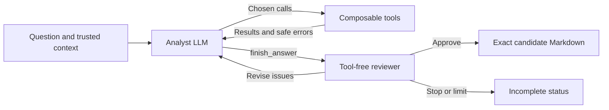

# Technical reasoning: autonomous retail analyst

Updated: 20 November 2026. This document describes the from-scratch implementation, installed from the canonical `src/retail_agent/` package. It has no imports from the previous planner, renderer or runtime. The earlier implementation notes are preserved under [legacy documentation](../legacy/runtime-2026-11-20/docs/technical_reasoning.md). See the [architecture](architecture.md), [replacement plan](from-scratch-agent-plan.md) and [actual test-prompt observations](rewrite-test-observations.md).

## Implemented prototype

The application uses one Google ADK analyst tool loop for each user turn. The LLM chooses its next action after observations, generates SQL, interprets results and writes the entire answer in ordinary Markdown. It decides whether a table is useful and what belongs in it. No business-intent enum, fixed analysis plan, mandatory cell placeholders or automatic evidence appendix controls the answer.

## Model planning workflow

Planning happens within the model's choice of actions. It can inspect the schema, retrieve a method, compare alternative populations, recover from a rejected SQL expression or finish after a single useful query. The application does not require a serialized task plan or a particular tool sequence. New analytical compositions are evaluated by their supported outcomes.

The evaluator is a separate call, not a second investigator. It receives the request, relevant prior approved context, candidate, actual evidence and proposed save target. It returns approve/revise/stop with issues. Revision returns to the same ADK conversation, allowing the analyst to change SQL, gather evidence or narrow its claims. Approval publishes the exact candidate through ADK's `skip_summarization` mechanism, without a final writer pass. [ADK function tools](https://adk.dev/tools-custom/function-tools/)

A raw final response gets a bounded reminder to use the completion tool. It is not displayed as an approved answer. All model-authored completed answers, including clarification/refusal, pass through review; deterministic library/help/confirmation commands do not invoke models.

## Implementation map

Paths in this table are relative to the replacement's `retail_agent` package.

| Module | Implemented responsibility |
|---|---|
| `cli.py` | Typer commands, Rich Markdown, actual progress, library and confirmation UI |
| `runtime.py` | One analyst loop, ADK assembly and bounded prior context |
| `turn.py` | Shared turn state, tool accounting, artifacts and metadata events |
| `tools/` | Model-facing analytics, Golden, report, skill and completion adapters; explicit registry |
| `provider.py` | Gemini adapter, contact screening, shared accounting and bounded transient retry |
| `reviewer.py` | Isolated tool-free structured review and bounded schema repair |
| `services/warehouse.py` | SQL capability validation, scoped BigQuery execution, fixture/local worker and state aggregates |
| `services/golden.py` | Eligible Golden records, FTS5 search, full-trio reading and integrity metadata |
| `services/reports.py` | Owner-scoped SQLite storage, idempotent save, exact deletion and explicit legacy import |
| `budget.py` | Shared deadline, model/query/tool admission and completion reservation |
| `contracts.py`, `config.py`, `privacy.py` | Small records, explicit settings and contact-pattern screening |
| `prompts/` | Concise universal analyst/reviewer instructions and completion protocol |
| `skills/` | ADK-parsed analytical methods, optional references and always-supplied review rubric |

## Tool surface

The 16 tools expose capabilities rather than named business questions. Trusted identity and scope are injected by application code, never supplied by the model. Their registration is centralized in `tools/registry.py`. See [runtime skills and package organization](runtime-skills.md).

| Tool | Purpose |
|---|---|
| `describe_data` | Discover authorized relations, columns, join grain and metric defaults |
| `load_skill` | Read a relevant packaged analytical method by catalog name |
| `load_skill_resource` | Read a listed Markdown reference from a skill loaded this turn |
| `query_data` | Execute scoped read-only SQL with scalar parameters and bounded evidence |
| `read_result` | Read another bounded page of stored evidence |
| `analyze_results` | Query selected result snapshots locally while retaining parent lineage |
| `query_state_summary` | Obtain aggregate geography without individual customer/state records |
| `search_golden` | Search eligible method summaries |
| `read_golden` | Read a complete method/SQL/example-answer trio |
| `search_reports` | Search the current owner's private report metadata |
| `read_report` | Read an owned historical report and register its evidence |
| `read_answer` | Fetch an exact prior approved answer from this conversation |
| `stage_report_save` | Propose an explicitly requested save without committing it |
| `preview_report_deletion` | Request an application-rendered exact selection |
| `cancel_report_deletion` | Cancel the pending deletion |
| `finish_answer` | Submit model-authored Markdown and evidence for review |

Independent read calls can be issued together; shared admission counters are updated before execution. Completion must be called alone after other work is observed. The model cannot obtain a confirmation token through its deletion tool or call a deletion-confirmation tool. No shell or arbitrary Python tool is exposed.

## Query contract and access

`query_data` accepts BigQuery-dialect SQL over `sales`, `transactions` and `products`. `sales` is qualifying item-level purchases; `transactions` contains all current statuses for explicit overrides; `products` includes authorized unsold catalog entries. `purchased_at` is the order item's creation timestamp. Customer IDs are permitted, while contacts and individual geography are absent.

The gateway validates a single read-only query, resolves physical leaves through nested/CTE scopes, rejects direct raw-source paths and injects authorized relations before histories or joins. CTEs, joins, unions, windows, conditional aggregates and supported pure functions can be composed into new metrics. Unknown routines and external IO are rejected; the function capability list is not an intent/metric registry. Invalid SQL returns a sanitized actionable error for the analyst to repair through the same gateway.

BigQuery dry-run estimates and maximum bytes billed bound execution. Stable job IDs support recovery of an identical submitted query. Returned rows include columns, logical SQL, parameters, backend, bytes, job ID, definitions and truncation status. The default gateway stores at most 200 rows; the tool initially previews 20, with additional stored pages available through `read_result`. A truncated source cannot be used as if it were the complete population in `analyze_results`.

Local result analysis receives only explicitly selected conversation result handles. It executes in a spawned DuckDB process with external access disabled, 256 MB memory, one thread, no temporary spill and bounded termination. The fixture backend uses the frozen synthetic rows through the same scoped logical relations, but transpilation/execution in DuckDB does not establish live BigQuery compatibility for every expression.

`query_state_summary` is a separate aggregate implementation using `users`, with UTC period boundaries and qualifying/complete/all status choices. It suppresses states with fewer than five distinct customers. No individual state associations or arbitrary customer/product filters are exposed. The fixture has no geography, so this capability requires BigQuery.

## Metric meaning

Revenue sums eligible item `sale_price`. Units are item rows; orders and customers are distinct IDs. Separate product rankings by revenue and distinct customers must each use their full requested population. Multiple items in one order do not create multiple orders. Other-brand purchases cannot change a manager's customer history or acquisition date. The source does not establish a reporting currency, so the model must not invent one.

Default qualifying revenue excludes Cancelled/Returned items and orders. Explicit overrides can use `transactions` while preserving scope. Periods use UTC `[start, end)` boundaries. Inactivity defaults to a documented 90-day snapshot with an eligible denominator and last authorized purchase before the as-of boundary. The LLM composes and explains the particular query; code does not route an inactivity question through a preset plan. Zero eligible customers means an undefined rate, and the current status fields cannot reconstruct historical status changes.

The evaluator inspects both SQL and results because a plausible numerical value can represent the wrong grain or period. Transaction patterns can support descriptive findings and hypotheses, not prove campaign, inventory or competitor causes.

## Evidence, review and follow-ups

Result artifacts have conversation-local IDs, actual rows, SQL/parameters, scope, execution metadata and parent lineage. Stored artifacts are separate from the answer; the ordinary answer includes only what the LLM chooses to write. `/details` exposes evidence on request. An execution timestamp is not a guarantee of source freshness.

The reviewer sees complete bounded artifacts named by the candidate, a manifest of other results, original request, bounded prior approved context and retrieved-method references. Oversize review bundles return a correction request rather than silently dropping supporting rows. The analyst can obtain a smaller aggregate or narrow its answer. The reviewer returns five short factual findings (coverage, grounding, metrics, presentation and operations) before its decision. Approval requires all five checks to pass and no unresolved issues. It checks periods, populations, denominators, causal claims, readability, requested formatting and current-user save authorization. Its default thinking level is medium, separately configurable from the low-thinking analyst. These structured findings are not hidden reasoning or a proof of correctness.

The model uses ordinary numbers, not a mandatory reference grammar. Optional evidence citations can help readers, but numerical correctness is not reduced to string matching. The reviewer may share a model and its errors with the analyst. Approval is a quality signal, not a proof; independently enumerated fixture expectations and boundary/mutation assertions remain essential.

Follow-ups reuse application-owned results and approved answers. Each new turn reconstructs a bounded context in a fresh ADK session; this is not persistent provider-side chat history. Long previous answers are explicitly marked as excerpts and remain available through `read_answer`. A manifest exposes recent result handles; local relational analysis can preserve a previously selected population such as “those five.” Context is ephemeral and cleared on exit, reset or successful deletion.

## Golden Knowledge

Working retrieval is implemented. The [bootstrap corpus](../knowledge/golden/README.md) has 11 LLM-authored synthetic examples and 14 fixture-checked SQL queries. Its narrative answers vary between prose, tables and a short report. The data/prose are illustrative, not live company results or human-approved knowledge.

`GoldenStore` uses an in-memory SQLite FTS5/BM25 index with stemming. It indexes only eligible scope, schema/metric versions and publication state. Default mode does not expose the synthetic corpus; explicit bootstrap mode enables these labelled methods for demonstrations. Production records require approved metadata, distinct editor/reviewer IDs, approval time and a matching content digest. This is a loader contract over trusted files; a nontechnical publication service is still a proposal.

Search returns short summaries and provenance; read returns the full trio. The analyst decides whether to retrieve or use it. Historical example figures never become current evidence: the analyst must obtain current scoped results. Empty or irrelevant retrieval does not prevent a question from being answered. Lexical matching is a baseline, not an embedding retriever. The evaluation set is excluded from the index.

## Report storage and destructive actions

Saving requires an explicit current-user request. The analyst stages a target, the reviewer judges authorization, and application code commits the exact approved artifact. A target may be the current candidate or a known previous answer. Save retries are idempotent by owner and answer ID; changed content under the same ID is rejected. Only actual transaction receipts report success. The current natural-language authorization check is probabilistic; report ownership remains independently enforced.

Saved reports live in `reports-v2.sqlite3`. Search/read/preview/confirm all constrain the owner; CEO analytical permissions do not broaden a private library. Deletion preview is rendered from stored records by trusted CLI code. Confirmation binds the owner, conversation, exact IDs, versions/content signatures, expiry and single-use token. Cancelled, expired, stale and replayed requests delete nothing. Newly matching records are outside the snapshot. A successful transaction erases report Markdown, evidence and imported payload, records only content-free audit and clears active context.

The explicit legacy importer reads the prior SQLite `reports.body` JSON or owner-tagged JSON exports without importing old application code. Original answer text/evidence and the structured legacy payload are preserved as historical data, not newly reviewed output. The original source remains untouched. Deleting an imported copy cannot erase that separate source or an externally created export; the migration boundary is stated in the command output.

## Resilience and budgets

The defaults in `config.py` are 120 seconds, USD 1 conservative model/query admission cost, 12 model attempts, eight queries, 24 tools and three candidate reviews. Analyst output is bounded at 4,096 tokens and review output at 2,048, with low thinking effort. Existing environment settings can override defaults. Admission rates are configurable conservative inputs, not a quotation of current provider invoice prices.

One ledger covers analyst, reviewer and every provider retry. Before optional work, it reserves one model-call slot, one completion-tool slot, 30 seconds and review cost based on a bounded 60,000-byte payload plus 12,000 bytes of envelope overhead. Review payload/request sizes are checked against their bounds. Limits stop the run; no retry or revision resets them. The provider permits at most one transient retry and does not replay a request after emitting a response. Repeated unchanged candidate submissions are rejected.

The runtime buffers drafts and displays only approved Markdown. Stop, deadline, unavailable reviewer or exhausted allowance produces a controlled incomplete status; completed query evidence remains inspectable. It never labels an unreviewed draft approved. Progress is based on actual model/tool/review events. Cleanup is bounded, and a diagnostic-file failure cannot erase an already obtained answer. Cancellation of remote BigQuery work is best effort; a timed-out local subprocess can be terminated.

## Privacy, observability and retention

Source privacy comes from structural projections and scoped query validation before data reaches either model. The runtime also screens common contact patterns in user input, tool observations and outbound model payloads. This regex is not comprehensive entity recognition: unusual names, addresses or obfuscated contact data can pass. It must not be described as complete input PII protection. Tests use synthetic canaries; stronger production input handling remains work.

Metadata-only `events-v2.jsonl` records correlation, model attempts, usage, tool/status categories, result IDs, review decisions and approved-answer hashes. It excludes raw questions, result rows, credentials, raw provider exceptions and hidden reasoning. SQLite audit stores owner, action, count and time; it has no report title/body and is pruned after one year.

Approved conversation context and query artifacts are in process memory, with old history filtered against the 90-day bound. Closing the CLI loses that context; it is not a durable 90-day chat store. Reports remain until deletion. Local diagnostic files do not yet have managed retention/rotation. Production retention, recovery and monitoring are described separately in the [HLD](architecture.md#production-deployment-proposal).

## Assignment coverage

| Requirement | Implemented capability or explicit remaining proposal |
|---|---|
| Analytical assistance and reports | Autonomous SQL/tool choice, model-owned answers, follow-ups, reviewed completion and report persistence |
| Safety/privacy/access | Trusted demo identity, scoped gateway, projected warehouse schema, aggregate geography and owner-only reports; input regex limitations disclosed |
| Destructive confirmation | Application preview and transactional user-origin confirmation; no model confirmation tool |
| Resilience | Shared budgets, reserved review allowance, bounded attempts, safe tool errors and controlled incomplete outcomes |
| Observability | Minimized events, usage, provenance, review outcomes and transactional mutation audit; production dashboards/retention remain proposed |
| Golden Knowledge | Actual eligible FTS retrieval, full-trio reading, synthetic bootstrap and production metadata checks; authenticated publishing UI remains proposed |
| Learning/preferences | Explicit conversational preferences can guide the LLM; persistent/inferred preference learning and inspect/reset administration remain design-only |
| Nontechnical persona management | Design-only versioned editor with automatic quality-gated publication; no manual approval requirement added |

## Evaluation and limitations

The replacement tests exercise real ADK tool dispatch with scripted providers, independent fixture values, SQL capability boundaries, local process execution, Golden eligibility/retrieval, SQLite state transitions and shared resource limits. Scripted action choices verify orchestration, not live-model autonomy or answer quality. Live prompts and observations are recorded separately in [rewrite-test-observations.md](rewrite-test-observations.md), including model/settings, backend, timings, actual answers, failures and qualifications.

The previous runtime's 263 passing tests and earlier live captures are historical regression inputs. They do not establish this implementation's correctness. The [18 proposed acceptance cases](../evals/rewrite/README.md) remain specifications unless their fixture/oracle/runner is explicitly implemented and a result recorded. Do not treat a bootstrap retrieval example as a held-out evaluation.

The main limitations remain probabilistic review and natural-language save authorization, incomplete input contact detection, lexical rather than semantic retrieval, simulated local identity, ephemeral context, and the absence of the production persona/preference administration services. Fixture success alone does not establish BigQuery compatibility or production latency. Observed outcomes and unanswered cases belong in the test report, without inventing benchmark guarantees.
