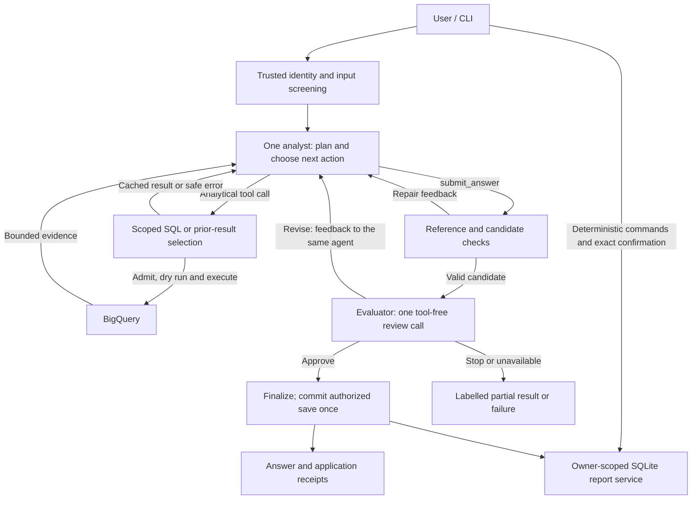

# Technical reasoning: one agent loop with evaluated completion

**Current prototype notes.** The [from-scratch replacement plan](from-scratch-agent-plan.md) supersedes this implementation as the next direction. It moves answer composition and table choice into the LLM and requires working Golden retrieval. The replacement is not yet implemented.

The local CLI uses **one ADK analyst** that plans, chooses tools, observes results, and changes its approach. It submits a candidate through `submit_answer`; that tool performs deterministic reference checks and one independent, tool-free evaluation call. A rejected candidate returns correction objectives to the same agent conversation. There is no separate Planner agent or outer replanning controller.

The production services in [the HLD](architecture.md) remain proposals. The [implementation and migration guide](autonomous-agent-refactor.md) describes the code and remaining limitations. [Earlier implementation notes and live captures](legacy-technical-reasoning.md) are historical evidence for the retired fixed workflow, not validation of this runtime.

## Implemented prototype

<!-- diagram:prototype:start -->

<!-- diagram:prototype:end -->

Every natural-language candidate, including help and clarification, goes through `submit_answer` and its reviewer. This avoids trusting a model-provided “nonanalytical” label as a way to bypass review. Deterministic slash commands such as `/reports`, `/read`, `/save`, and `/confirm` bypass model calls and retain application validation.

Planning is part of the analyst's responsibility. After a query result or review issue, the model may inspect another result, change SQL, investigate a different breakdown, ask a focused clarification, or submit a revised answer. It is not required to execute a precomputed list of queries.

## Implementation map

| Module | Current responsibility |
|---|---|
| `agent.py` | One `LlmAgent`/`Runner` invocation per turn; screened input; bounded context; finalization and approved save integration |
| `tools.py` | Analytical tools, result selection, owner-scoped library tools, staged saves, and `submit_answer` |
| `evaluator.py` | Typed `approve`/`revise`/`stop` result from one tool-free model call; request coverage, evidence support, SQL meaning, and natural-language save authorization |
| `sql_policy.py` | Parse/qualify model SQL over virtual relations, replace every physical leaf with code-owned scoped SQL, reject unsupported constructs |
| `evidence.py` | Scalar normalization, cell-reference substitution and numeric table rendering |
| `bigquery.py` | Dry run, byte caps, stable job recovery, timeout cancellation and bounded result validation |
| `model.py`, `budget.py` | Shared pacing, provider retry, cost/call/query/deadline allowance |
| `reports.py` | SQLite ownership, idempotent save, exact previews and transactional single-use hard deletion |
| `models.py`, `render.py` | New query evidence and evaluation status alongside legacy report decoding/rendering |
| `observability.py`, `versions.py` | Minimized traces and reproducible source/prompt/runtime/compiler fingerprints |

The old `planning.py`, `intent.py`, `capabilities.py`, `quality.py`, `commentary.py`, `conversation.py`, and `result_views.py` remain for legacy contracts, standalone regression tests, and historical evaluation scripts. They do not choose tools or run a second planning/writing loop in the active `Analyst`. The template compiler in `queries.py` supplies the aggregate-only state tool and legacy numerical regression fixtures.

## Model planning workflow

1. Application code resolves the fixed demo identity, screens input, and creates one shared turn budget.
2. The analyst receives the original question, six recent completed turns, available evidence summaries, the virtual schema, and tool descriptions.
3. The model selects one tool call per response. Query results, safe errors, and previous-result selections become observations in that same invocation.
4. `submit_answer` checks references and selected sources, binds the candidate and pending operation to a fingerprint, and invokes the Evaluator without tools.
5. `revise` returns concrete issues to the analyst. It may obtain more evidence or correct its wording, then resubmit. Unchanged rejected candidates stop rather than loop.
6. `approve` binds approval to that exact candidate. Application code fills final metadata, commits an authorized save once, and appends actual receipts. Raw model prose cannot bypass this path.
7. Limits, failed review, or `stop` preserve completed evidence as an explicitly incomplete result. With no evidence, the CLI receives a controlled error and stays usable.

ADK is pinned to 2.12.0 in `uv.lock`. The evaluator is a bounded model call, not a second autonomous agent or a separate Runner. The main call and evaluator share the same model adapter, pacer, budget, deadline, and retry accounting. See [ADK tools](https://adk.dev/tools-custom/function-tools/) and [LLM agents](https://adk.dev/agents/llm-agents/) for the underlying interfaces.

## Query contract and access

`run_analysis` accepts BigQuery SQL over three virtual relations:

- `sales`: item-level authorized purchases, excluding Cancelled/Returned at both order and item level.
- `transactions`: authorized items with their statuses, for explicit metric overrides and return analysis.
- `products`: authorized catalog identifiers, names, categories and brands, including unsold entries.

CTEs, nested queries, joins, unions, conditional aggregates, windows and supported date arithmetic allow new analytical compositions without new intent branches. Each physical leaf is expanded into a code-owned relation with trusted brand parameters before history or aggregation. Raw source paths, unsupported relations/functions, model query parameters, scripts and destructive SQL are rejected. Entire table records and unsupported result types are blocked; output has at most thirty named columns and one hundred rows. An extra row detects overflow rather than silently truncating.

Customer IDs are allowed; names, contact details and individual geography are absent from the SQL surface. `analyze_states` uses a separate code-owned aggregate query over the fourth source table, `users`, with a proposed minimum of five distinct customers and no individual/product filters. Its top-fifty-state limit is disclosed. SQL read-only admission does not prove metric correctness: the evaluator and independent numerical tests address wrong grain, denominators and history windows.

The local identity is simulated, and the local machine owner is trusted. Production needs the independent query gateway and restricted execution identities described in the HLD. A shared service account does not automatically implement user-level row permissions.

## Metric definitions

Default revenue is the sum of authorized eligible item `sale_price`; units are eligible item rows, orders and customers are distinct IDs. Count customers independently for each product ranking. Requesting top products by revenue and by customers requires separate rankings. The dataset does not establish a reporting currency; do not invent one.

Use UTC half-open periods. Default inactivity means the first authorized purchase was before `as_of - 90 days` and the last authorized purchase was also before that cutoff. Eligible history includes all qualifying purchases before each as-of boundary, not only purchases inside the reporting month. Show numerator, denominator, share and percentage-point change when comparing snapshots. An empty denominator is undefined. Current statuses cannot reconstruct historical status changes.

Definitions and periods supplied alongside SQL are analyst-declared interpretations, not proof that SQL implements them. The evaluator examines both. Associations and hypotheses must be distinguished from causes; transaction data alone does not establish campaign, stock or competitive explanations.

## Evidence, evaluation and follow-ups

Each successful query has a stable conversation-local evidence ID, scoped SQL provenance, result rows, query hash, job ID, bytes, timestamp, scope, purpose and definitions. Identical SQL with identical bound parameters within a turn reuses its evidence. A query timestamp is not a source freshness measurement.

`read_result` exposes bounded previous evidence. `select_result` sorts and selects rows/columns within that existing population, produces another evidence ID, and records parent/source selection metadata. It cannot expand “those five” into a different global population. More complex comparisons may use new SQL over the same explicit filters or IDs.

Measured values in candidate prose use references such as `{{E1.r0.revenue}}`; ratio formatting uses `{{E1.r0.share|percent}}`. Code resolves values and renders selected evidence tables. The evaluator checks whether the references actually support the wording and whether the original question is answered. Hard reference failures cannot be overruled by an LLM approval. Grouped citations such as `[E1, E2]` normalize to individual checked citations; list ordinals and exact digit-bearing source labels do not count as fabricated measures.

`evaluation_status` is `approved`, `incomplete`, or `not_reviewed` for legacy artifacts. Approval records a configured review outcome, not a proof of semantic truth. The same underlying model may share mistakes between generation and review. Numerical oracles, privacy assertions and mutation-state tests remain separate.

## Report operations and storage

Generating an analysis does not save it. A natural-language save is staged and independently reviewed against the current user's exact request and target. An authorizing quote must occur in that message; mere mentions, quotes, negations and hypothetical requests are not authorization. Natural-language interpretation remains probabilistic; `/save TITLE` provides an unambiguous deterministic route.

After approval, the application sets artifact versions and cost metadata, saves exactly once, and appends a code-owned receipt. Failed/rejected candidates are never saved by the loop. A user can explicitly save a labelled partial result through the CLI. `artifact_version=2` identifies new artifacts, while older JSON bodies remain readable through defaulted fields and the legacy evidence model.

Only the owner can read, search or delete reports, including when the requesting identity is CEO. Natural-language deletion prepares a preview only. `/confirm TOKEN` rechecks exact IDs/versions, owner, conversation, expiry and one-use state transactionally. `/cancel` does not delete. Confirmation purges application-managed chat copies for affected conversations and clears active conversation/evidence context.

## Resilience and budgets

Defaults remain USD 1 reserved model/query cost, eight total model attempts, six query attempts, twenty tool calls and 120 seconds per turn. At most three distinct candidates may receive a review. Default thinking effort is low. Actor output is capped at 4,096 tokens; evaluator output at 2,048. All values are configurable. Admission rates are configurable conservative accounting inputs, not quoted current invoice prices.

The analyst preserves one model-call slot for review; actual review cost is reserved immediately before its provider call. This does not guarantee that enough time or money remains for review: exhaustion returns partial findings, never automatic approval. Provider retries also use the shared counters. Fixed pacing is disabled by default; constrained accounts can opt into spacing, and provider 429 backoff still applies. Each model step receives the remaining time, call, query and cost allowance. The CLI displays stages and elapsed time. Async runner/client cleanup has a combined two-second bound after the turn; measure under actual quota before promising service levels.

Only one tool call is accepted per model response, preventing competing mutations or approval while another tool is running. Duplicate successful SQL with identical bound parameters in a turn is reused, repeated identical rejected candidates stop, and new candidates remain capped. Dynamic SQL errors return safe feedback for model correction through full admission again; the legacy state compiler retains its bounded syntax-only reserialization recovery.

BigQuery paid jobs use stable IDs, byte caps, bounded waits and timeout cancellation. Async cancellation does not itself stop a Python worker thread; provider-side bounded waits remain relevant. Completed evidence survives later failures. Diagnostic-file failure degrades to in-memory events with a warning; mutation auditing stays transactional.

## Privacy and observability

The English input filter detects common contact patterns before remote calls. It is not comprehensive entity recognition: arbitrary names, nonstandard addresses and obfuscated contact data can pass. Database column exclusion remains the structural source-data protection. Tests use synthetic canaries and capture both analyst and evaluator payloads.

Events include model starts/usage, tool calls/rejections, evidence IDs, candidate hashes, evaluation decisions/issue codes, and terminal status. Raw questions, rows, provider error bodies, credentials and hidden reasoning are not written to general logs. Report content remains owner-scoped. Chat retention is ninety days; saved reports remain until deletion; audit retention is one year. Local diagnostic file rotation is not a managed production retention service.

## Assignment coverage

| Requirement | Prototype or design coverage |
|---|---|
| Analytical assistance and reports | One adaptive analyst, composable SQL, evidence-backed answers and report persistence |
| Safety/privacy/access | Trusted identity, scoped query compiler, privacy-safe schema, aggregate geography and owner-only reports |
| Destructive confirmation | Exact preview and deterministic transactional `/confirm`; no model confirmation tool |
| Resilience | Shared budgets, bounded review/provider attempts, query recovery, partial results and usable CLI after failure |
| Observability | Correlated minimized traces, provider usage, query provenance and explicit review outcomes |
| Golden Knowledge | Schema and illustrative trios supplied; production review/index/retrieval design; runtime retrieval remains optional and unimplemented |
| Learning/preferences | Production design only; approved runtime answers are not automatically promoted to trusted knowledge |
| Nontechnical persona management | Production automatic quality-gated publication design; no manual approval requirement added |

## Evaluation and limitations

The new offline tests run real ADK dispatch, SQL admission, DuckDB fixture execution and SQLite transactions while replacing only the provider boundary. They establish that tool observations and evaluator issues reach the next decision in the same loop. Scripted provider choices do not prove live-model reasoning quality.

`tests/test_sql_policy.py` independently checks scope, nested SQL, repeat-purchase composition, inactivity histories, status overrides, prohibited relations and scalar normalization. Existing transaction, provider-retry, budget, privacy and legacy numerical/view tests remain. Old assertions requiring a tool-free runtime or precomputed queries were replaced by single-loop behavior tests rather than disabled.

Offline verification on 19 November 2026: **263 passed**, with seventeen opt-in live tests deselected. Ruff lint/format checks, strict Pyright, and diagram synchronization passed. The three changed diagrams were rendered and visually reviewed. Subsequent live debugging exercised the exact reported prompt, follow-ups, category repeat rates, report generation and CLI persistence in isolated storage. The final direct ranking and report checks completed in 20.8 and 31.0 seconds. See the [dated results, including intermediate failures](../evals/single-loop-live/README.md); these are observations, not latency guarantees.

Use the repository checks:

```sh
uv run --locked ruff check .
uv run --locked ruff format --check .
uv run --locked pyright
uv run --locked pytest --cov=retail_agent --cov-report=term-missing
python3 scripts/diagrams.py --check
```

Current live checks are opt-in in `tests/test_live.py` and use isolated storage. They require external Gemini/BigQuery credentials and can incur cost. The new `evals/single-loop-live/` results describe this runtime. Other older `evals/` captures and the legacy planner's optional tests describe prior implementations. They are not evidence that the new model-driven investigations or evaluator have passed live validation. See [evaluation scope](../evals/README.md).

The approval tool uses ADK’s documented `skip_summarization` action so approved content is finalized without an extra writer call. [ADK function tools](https://adk.dev/tools-custom/function-tools/)
