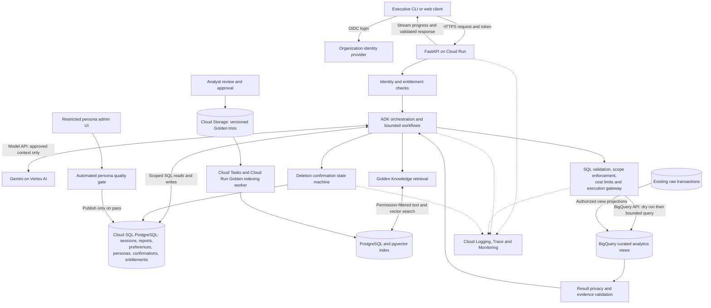

# Architecture and technology proposal

> Implementation update: the prototype and reviewer documentation now live in `src/`, `tests/`, and [docs](../docs/README.md). This file preserves planning context; use the submission documents and evaluation report for current behavior and executed checks.

Status: proposal updated with client answers on access, privacy, metrics, deletion, Golden Knowledge, demo priorities, production scale, persona publishing, and retention. This is a planning document, not a claim that the system is implemented or that the final submission is complete.

Execution order and acceptance criteria live in the [implementation plan](implementation_plan.md). Confirmed requirements and remaining questions live in [client Q&A](q&a.md); research rationale is in [the quality strategy](1-percent.md).

Confirmed by Harry: development and testing use the candidate's own GCP project and Gemini API key. Reviewers will use their own credentials. Accept the billing/project ID and Gemini API key through external configuration and use externally configured Google credentials for BigQuery. Do not hardcode a personal project or commit secrets. Document both authentication paths and verify setup with replaceable credentials on another machine.

## Approach

Use Python with Google Agent Development Kit (ADK), Gemini, and BigQuery. Keep one conversational agent with a small set of typed tools and explicit application-controlled workflows. Authentication, authorization, SQL admission, privacy checks, and deletion confirmation must be enforced by ordinary code and database permissions, independently of model instructions.

ADK fits the Google stack and supports custom orchestration and callbacks. Use those hooks for tracing and tool admission, with a separate policy layer for security. The documented [custom agent interface](https://github.com/google/adk-docs/blob/main/docs/agents/custom-agents.md) allows application-controlled execution. This proposal does not require a team of autonomous agents.

## Agreed prototype tools

The prototype runs locally on a laptop. Google ADK is a Python dependency; it does not require deploying the application. Gemini and BigQuery are remote services accessed over the internet, while SQLite stores application state locally. Reviewers can run the same CLI with their own credentials.

| Technology | Role in the prototype |
|---|---|
| Python | Runs the application and connects its components |
| Google ADK (`google-adk`) | Manages agent conversations and tool calls, with application-controlled workflows |
| Gemini API | Understands questions, proposes SQL, and explains validated results |
| BigQuery Python client (`google-cloud-bigquery`) | Executes approved SQL against the retail dataset |
| Pydantic | Validates structured tool inputs and outputs |
| SQLGlot | Parses SQL for application safety checks before execution; parsing alone does not enforce authorization |
| SQLite | Stores conversations, saved reports, ownership, and pending deletion confirmations locally |
| Typer + Rich | Provides CLI commands and readable terminal output |
| python-dotenv | Loads local `.env` configuration, including the Gemini API key and GCP project ID |
| uv + `pyproject.toml` + `uv.lock` | Pins a reproducible dependency environment; provide a documented pip route for reviewers |
| Ruff | Formats and lints Python consistently |
| pytest | Tests critical behavior, especially permissions, privacy, deletion confirmation, and recovery |
| Python logging with structured JSON events | Records correlated diagnostic events without exposing secrets or raw PII |

Keep one agent with a few tools. Gemini proposes actions; Python code enforces permissions, privacy, query budgets, and deletion confirmation. BigQuery credentials come from externally configured Application Default Credentials, not secrets committed to the repository.

## Prototype and production technology choices

| Concern | Prototype | Production proposal and reason |
|---|---|---|
| Language and framework | Python, ADK, Pydantic tool schemas | Same core; typed boundaries keep tools independently testable |
| LLM | Configurable, pinned stable Gemini Flash-family model through Gemini API | Gemini on Vertex AI, subject to region and data-policy approval; evaluate a stronger model only if measured quality warrants its cost |
| Interface and compute | CLI using Typer/Rich; application runs locally | FastAPI service on Cloud Run; HTTPS API with streamed progress, plus an executive web client if requested |
| Analytics | `google-cloud-bigquery`; supplied client is a reference starting point | BigQuery curated analytics dataset with restricted execution identities |
| SQL validation | SQLGlot BigQuery AST validation plus BigQuery dry run | Same controls; database permissions remain the final boundary |
| Application state | SQLite for sessions, reports, pending deletions, and demo entitlements | Cloud SQL PostgreSQL for transactional ownership and confirmation records |
| Golden Knowledge | Seed a small illustrative local Trio collection; live retrieval is optional | Cloud Storage for versioned source trios; PostgreSQL with pgvector and text search for filtered retrieval |
| Background work | No separate worker initially | Cloud Tasks and a Cloud Run worker for event-driven Golden Knowledge indexing and user-requested long report jobs |
| Identity and secrets | Explicit local demo identities; ADC and an uncommitted Gemini API key | Organization OIDC/SSO, service accounts, Secret Manager, least privilege |
| Observability | Structured JSON events with correlation IDs | OpenTelemetry instrumentation exported to Cloud Logging, Trace, and Monitoring |
| Persona management | Versioned local configuration if needed | Restricted admin UI storing approved versions in PostgreSQL, with rollback and an audit trail |

Select the exact Gemini model at implementation time from the [official model catalog](https://ai.google.dev/gemini-api/docs/models), check access and quotas with the project, then pin the model ID and dependency versions. A newer preview model is not automatically the best production default. The candidate must add their actual framework experience; do not imply experience they do not have.

Development tooling refinement: use `pyproject.toml` with `uv.lock` for reproducible dependency installation, Ruff for formatting/linting, and pytest for focused verification. Keep a documented pip installation route or exported pinned requirements for reviewers who prefer the assignment's suggested setup. Choose the supported Python/ADK/model combination after checking compatibility and running the three priority scenarios; record versions and results rather than claiming that the newest release is inherently best. See [uv project locking](https://docs.astral.sh/uv/concepts/projects/sync/) and [Ruff](https://docs.astral.sh/ruff/).

Roi confirmed on 22 October 2026 that analysis uses existing data on demand, with no cron-based analysis. Brand access-revocation lifecycle handling is explicitly out of scope. Normal query authorization and private-report ownership remain required.

## Local implementation boundaries and version selection

Keep the CLI, agent orchestration, analytics gateway, privacy/evidence validation, report store, and confirmation handler as distinct modules within one local application. A tool call is a proposal: typed input validation checks structure, policy code checks authorization, and the service verifies the outcome. Pydantic schemas, SQLGlot parsing, and framework callbacks each help enforce a boundary but none establishes safety alone.

The confirmation handler accepts explicit user input directly from the CLI/application interface. The model can request a deletion preview but cannot create the trusted confirmation event. SQLite transactions bind the consumed action to the exact hard-deleted report set. Diagnostics and model calls must not gain a route around the same policy services.

Select versions through a short compatibility check: supported Python and ADK release, available stable Gemini model, functioning typed tool calls, then the three priority scenarios with measured correctness, elapsed time, and usage. Record and pin the successful combination; changing the default requires rerunning relevant evaluation cases. The deployment candidate should meet our workload needs, rather than merely being the most recently announced release.

Model credentials, Python ADC, and BigQuery job submission are separate readiness checks. A successful `bq` command does not establish that the Python app or Gemini is configured. Include these distinctions in setup diagnostics and verify them before reporting the prototype as runnable.

## Confirmed production targets and demo priorities

Design for approximately 100 active managers/day, 10 questions per manager/day (about 1,000 questions/day), one saved report per manager/day (about 100/day), and 1 million new data rows/day. Only a few users are concurrent. Target 10–30 seconds for simple answers and 1–2 minutes for long reports. The configurable per-question budget defaults to USD 1; this is a budget, not an expected cost or a total infrastructure allowance. There are no client-specific region or data-residency constraints; choose compatible service and dataset locations.

Use modest Cloud Run concurrency and bounded scaling, pooled PostgreSQL connections, and bounded queries against existing BigQuery data. Upstream transaction ingestion and physical warehouse changes are outside this application’s scope. Validate these design choices with representative workload tests rather than assuming latency targets are guaranteed. Long report jobs report progress and preserve their job ID for reconnects.

Run business analysis only on explicit user demand. Show the queried period and available source timestamps; do not promise an upstream freshness SLA. Golden example approval may trigger indexing, and retention cleanup implements the separate retention requirement; neither schedules business analysis.

Prioritize these demo prompts:

1. “List the top 10 best sellers by revenue and by number of customers.” Show separate rankings using documented revenue and distinct-customer definitions, within the user's brands and selected period.
2. “Why did our churn rate spike last month?” First verify whether a spike occurred using comparable month-end measurements and authorized-brand purchase history. Show measured drivers and clearly labelled hypotheses; do not assume the question's premise is true or claim causation.
3. “Create a report for Q1 including insights and action items for Q2.” Clarify the year if needed, use calendar quarters in UTC, and generate recommendations supported by evidence. Creating a report does not automatically save it.

Harry endorsed the explanatory approach and invited Roi to confirm the assessment bar and add scenarios. The FAQ itself has not been supplied; these three prompts are the available client priorities.

## Production HLD

The API validates identity before loading any session or report. Calls to the model and BigQuery use service identities, never user-supplied credentials or model-selected credentials. Secrets come from Secret Manager. Deploy storage and compute in approved compatible locations; confirm BigQuery dataset location before deployment.

## Request and data flow

1. Resolve authenticated user, conversation, and allowed product scope on the server. Do not accept the user ID or scope from model output.
2. Load authorized conversation context, user preferences, published persona version, and metric definitions. Treat conversation text and retrieved documents as untrusted data.
3. Classify the request: supported analysis, schema explanation, report creation, deletion, or unsupported request. Report management is explicitly allowed despite the “analysis only” rule. Clarify material ambiguity instead of guessing.
4. Retrieve a few relevant, approved Golden trios, filtering by permissions before ranking. Include definition, schema version, and source identifiers. Historical SQL is a reference, never a bypass around the execution gateway.
5. Generate a typed analysis plan and SQL against safe logical relations. Validate identifiers, operations, scope, and cost; execute only through the gateway.
6. Validate result shape and privacy, then generate an answer from bounded evidence. Check reported numeric claims against recorded results and include period, filters, caveats, and evidence IDs.
7. On an explicit save request, persist the validated report with owner, conversation, underlying brand scope, definition versions, sanitized evidence, and model/prompt versions. Return a report ID only after successful persistence. Evidence needed to understand the report must survive expiration of its source chat.

If caching is introduced, include effective brand scope, metric definitions, period, and relevant data/prompt versions in its keys to avoid cross-scope reuse. Permission-revocation invalidation and historical report/chat reauthorization are not part of this assignment.

Sessions and reports live in the application database, not BigQuery. Large production report artifacts may go in private Cloud Storage with ownership-checked downloads. Raw transaction rows do not enter ordinary application logs. Chat history expires after 90 days, saved reports persist until explicit owner deletion, and audit logs expire after one year. Use scheduled cleanup for sessions and retention policies for audit storage; report retention is independent of session retention. Keep report content out of audit logs. Deletion must also invalidate cached artifacts and report-content copies in conversation context so they cannot resurrect a deleted report. Backup expiration and deletion propagation mechanics remain implementation details to document; do not claim hard deletion from every physical backup merely because the active database row was removed.

## Metric defaults

The client authorizes documented defaults, requires the definition used to be stated in each analytical answer, and allows user overrides. Proposed initial defaults: revenue sums authorized item sale prices excluding cancelled and returned purchases; churn means no qualifying purchase in the preceding 90 days among customers who purchased before that window. Use UTC and calendar quarters by default. Calculate customer spend and churn only within authorized brands, as confirmed by the client. Specify the as-of date, qualifying statuses, denominator, and brand scope when implementing; the client’s examples do not settle those details. Definition overrides never override access or privacy controls.

## 1. Hybrid intelligence

No real Golden bucket is available. Define a Question → SQL Query → Analyst Report format and seed a small sample collection, clearly labelled as illustrative rather than supplied by company analysts. Explain production ingestion and retrieval in the HLD; a working retrieval demo is welcome but not required.

Store each trio with its question, reviewed SQL, sanitized report, business definitions, applicable product scope, author, approval state, timestamps, and schema version. An ingestion worker validates and sanitizes it, computes embeddings using an approved embedding model, and updates a searchable index. Use semantic retrieval plus text matching and permission filters; do not retrieve stale or unauthorized examples.

New conversations become candidates only after feedback, privacy review, and analyst approval. Revalidate SQL when schemas or definitions change. Version and retire entries rather than silently overwriting them. Never treat a user's positive rating as sufficient proof of correctness. Retrieval outages can fall back to approved metric definitions with a disclosed limitation; stop if the required definition is unavailable.

## 2. Safety, privacy, and product access

The supplied `mds/task/bq_client.py` executes arbitrary SQL. Preserve it as source material; build a guarded execution layer for the actual prototype.

- Allow only a supported subset of a single read-only query. Reject scripts, writes, exports, external queries, remote functions, unknown tables/functions, and unsupported syntax. Parse the SQL AST rather than relying on keyword matching.
- Expose safe logical relations containing only approved columns. Resolve every underlying relation, including nested queries and CTEs, through controlled scoped relations; reject anything the validator cannot prove safe. Resolve manager-to-brand entitlements from trusted configuration and bind allowed brands as server-owned parameters. A trusted CEO role has all-brand analytics access, but still follows privacy rules and report ownership checks. Never append a predicate to arbitrary SQL and assume it secures all branches.
- Scope item facts first. Derive order and customer metrics from authorized items so full order totals do not leak purchases from other product scopes. Define access for the users and orders tables through this relation, not an unrelated user-provided filter.
- Never send names, emails, addresses, postal codes, exact coordinates, or other forbidden fields to the LLM or output. Internal user IDs or stable pseudonyms are approved for customer rankings and follow-ups. State-level demographics are allowed only in aggregates, never joined to individual customer IDs in model-visible results. Keep geography and customer-ranking result contracts separate. A small-cohort threshold remains a design decision, not a client-specified number.
- Check result columns and values before the model sees them, and check final responses and saved reports. Redact user-entered sensitive text before external model calls where possible. A regex-only output filter cannot guarantee privacy; preventive column restrictions and conservative output policy are primary controls.
- Use BigQuery read-only IAM and production curated views. An execution identity must not have access to unrestricted source tables. If using database row policies, map identity to entitlements explicitly: a shared service account does not automatically distinguish end users. See [BigQuery row-level security](https://cloud.google.com/bigquery/docs/row-level-security-intro).

For the public-data prototype, use two demo managers with different brand permissions in local configuration, and support a trusted CEO role; label this as an authentication simulation. The public dataset is accessible independently of the app, so the demo demonstrates application enforcement, not confidentiality of the public source. Production requires private source permissions and a stronger database boundary.

## 3. Destructive-operation confirmation

Deletion follows `requested → previewed → confirmed → executed`, with cancellation and expiration states. Search only the requesting user's reports, showing the matching titles, count, and IDs. “This conversation” means a server-recorded conversation ID. “Mentioning Client X” may refer to any named report entity, such as a brand or category. Proposed matching uses case-insensitive literal entity text, with the exact preview controlling what gets deleted; semantic matching has not been required.

Persist a short-lived pending action containing owner, conversation, exact report IDs and versions, and a random confirmation token. Ask the user to enter `confirm <token>` or cancel. Handle confirmation in application code, outside the model. A model tool call, quoted instruction, or vague “yes” cannot execute deletion.

On confirmation, recheck ownership and report versions in a transaction. Delete only the previewed set; if relevant state changed, require a new preview. Mark the action consumed atomically so a repeated confirmation cannot trigger a new operation. Audit the outcome without copying report contents. The client requires permanent hard deletion with no recovery. Remove report content and associated artifacts; retain only content-free audit metadata. Production backup and restore procedures must prevent deleted reports from being restored into service; document retention and deletion propagation explicitly. CEO analytics access does not grant permission to delete other users’ reports.

## 4. Continuous improvement

Store explicit preferences per user and allow inspection, correction, and reset. Inferred preferences carry provenance and confidence and never change authorization. Tone and formatting preferences cannot alter metric definitions or factual results.

At the system level, review failure clusters and feedback, add approved Golden examples, and improve prompts/tools through versioned changes. Run an evaluation suite before promotion and retain rollback. Do not let the live agent rewrite its own security policy or automatically train on unreviewed conversations.

## 5. Resilience and cost

Use a per-turn deadline and shared budgets for model calls, tool calls, retries, tokens, and bytes billed. Default the configurable question budget to USD 1, covering variable model and query charges; track fixed hosting/storage costs separately. Before each call, reserve a conservative cost estimate using configured prices, bounded output tokens, and BigQuery dry-run bytes. Stop before a new call would exhaust the budget and reconcile actual usage afterward. Treat price configuration freshness and estimate uncertainty explicitly. Set separate simple-question and long-report deadlines aligned with the 30-second and 120-second upper targets. Initial configurable limits: at most three SQL executions, two SQL repairs, and two transient retries, all within the same total budget. Multi-step analyses must fit that budget or ask the user to narrow the task.

Run a BigQuery dry run before execution and set `maximum_bytes_billed` on the actual job. `LIMIT` alone does not bound scanned bytes. BigQuery describes these controls in its [pricing and cost-control documentation](https://cloud.google.com/bigquery/pricing).

Return sanitized SQL errors for repair; never repair an authorization failure by relaxing restrictions. For empty results, check time range and filter validity once, distinguish zero activity from missing data, and explain when the answer remains empty. Never silently broaden permissions or change the user's question.

Retry transient timeouts, 429s, and 5xx responses with bounded exponential backoff and jitter, honoring retry hints. Track BigQuery job IDs so a client timeout does not cause duplicate submissions. Use circuit breakers in production. If the model is unavailable, preserve the conversation and offer a retry; report deletion confirmation can still work without the model. A failed report store must produce an explicit “not saved” response.

## 6. Quality and UX

The [testing strategy](testing_strategy.md) specifies executable verification layers and release evidence. Use pytest, pytest-asyncio where needed, branch coverage, and focused Hypothesis invariants/state sequences. Keep normal CI isolated from credentials and network; real BigQuery/model evaluations are separately enabled and budgeted. Use real temporary SQLite stores for mutation tests, independent expected results for analytics, and small BigQuery fixture queries for dialect semantics.

Before deployment, use a fixed synthetic dataset with expected metrics, alongside a small live BigQuery smoke suite. Test wrong-user access, nested-query scope escape, PII leakage, prompt injection, report ownership, confirmation replay/expiry, empty results, invalid SQL, and dependency outages. Security invariants must hold even when the model output is malicious.

Verify actual boundaries: capture outbound model payloads using synthetic PII canaries, assert what reaches the query executor, and inspect database state after report mutations. Include cross-user evidence isolation, mixed-brand orders, duplicate purchases, temporal boundaries, and false churn-spike premises. Separate deterministic offline tests, live BigQuery compatibility checks, and model-quality evaluations. Run Ruff and relevant pytest checks locally and in a small CI workflow when the repository is prepared for submission.

Evaluate task completion, numerical correctness, metric definitions, evidence coverage, appropriate caveats, and action-item relevance. Compare query results rather than exact SQL strings. An LLM judge can help triage but cannot be the sole correctness oracle. Ask representative users to complete comparison, follow-up, report, and deletion tasks; record completion, time, clarification burden, and whether the deletion preview was understood.

Publish observed case counts, outcomes, model/configuration versions, costs, and timings with the number of trials and known limitations. Never describe simulated faults or saved transcripts as live execution, or infer production p95 reliability from a handful of calls. Provide a requirement-to-evidence map so reviewers can distinguish code, tests, and design-only features.

## 7. Observability

Trace each turn with user pseudonym, session ID, trace ID, prompt/model/persona versions, retrieved trio IDs, tool calls, SQL fingerprint, BigQuery job ID, retry reason, latency, token usage, bytes billed, and final outcome. Include parent event IDs so the request, model calls, tool results, and response can be reconstructed as a sanitized timeline. Record decisions and evidence, not hidden model reasoning.

Track completion and error rates, SQL repair success, empty-result rates, access denials, privacy blocks, confirmation outcomes, p50/p95 latency, and estimated cost per successful task. Alert on sustained failures, latency/cost spikes, and unexpected authorization events. Restrict access and retention for redacted debug payloads; do not put raw PII or full raw conversations into telemetry.

## 8. Persona changes without deployment

Provide an authenticated admin form for tone, audience, length, and presentation defaults that a non-technical user can edit without code changes or redeployment. On submission, save a draft and run an automated quality gate against representative fixed-evidence reports. Check factual and numeric preservation, required caveats, privacy, authorization invariants, and requested style. Use deterministic checks for security and numbers, with rubric-based evaluation for tone. Publish the version automatically only if all required checks pass; on failure or evaluator outage, retain the current version and show actionable feedback. No manual approval step is required for tone/persona changes. Allow rollback and audit every publication. Golden Knowledge retains its separate editor/reviewer process; reviewer identities and detailed criteria can be refined with Roi. Load the published version at the next turn and record its ID. Keep security rules, tool permissions, and analytical definitions outside editable persona text.

## Implementation order and future extensions

Within the 6–12 hour assignment budget, implement the CLI, guarded BigQuery path, report confirmation flow, bounded retries, structured logs, and focused tests first. Complete the production explanation and setup guide alongside them. Define the Trio format and seed a small illustrative local collection as requested. A working retrieval demonstration remains optional after the mandatory behavior works.

Start with one safe end-to-end dynamic question and its negative scope test, then expand analytical coverage, reports, and failure handling using the [phase exit criteria](implementation_plan.md). Validate quality through correct answers, malicious-query rejection, exact confirmed deletion, bounded failure behavior, and a clean reviewer setup. Track actual effort, including prior research; the assignment's time expectation is not evidence that all planned work has already fit within it.

Keep separate interfaces for analytics execution, report storage, identity, knowledge retrieval, and model access. Later chart, email, and web-search tools should declare typed inputs, permission requirements, side effects, and budgets. Email would require its own authorization flow; web results would remain untrusted evidence.

The final repository must add tested installation commands, `.env.example`, pinned dependencies, Google authentication and billing-project instructions, demo identity setup, and actual transcript examples. This proposal intentionally does not present unimplemented commands as working setup instructions.

## Planned Python tooling

Use uv for dependency management, Ruff for linting/formatting, and Pyright in strict mode for type checking. Keep dependency declarations and all tool settings (including pytest and coverage) in `pyproject.toml`, with resolved versions in `uv.lock`. Use a modular `src/retail_agent` layout. See [Python development](python_development.md) for the proposed commands and module boundaries. This is a plan only; tooling and application scaffolding have not been added.
